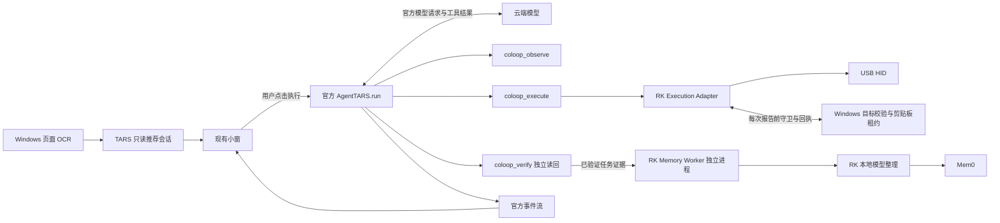

# Agent TARS 主架构与 RK 适配

2026-11-04。此次迁移以官方 Agent TARS 为主，借鉴 LangGraph 的状态边界。先验证被动页面建议和小窗接受后的实机闭环，再逐步迁移其他入口。

## 固定版本与运行入口

- `@agent-tars/core@0.3.1` 精确锁定到 package-lock；发布包 integrity 也在 lock 中。
- `openai@6.0.0` 用作官方 `setCustomLLMClient` 的传输实现，兼容项目 Zod 4。云端密钥仍由 Windows 主机保管。
- 官方源码审阅快照：`bytedance/UI-TARS-desktop@3ac2cb8d946d78d5ff92ad17b318eaafa18c178c`。发布包和源码快照分别记录，不将源码快照当作发布包构建证明。
- `src/main/infrastructure/tars-runtime.ts` 创建真正的 `AgentTARS` 实例，通过工具注册、工具预处理和请求钩子适配。
- `tests/tars-runtime.test.ts` 对真实官方实例运行本地 HTTP/SSE 集成测试，断言 `run === AgentTARS.prototype.run`，测试工具往返、事件、取消和工具隔离。
- 默认发布目录为 `release/tars-rk-0.13.0-20261104-r3/win-unpacked`。`start.cmd` 优先启动此包，包不存在时提示并启动当前源码的 `npm run dev`。`start-proactive.cmd` 与 `start-desktop.cmd` 启动同一个上位机适配包，缺失时报错。验收记录见本文后续章节。

## 职责

OCR 不经过 RK 本地模型筛选，不再按简单/复杂任务分流。被动建议也使用官方只读 TARS 会话，其唯一工具为 `coloop_recommend`，没有输入权限。接受建议后建立独立 TARS 执行实例。

主工作台保留一次 `CloudGateway` 的 `answer | execute` 决策：纯问答直接返回云端回答；需要实际操作时，将原始任务和参考资料交给 TARS。这个入口判断没有调度动作的循环，执行分支的后续规划、工具调用和结果反馈均由官方 `AgentTARS.run` 驱动。因此当前不能把纯问答路径也称为 TARS 会话。

主工作台合同仍是任务最多 24000 字符、参考资料最多 50000 字符。TARS 执行目标允许最多 240000 UTF-8 字节，原文直接送云端；超限明确拒绝，不再改写成读取本地文件的指令，也不截断任务。页面 OCR 的被动推荐请求另有独立大小限制，截取时携带 `truncated` 标记。RK 执行通道只接收单步动作和其观察引用，不接收完整任务目标。

执行会话仅开放页面观察、单步 RK 执行、结果核验、记忆目录/正文读取和用户提问。内置浏览器、命令、文件工具既不会启动，也不会进入可执行工具注册表。官方运行循环决定下一次工具调用；项目服务仅处理授权边界、回执、UI 投影与资源释放。

RK 执行进程不连接云模型，不运行本地理解，不决定下一步。它校验动作、窗口/观察引用和任务代次，持久记录命令，再执行 USB 输入并返回结果。记忆进程单独运行，复用已经测试过的 `MemoryReviewQueue`、`Qwen` 和 Mem0 客户端；本地模型仅用于整理已验证行为。

完成后的记忆 RPC 单独生成有界摘要：目标最多 1000 字符、结果最多 600 字符、最近 16 条精简回执，以及最多 8 段已核验粘贴文本节选，每段最多 500 字符并标注节选。不会把完整文档、全量命令或观察作为记忆 RPC 发送；消息还检查 63 KiB 上限。原始目标和执行文本仍保留在主机任务/事件记录中，摘要限制不改变模型任务或实际输入。记忆入队失败只影响记忆保存状态，不把已验证执行改报为失败，也不自动重做动作。

迁移期间支持模块从旧资源中加载纯函数和记忆类，随后删除其中的 `Agent`、`DecisionBudget`、`CLOUD` 和 `main` 名称。新入口不能实例化旧 Agent，也不调用旧 `run_task`。这是渐进提取的过渡措施，避免同时维护两套记忆队列。

## 状态与停止

借鉴 LangGraph 的短期任务状态与长期 store 分离：

| 状态                           | 所有者             | 持久化/恢复边界                                        |
| ------------------------------ | ------------------ | ------------------------------------------------------ |
| 模型上下文、工具循环           | 官方 TARS 实例     | 独立任务使用独立实例；当前不自动恢复未完成模型循环     |
| 小窗阶段、问题、推荐           | 官方事件的宿主投影 | 不驱动第二个规划循环                                   |
| 命令、发送状态、效果回执       | RK 执行适配器      | SQLite；相同 command_id 同内容返回历史回执，不再次输入 |
| 原生 TARS 事件                 | 主机审计日志       | 保留官方事件形状；日志不用于重放工具                   |
| 已验证行为、总结提案、保存 ACK | RK 记忆工作进程    | 独立 SQLite 队列；重试复用确定的记忆 key 和提案        |

停止同时取消官方模型传输和 RK 执行；只有原 `run` 已结束、RK 返回 `stopped:true` 与 `neutral:true`，清理迟到的剪贴板准备后，才释放操作会话。官方 `abort()` 返回或状态变为 aborted 本身不等于硬件已经停止。

发送前写入 journal；重启遇到未确认发送，按 unknown 处理。unknown 阻断后续动作，不自动重放。新观察使旧核验失效；完成要求真实输入回执、与最新观察一致的核验，以及 RK 释放确认。模型的最终自然语言不能代替核验结果。

## 官方能力缺口与最小补充

1. 官方工具回调只接收参数，不自动停止远端 USB。因此适配器必须显式发送停止、检查 heartbeat/代次、等待释放回执。
2. 官方 `onBeforeToolCall` 抛错会被捕获，不能作为权限闸。项目在注册表层拒绝非 `coloop_` 工具。
3. 审阅版本的默认模型适配器未传递取消 signal。使用官方 custom-client 扩展接入可取消的 OpenAI 协议传输，不改运行循环。
4. 官方 core 事件流主要在内存中；server 有会话/事件存储，但它不保证 USB 工具恰好执行一次。RK journal 只补硬件回执与幂等边界；不另写任务规划器。
5. 目前不做未知输入的自动解除或自动续跑，不把审计日志称为 LangGraph checkpoint。后续恢复能力需先核验实际效果，再设计最小接入。

官方参考：[Agent TARS](https://github.com/bytedance/UI-TARS-desktop/tree/3ac2cb8d946d78d5ff92ad17b318eaafa18c178c/multimodal/agent-tars/core)、[Tarko Agent](https://github.com/bytedance/UI-TARS-desktop/tree/3ac2cb8d946d78d5ff92ad17b318eaafa18c178c/multimodal/tarko/agent)、[LangGraph 持久化](https://docs.langchain.com/oss/javascript/langgraph/persistence)、[LangGraph 中断](https://docs.langchain.com/oss/javascript/langgraph/interrupts)。

## 验收记录

- 官方真实模型探针：`D:/RK/logs/coloop-tars-model-20261104-01/report.json`，两次真实云请求、一次自定义工具、官方事件流、最终结果通过。没有 RK 输入。
- 第一轮小窗实机：`D:/RK/logs/coloop-tars-island-20261104-01`。推荐与点击通过，新适配器启动参数超过 SSH 单参数长度，执行未开始；不计通过。支持模块已压缩传输。
- 第二轮：`D:/RK/logs/coloop-tars-island-20261104-02`。已进入 RK 输入路径，但测试驱动读取剪贴板的异步结果漏掉 `await`，导致粘贴被拒绝；整体任务未完成。该测试驱动问题已修复，不能用这一轮证明粘贴闭环通过。
- 第三轮：`D:/RK/logs/coloop-tars-island-20261104-03`。粘贴与剪贴板恢复通过，但 Windows 编辑控件对 LF 换行的显示、快捷键参数和 OCR 截断引起多余操作，达到测试调用上限后失败。适配层已转换剪贴板换行为 CRLF，规范快捷键大小写，并向模型说明完整编辑区核验与 `exact_insertion` 回执含义。
- 第四轮：`D:/RK/logs/coloop-tars-island-20261104-04`。同一观察中的新增文字已通过实际编辑区核验；随后对原有标题的补充检查被拒绝，却错误清除了先前有效证据，导致最终状态为 `blocked`。已修复并补回归；真实回读失败仍会清除旧证据。本轮不计完整通过。
- 第五轮：`D:/RK/logs/coloop-tars-island-20261104-05`。新增文字核验成功后，模型执行 `CTRL+HOME` 并重新观察，未再次核验就结束，因此被正确阻断。已在工具描述与返回状态中明确 `completion_verification_required`；没有放宽新观察使旧核验失效的规则，也没有增加自研重试循环。
- 第六轮通过：`D:/RK/logs/coloop-tars-island-20261104-06/result.json`。生产 OCR、小窗 renderer/preload、TARS 服务和 RK 适配器在隔离的原生 WinForms 文档上完成「页面理解 → 推荐 → 点击执行 → 实际读回 → 小窗完成 → RK 本地整理 → Mem0 保存 → 下一任务检索正文并执行」全链路。真实 DeepSeek 云请求 22 次；官方事件记录了 6 次执行、2 次最终核验、2 次记忆目录查询与 1 次记忆正文读取。
- 此轮推荐耗时 5.743 秒，两个前台任务分别 27.854 秒和 29.295 秒；本地模型仅有两次 `memory_review`，耗时分别 134.714 秒和 23.283 秒。记忆异步保存没有延迟前台完成状态。每次粘贴均确认实际文字与剪贴板恢复；后续任务保留全部第一任务正文，仅追加「记忆已调用」。这是单次场景的数据，不代表通用速度或成功率。
- 最终回归：709 项 TypeScript 测试、127 项 Python RK 测试、typecheck 和生产构建通过。新发布包通过 9 项界面联调检查及独立小窗启动检查；包内 main 与构建产物、3 份 Python 资源与实机 manifest 哈希一致，生产依赖确含固定版本 TARS 和 OpenAI 客户端。
- 其余实机结果在对应独立目录保存，不能用旧自研循环的成功记录替代 TARS 验收。

首轮测试版为 `release/tars-rk-0.13.0-20261104-r1/win-unpacked/Coloop.exe`。首轮汇总证据见同目录上级的 `verification.json`，包内容核对见 `artifact-integrity.json`。第二轮使用下文的 r2 测试包。

当前 OpenAI 兼容模型接口已实测，跨应用、脚本工具、移动端和旧 Violoop 入口另行验收。主工作台纯问答使用已有 `CloudGateway`。`start-violoop.cmd`、`start-mobile.cmd` 和 `start-cloud-hid.cmd` 指向各自专用发布版本。真实云端与 USB 验收使用生产适配层及隔离文档，主窗口发布包另做界面联调。r3 的电脑操作页迁移见下文。

## 第二轮方案比较与迭代

2026-11-04。先比较执行路径，再根据当前闭环选择改动。

| 工作 | 比较结果 | 本轮选择 |
| --- | --- | --- |
| 屏幕操控 | 官方 TARS 已有 GUI、DOM 和混合浏览器控制。UFO2 使用 UIA 与视觉结合，并通过多动作规划减少模型开销。当前 Coloop 已有 UIA/OCR 与 RK 单步回执，可以直接减少工具往返 | 执行工具增加可选 `observe_after:true`，一次单步输入后直接采集新观察并携带回执返回 |
| 下一步推荐 | 推荐只有一个结构化决策，继续请求结束语增加一次云调用 | 有效决策校验通过后调用官方 `requestLoopTermination()`。保留无效参数纠正与过期页面淘汰 |
| 状态与恢复 | LangGraph 的 checkpointer 与长期 store 分工适合当前职责边界。外部硬件效果仍需独立回执 | 继续使用 TARS 运行循环和 RK journal，按实际输入回执与新观察推进 |
| 记忆整理 | Mem0 的模型提取与直接存储有不同语义。当前已由 RK 本地模型生成经过校验的提案，队列也已缓存提案供重试 | 复用现有整理与保存路径，补充内容冲突检查和分阶段计时，根据实测定位整理延迟 |

参考 [TARS 官方仓库](https://github.com/bytedance/UI-TARS-desktop)、[UFO2 论文](https://arxiv.org/abs/2504.14603)、[LangGraph 持久化](https://docs.langchain.com/oss/javascript/langgraph/persistence)、[Mem0 记忆写入](https://docs.mem0.ai/core-concepts/memory-operations/add)。表中的工程选择是结合仓库现状作出的判断。

### 单步执行与观察

`coloop_execute` 的 `observe_after` 为可选布尔参数，省略时保留已有工具合同。模型提示优先使用 `true`。工具仍只执行一个动作，然后调用与 `coloop_observe` 相同的实际观察管道。

- 返回 `observation` 时，其新编号成为后续动作和最终核验的依据。
- 观察失败或返回旧编号时，返回原始输入回执及 `observation_error`。模型需要重新观察，已经确认的输入保持记录。
- 未知输入、取消和断连仍阻断后续动作。工具互斥覆盖输入与后续采集全过程。
- 独立观察刷新失败也要求重新取得新观察，旧编号失效。
- 结束前仍要求最新观察对应的独立 `coloop_verify` 及 RK neutral ACK。

控件观察增加最多 32 个可见、启用且位于目标窗口内的 UIA Toggle/SelectionItem 控件，并复用 Win32 回读作为补充。复选框、单选按钮和列表项导出实际 `checked/selected`，状态进入观察内容哈希。原生可选测试覆盖系统样式复选框和列表项。自绘控件如果缺少可读取的 UIA Pattern 与原生状态，仍无法提供布尔核验证据。

### 推荐与运行时

正常推荐路径只需一次模型请求。无效决策继续交给官方循环纠正。末次迭代提交有效决策时，只有已经确认调用官方终止接口才接受该结果。取消和错误仍按失败处理。

注册表之外的工具名称跳过官方环境准备，防止虚构 `browser_*` 调用触发浏览器启动。实际执行仍由受限注册表决定。

官方 `onPrepareRequest` 钩子使用完整 Coloop 指令及原工具数组，SDK 自动补充的时间信息继续进入系统消息。通过真实本地 HTTP 请求测得，每次减少 8,086 字符默认浏览器、命令行与报告生成指令。推荐系统消息由 8,917 降至 831 字符，执行系统消息由 10,597 降至 2,511 字符。这里记录字符数量，速度变化另由实机记录衡量。

### 记忆队列

相同 `task_id` 的证据经规范 JSON 比较。内容相同支持幂等重试，内容不同返回 `memory_task_conflict`，保留已存任务与提案。比较与入队位于同一 SQLite 写事务。

既有 `model.timing` 增加 `readiness_ms`、`inference_ms`、`model_requests` 与 `json_repairs`。就绪计时覆盖 `/ready-for-foreground`，推理计时覆盖健康检查、生成、解析与一次 JSON 修复。总耗时仍包含活动登记和清理，因此分项之和可以小于总耗时。新增计时用于区分等待与推理开销。

### 第二轮验收与交付

第二轮测试版为 `release/tars-rk-0.13.0-20261104-r2/win-unpacked/Coloop.exe`。该目录上级保存 `verification.json` 与 `artifact-integrity.json`。当前默认入口使用后续的 r3 上位机适配包。

- 724 项 TypeScript 测试、132 项 Python RK 测试、typecheck、生产构建和修改文件格式检查通过。原生观察模式的 28 项测试通过，其中两项使用真实 Windows 观察工作进程。r2 发布包另通过 9 项界面联调检查。
- 首次基线全量测试出现一次既有 coordinator 15ms 超时用例的时序失败，单独重跑和最终全量回归通过。最终结果以本轮全量日志为准。
- `coloop-tars-island-20261104-07` 的 QA 启动器在模块顶层等待 Electron ready，导致启动超时，已修正启动时序。
- `coloop-tars-island-20261104-08` 的测试小窗遗漏生产入口已有的窗口恢复回调，首个任务因目标失去前台而失败。未发送 HID 输入，已补齐测试回调。
- `coloop-tars-island-20261104-09` 完成首个任务、记忆保存及正文检索。另一组界面测试改变前台后，第二个任务等待用户恢复窗口。通过测试小窗的停止接口取消该任务，并补齐测试驱动直接启动第二任务之前的目标恢复。后续实机与界面测试顺序执行。
- `D:/RK/logs/coloop-tars-island-20261104-10/result.json` 完整通过页面推荐、小窗接受、两次任务输入与独立核验、两次 RK 本地整理和 Mem0 保存，以及第二任务读取第一任务记忆正文。推荐耗时 4.579 秒，两个前台任务分别 15.712 秒与 15.212 秒，共 15 次真实云请求。
- 四次成功执行均携带 `observe_after:true` 的新观察。另有一次缺少 `observation_id` 的模型调用被参数校验拒绝，随后模型自行纠正。实际正文保留、追加文字、剪贴板恢复和停止释放均通过核对。
- 两次异步记忆整理分别耗时 72.298 秒与 67.886 秒。第一次就绪等待 27.013 秒、推理 45.261 秒，一次模型请求。第二次就绪等待 0.003 秒、推理 67.876 秒，包含一次 JSON 修复和两次模型请求。第九轮另记录过 154.126 秒的整理，其中就绪等待 59.648 秒、推理 94.453 秒。模型就绪调度与 JSON 输出稳定性仍是后续记忆优化的重点。
- 本次任务生成的正文与首轮不同，耗时和调用数只代表单次隔离样例。默认指令减少量与工具调用行为另有本地真实 HTTP/SSE 回归。
- 包内 main、三份 Python 资源、源码和实机 manifest 哈希一致。生产依赖中的 TARS 固定为 `0.3.1`，OpenAI 客户端固定为 `6.0.0`。

## Coloop 上位机适配

2026-11-04。发布目录为 `release/tars-rk-0.13.0-20261104-r3/win-unpacked`。`start.cmd`、`start-proactive.cmd`、`start-desktop.cmd` 均已切到该包。

- 「电脑操作」默认使用 TARS，直接提交明确的执行任务。入口仅要求 RK 连接和兼容云端模型配置，本地模型就绪状态单独用于后台记忆能力。
- 显式电脑任务通过 `task:dispatch` 的可选 `intent:"execute"` 进入同一个任务服务与 TARS 执行回调，保存任务编号、结果与 `execution:"desktop"` 标记。普通工作台请求沿用问答或执行的入口判断，历史数据支持缺少新字段的旧记录。
- 工作台和电脑操作页共用执行状态面板，提供建议接受与忽略、绑定任务和问题编号的回答、停止、观察暂停和后台记忆结果。新问题会清除上一问题的回答草稿。
- 主窗口的建议接受和问题回答通过独立 preload/IPC 方法调用。主进程校验输入与当前编号，恢复目标窗口后继续任务。启动或恢复执行时收起主窗口，小窗显示进度。
- 任务记录中的停止状态等待执行回调收尾。结果未知时显示输入未确认，停止请求不会把该结果写成已确认停止。用户检查目标后可从状态面板恢复控制。
- 顶部小窗、任务记录和工作台底栏同步当前阶段。任务完成与后台记忆的整理、成功、失败分开显示。设备侧栏说明本地模型的记忆职责。
- 原有本地规划、隐私协作和浏览器专用模式收纳到「其他操作模式」，保留原 API 与状态。TARS 执行期间阻止从旧表单发起并行任务。

### 验证范围

728 项 TypeScript 测试、typecheck 与生产构建通过。新增回归覆盖显式执行入口、等待取消确认、取消后的未知输入，以及新旧历史记录兼容。

`tests/upper-host-e2e.mjs` 在隔离配置中先检查真实主进程对过期建议、迟到回答及断连任务的拒绝，以及真实观察暂停快照。随后使用明确标记的 IPC 状态夹具验证生产 renderer/preload 的 7 组交互，涵盖本地模型离线可提交、建议操作、问题编号、草稿清理、停止、记忆状态与最小窗口布局。状态夹具与实机执行分别记录。

r3 发布包通过上述 7 组适配检查、9 项基础界面检查，以及旧模式的页面和真实窗口枚举检查。包内全部 `out` 文件和三份 Python 资源与当前构建核对一致。TARS 服务、运行时、RK 桥接、Windows 观察和 Python 资源哈希与第二轮成功实机 manifest 一致。本轮增加上位机界面与 IPC 验证，硬件证据沿用 `coloop-tars-island-20261104-10`。

证据汇总保存在 r3 目录的 `verification.json`。启动器替换后，通过重新启动 Coloop 加载新界面。
