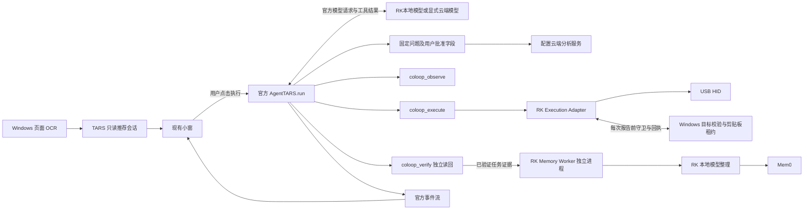

# Agent TARS 主架构与 RK 适配

> 2026-11-05 更新：本页保留 TARS 路线与历史验收。0.14.0 的生产主循环默认改为官方 DeepSeek Harness，TARS 作为可选回退。当前架构、恢复边界和目录包入口见 [迁移说明](harness-migration.md)。

2026-11-05持续开发。官方Agent TARS负责推理与工具循环，RK适配负责输入、观察和回执。当前发布及验收记录见本文与本轮功能结果报告。

## 固定版本与运行入口

- `@agent-tars/core@0.3.1` 精确锁定到 package-lock；发布包 integrity 也在 lock 中。
- `openai@6.0.0` 用作官方 `setCustomLLMClient` 的传输实现，兼容项目 Zod 4。云端密钥仍由 Windows 主机保管。
- 官方源码审阅快照：`bytedance/UI-TARS-desktop@3ac2cb8d946d78d5ff92ad17b318eaafa18c178c`。发布包和源码快照分别记录，不将源码快照当作发布包构建证明。
- `src/main/infrastructure/tars-runtime.ts` 创建真正的 `AgentTARS` 实例，通过工具注册、工具预处理和请求钩子适配。
- `tests/tars-runtime.test.ts` 对真实官方实例运行本地 HTTP/SSE 集成测试，断言 `run === AgentTARS.prototype.run`，测试工具往返、事件、取消和工具隔离。
- 当前持续验收使用 `release/tars-rk-0.13.0-20261105-r58/win-unpacked`，三个启动脚本已同步到该包。r58类型检查、构建、863项软件回归与48个文件通过。发布包主程序及10项资源摘要与源码一致，证据为 `release-r58-integrity.json`。窗口恢复在r56通过实际业务验收，显式偏好保存与局部纠正在r58继续业务复测。`start.cmd` 优先启动指定包，缺少时启动当前源码开发模式，另外两个入口缺少包时报错。

## 职责

被动OCR由RK本地模型的官方只读TARS会话处理，其唯一工具为`coloop_recommend`，没有输入权限。接受后建立独立执行实例。r33起混合模式先在本地规划，云端协助仅通过固定问题及宿主提取的用户批准字段。显式cloud模式使用配置云端模型，并向其提供任务及工具上下文。两种路由分别验收。

主工作台先作一次`answer | execute`入口判断。hybrid和rk使用本地模型，cloud使用配置云端模型，显式intent为execute时直接进入执行分支。需要实际操作时，将原始任务和参考资料交给TARS，后续规划、工具调用和结果反馈均由官方`AgentTARS.run`驱动。纯问答路径直接返回对应路由的回答。

主工作台合同仍是任务最多 24000 字符、参考资料最多 50000 字符。TARS 执行目标允许最多 240000 UTF-8 字节，原文直接送云端；超限明确拒绝，不再改写成读取本地文件的指令，也不截断任务。页面 OCR 的被动推荐请求另有独立大小限制，截取时携带 `truncated` 标记。RK 执行通道只接收单步动作和其观察引用，不接收完整任务目标。

执行会话通过受限Coloop工具开放页面观察、单步RK执行、结果核验、记忆读取、用户提问、授权任务目录中的文档操作和独立浏览器会话。SDK内置通用浏览器、命令和文件工具关闭。官方运行循环决定下一次工具调用，项目服务处理授权边界、工具实现、回执、UI投影与资源释放。本地模式按需显示强类型工具组，所有调用仍经原有执行校验。

RK执行进程校验动作、窗口/观察引用和任务代次，持久记录命令，再执行USB输入并返回结果。模型推理由独立RK服务处理，用于被动建议、混合模式规划和记忆整理。记忆进程单独运行，复用已经测试过的`MemoryReviewQueue`、`Qwen`和Mem0客户端。

完成后的记忆 RPC 单独生成有界摘要：目标最多 1000 字符、结果最多 600 字符、最近 16 条精简回执，以及最多 8 段已核验粘贴文本节选，每段最多 500 字符并标注节选。不会把完整文档、全量命令或观察作为记忆 RPC 发送；消息还检查 63 KiB 上限。原始目标和执行文本仍保留在主机任务/事件记录中，摘要限制不改变模型任务或实际输入。记忆入队失败只影响记忆保存状态，不把已验证执行改报为失败，也不自动重做动作。

迁移期间支持模块从旧资源中加载纯函数和记忆类，随后删除其中的 `Agent`、`DecisionBudget`、`CLOUD` 和 `main` 名称。新入口不能实例化旧 Agent，也不调用旧 `run_task`。这是渐进提取的过渡措施，避免同时维护两套记忆队列。

## 状态与停止

借鉴 LangGraph 的短期任务状态与长期 store 分离：

| 状态                           | 所有者             | 持久化/恢复边界                                        |
| ------------------------------ | ------------------ | ------------------------------------------------------ |
| 模型上下文、工具循环           | 官方 TARS 实例     | 独立任务使用独立实例；当前不自动恢复未完成模型循环     |
| 小窗阶段、问题、推荐           | 官方事件的宿主投影 | 不驱动第二个规划循环                                   |
| 命令、发送状态、效果回执       | RK 执行适配器      | SQLite；相同 command_id 同内容返回历史回执，不再次输入 |
| 原生 TARS 事件                 | 主机审计日志       | 保留官方事件形状；日志不用于重放工具                   |
| 已验证行为、总结提案、保存 ACK | RK 记忆工作进程    | 独立 SQLite 队列；重试复用确定的记忆 key 和提案        |

停止同时取消官方模型传输和 RK 执行；只有原 `run` 已结束、RK 返回 `stopped:true` 与 `neutral:true`，清理迟到的剪贴板准备后，才释放操作会话。官方 `abort()` 返回或状态变为 aborted 本身不等于硬件已经停止。

发送前写入journal，重启遇到未确认发送时按unknown处理。业务效果未知且硬件释放已确认时，回执交回官方模型循环，要求重新观察并核验实际效果，原command_id继续返回历史回执。独立任务可在旧会话停止后开始。仍在发送或硬件释放尚未确认时暂停输入。新观察使旧完成核验失效，完成要求真实输入证据、最新观察对应的核验及RK释放确认。

## 官方能力缺口与最小补充

1. 官方工具回调只接收参数，不自动停止远端 USB。因此适配器必须显式发送停止、检查 heartbeat/代次、等待释放回执。
2. 官方 `onBeforeToolCall` 抛错会被捕获，不能作为权限闸。项目在注册表层拒绝非 `coloop_` 工具。
3. 审阅版本的默认模型适配器未传递取消 signal。使用官方 custom-client 扩展接入可取消的 OpenAI 协议传输，不改运行循环。
4. 官方 core 事件流主要在内存中；server 有会话/事件存储，但它不保证 USB 工具恰好执行一次。RK journal 只补硬件回执与幂等边界；不另写任务规划器。
5. 业务效果unknown与硬件释放状态独立处理。历史回执保留，新的完整编辑区读回可生成粘贴效果核验依据。同一SDK运行循环据实际观察继续决策，未确认释放的输入保持暂停。审计日志仅记录事实。

官方参考：[Agent TARS](https://github.com/bytedance/UI-TARS-desktop/tree/3ac2cb8d946d78d5ff92ad17b318eaafa18c178c/multimodal/agent-tars/core)、[Tarko Agent](https://github.com/bytedance/UI-TARS-desktop/tree/3ac2cb8d946d78d5ff92ad17b318eaafa18c178c/multimodal/tarko/agent)、[LangGraph 持久化](https://docs.langchain.com/oss/javascript/langgraph/persistence)、[LangGraph 中断](https://docs.langchain.com/oss/javascript/langgraph/interrupts)。

## 验收记录

- 官方真实模型探针：`D:/RK/logs/coloop-tars-model-20261104-01/report.json`，两次真实云请求、一次自定义工具、官方事件流、最终结果通过。没有 RK 输入。
- 第一轮小窗实机：`D:/RK/logs/coloop-tars-island-20261104-01`。推荐与点击通过，新适配器启动参数超过 SSH 单参数长度，执行未开始；不计通过。支持模块已压缩传输。
- 第二轮：`D:/RK/logs/coloop-tars-island-20261104-02`。已进入 RK 输入路径，但测试驱动读取剪贴板的异步结果漏掉 `await`，导致粘贴被拒绝；整体任务未完成。该测试驱动问题已修复，不能用这一轮证明粘贴闭环通过。
- 第三轮：`D:/RK/logs/coloop-tars-island-20261104-03`。粘贴与剪贴板恢复通过，但 Windows 编辑控件对 LF 换行的显示、快捷键参数和 OCR 截断引起多余操作，达到测试调用上限后失败。适配层已转换剪贴板换行为 CRLF，规范快捷键大小写，并向模型说明完整编辑区核验与 `exact_insertion` 回执含义。
- 第四轮：`D:/RK/logs/coloop-tars-island-20261104-04`。同一观察中的新增文字已通过实际编辑区核验；随后对原有标题的补充检查被拒绝，却错误清除了先前有效证据，导致最终状态为 `blocked`。已修复并补回归；真实回读失败仍会清除旧证据。本轮不计完整通过。
- 第五轮：`D:/RK/logs/coloop-tars-island-20261104-05`。新增文字核验成功后，模型执行 `CTRL+HOME` 并重新观察，未再次核验就结束，因此被正确阻断。已在工具描述与返回状态中明确 `completion_verification_required`；没有放宽新观察使旧核验失效的规则，也没有增加自研重试循环。
- 第六轮通过：`D:/RK/logs/coloop-tars-island-20261104-06/result.json`。生产 OCR、小窗 renderer/preload、TARS 服务和 RK 适配器在隔离的原生 WinForms 文档上完成「页面理解 → 推荐 → 点击执行 → 实际读回 → 小窗完成 → RK 本地整理 → Mem0 保存 → 下一任务检索正文并执行」全链路。真实 DeepSeek 云请求 22 次；官方事件记录了 6 次执行、2 次最终核验、2 次记忆目录查询与 1 次记忆正文读取。
- 此轮推荐耗时 5.743 秒，两个前台任务分别 27.854 秒和 29.295 秒；本地模型仅有两次 `memory_review`，耗时分别 134.714 秒和 23.283 秒。记忆异步保存没有延迟前台完成状态。每次粘贴均确认实际文字与剪贴板恢复；后续任务保留全部第一任务正文，仅追加「记忆已调用」。这是单次场景的数据，不代表通用速度或成功率。
- 最终回归：709 项 TypeScript 测试、127 项 Python RK 测试、typecheck 和生产构建通过。新发布包通过 9 项界面联调检查及独立小窗启动检查；包内 main 与构建产物、3 份 Python 资源与实机 manifest 哈希一致，生产依赖确含固定版本 TARS 和 OpenAI 客户端。
- 其余实机结果在对应独立目录保存，不能用旧自研循环的成功记录替代 TARS 验收。

首轮测试版为 `release/tars-rk-0.13.0-20261104-r1/win-unpacked/Coloop.exe`。首轮汇总证据见同目录上级的 `verification.json`，包内容核对见 `artifact-integrity.json`。第二轮使用下文的 r2 测试包。

当前 OpenAI 兼容模型接口已实测，跨应用、脚本工具、移动端和旧 Violoop 入口另行验收。主工作台纯问答使用已有 `CloudGateway`。`start-violoop.cmd`、`start-mobile.cmd` 和 `start-cloud-hid.cmd` 指向各自专用发布版本。真实云端与 USB 验收使用生产适配层及隔离文档，主窗口发布包另做界面联调。r3 的电脑操作页迁移见下文。

## 第二轮方案比较与迭代

2026-11-04。先比较执行路径，再根据当前闭环选择改动。

| 工作       | 比较结果                                                                                                                                                        | 本轮选择                                                                              |
| ---------- | --------------------------------------------------------------------------------------------------------------------------------------------------------------- | ------------------------------------------------------------------------------------- |
| 屏幕操控   | 官方 TARS 已有 GUI、DOM 和混合浏览器控制。UFO2 使用 UIA 与视觉结合，并通过多动作规划减少模型开销。当前 Coloop 已有 UIA/OCR 与 RK 单步回执，可以直接减少工具往返 | 执行工具增加可选 `observe_after:true`，一次单步输入后直接采集新观察并携带回执返回     |
| 下一步推荐 | 推荐只有一个结构化决策，继续请求结束语增加一次云调用                                                                                                            | 有效决策校验通过后调用官方 `requestLoopTermination()`。保留无效参数纠正与过期页面淘汰 |
| 状态与恢复 | LangGraph 的 checkpointer 与长期 store 分工适合当前职责边界。外部硬件效果仍需独立回执                                                                           | 继续使用 TARS 运行循环和 RK journal，按实际输入回执与新观察推进                       |
| 记忆整理   | Mem0 的模型提取与直接存储有不同语义。当前已由 RK 本地模型生成经过校验的提案，队列也已缓存提案供重试                                                             | 复用现有整理与保存路径，补充内容冲突检查和分阶段计时，根据实测定位整理延迟            |

参考 [TARS 官方仓库](https://github.com/bytedance/UI-TARS-desktop)、[UFO2 论文](https://arxiv.org/abs/2504.14603)、[LangGraph 持久化](https://docs.langchain.com/oss/javascript/langgraph/persistence)、[Mem0 记忆写入](https://docs.mem0.ai/core-concepts/memory-operations/add)。表中的工程选择是结合仓库现状作出的判断。

### 单步执行与观察

`coloop_execute` 的 `observe_after` 为可选布尔参数，省略时保留已有工具合同。模型提示优先使用 `true`。工具仍只执行一个动作，然后调用与 `coloop_observe` 相同的实际观察管道。

- 返回 `observation` 时，其新编号成为后续动作和最终核验的依据。
- 观察失败或返回旧编号时，返回原始输入回执及 `observation_error`。模型需要重新观察，已经确认的输入保持记录。
- 未知输入、取消和断连仍阻断后续动作。工具互斥覆盖输入与后续采集全过程。
- 独立观察刷新失败也要求重新取得新观察，旧编号失效。
- 结束前仍要求最新观察对应的独立 `coloop_verify` 及 RK neutral ACK。

控件观察增加最多 32 个可见、启用且位于目标窗口内的 UIA Toggle/SelectionItem 控件，并复用 Win32 回读作为补充。复选框、单选按钮和列表项导出实际 `checked/selected`，状态进入观察内容哈希。原生可选测试覆盖系统样式复选框和列表项。自绘控件如果缺少可读取的 UIA Pattern 与原生状态，仍无法提供布尔核验证据。

### 推荐与运行时

正常推荐路径只需一次模型请求。无效决策继续交给官方循环纠正。末次迭代提交有效决策时，只有已经确认调用官方终止接口才接受该结果。取消和错误仍按失败处理。

注册表之外的工具名称跳过官方环境准备，防止虚构 `browser_*` 调用触发浏览器启动。实际执行仍由受限注册表决定。

官方 `onPrepareRequest` 钩子使用完整 Coloop 指令及原工具数组，SDK 自动补充的时间信息继续进入系统消息。通过真实本地 HTTP 请求测得，每次减少 8,086 字符默认浏览器、命令行与报告生成指令。推荐系统消息由 8,917 降至 831 字符，执行系统消息由 10,597 降至 2,511 字符。这里记录字符数量，速度变化另由实机记录衡量。

### 记忆队列

相同 `task_id` 的证据经规范 JSON 比较。内容相同支持幂等重试，内容不同返回 `memory_task_conflict`，保留已存任务与提案。比较与入队位于同一 SQLite 写事务。

既有 `model.timing` 增加 `readiness_ms`、`inference_ms`、`model_requests` 与 `json_repairs`。就绪计时覆盖 `/ready-for-foreground`，推理计时覆盖健康检查、生成、解析与一次 JSON 修复。总耗时仍包含活动登记和清理，因此分项之和可以小于总耗时。新增计时用于区分等待与推理开销。

### 第二轮验收与交付

第二轮测试版为 `release/tars-rk-0.13.0-20261104-r2/win-unpacked/Coloop.exe`。该目录上级保存 `verification.json` 与 `artifact-integrity.json`。当前默认入口使用后续的r7软件预检包。

- 724 项 TypeScript 测试、132 项 Python RK 测试、typecheck、生产构建和修改文件格式检查通过。原生观察模式的 28 项测试通过，其中两项使用真实 Windows 观察工作进程。r2 发布包另通过 9 项界面联调检查。
- 首次基线全量测试出现一次既有 coordinator 15ms 超时用例的时序失败，单独重跑和最终全量回归通过。最终结果以本轮全量日志为准。
- `coloop-tars-island-20261104-07` 的 QA 启动器在模块顶层等待 Electron ready，导致启动超时，已修正启动时序。
- `coloop-tars-island-20261104-08` 的测试小窗遗漏生产入口已有的窗口恢复回调，首个任务因目标失去前台而失败。未发送 HID 输入，已补齐测试回调。
- `coloop-tars-island-20261104-09` 完成首个任务、记忆保存及正文检索。另一组界面测试改变前台后，第二个任务等待用户恢复窗口。通过测试小窗的停止接口取消该任务，并补齐测试驱动直接启动第二任务之前的目标恢复。后续实机与界面测试顺序执行。
- `D:/RK/logs/coloop-tars-island-20261104-10/result.json` 完整通过页面推荐、小窗接受、两次任务输入与独立核验、两次 RK 本地整理和 Mem0 保存，以及第二任务读取第一任务记忆正文。推荐耗时 4.579 秒，两个前台任务分别 15.712 秒与 15.212 秒，共 15 次真实云请求。
- 四次成功执行均携带 `observe_after:true` 的新观察。另有一次缺少 `observation_id` 的模型调用被参数校验拒绝，随后模型自行纠正。实际正文保留、追加文字、剪贴板恢复和停止释放均通过核对。
- 两次异步记忆整理分别耗时 72.298 秒与 67.886 秒。第一次就绪等待 27.013 秒、推理 45.261 秒，一次模型请求。第二次就绪等待 0.003 秒、推理 67.876 秒，包含一次 JSON 修复和两次模型请求。第九轮另记录过 154.126 秒的整理，其中就绪等待 59.648 秒、推理 94.453 秒。模型就绪调度与 JSON 输出稳定性仍是后续记忆优化的重点。
- 本次任务生成的正文与首轮不同，耗时和调用数只代表单次隔离样例。默认指令减少量与工具调用行为另有本地真实 HTTP/SSE 回归。
- 包内 main、三份 Python 资源、源码和实机 manifest 哈希一致。生产依赖中的 TARS 固定为 `0.3.1`，OpenAI 客户端固定为 `6.0.0`。

## Coloop 上位机适配

2026-11-04。发布目录为 `release/tars-rk-0.13.0-20261104-r3/win-unpacked`。`start.cmd`、`start-proactive.cmd`、`start-desktop.cmd` 均已切到该包。

- 「电脑操作」默认使用 TARS，直接提交明确的执行任务。入口仅要求 RK 连接和兼容云端模型配置，本地模型就绪状态单独用于后台记忆能力。
- 显式电脑任务通过 `task:dispatch` 的可选 `intent:"execute"` 进入同一个任务服务与 TARS 执行回调，保存任务编号、结果与 `execution:"desktop"` 标记。普通工作台请求沿用问答或执行的入口判断，历史数据支持缺少新字段的旧记录。
- 工作台和电脑操作页共用执行状态面板，提供建议接受与忽略、绑定任务和问题编号的回答、停止、观察暂停和后台记忆结果。新问题会清除上一问题的回答草稿。
- 主窗口的建议接受和问题回答通过独立 preload/IPC 方法调用。主进程校验输入与当前编号，恢复目标窗口后继续任务。启动或恢复执行时收起主窗口，小窗显示进度。
- 任务记录中的停止状态等待执行回调收尾。结果未知时显示输入未确认，停止请求不会把该结果写成已确认停止。用户检查目标后可从状态面板恢复控制。
- 顶部小窗、任务记录和工作台底栏同步当前阶段。任务完成与后台记忆的整理、成功、失败分开显示。设备侧栏说明本地模型的记忆职责。
- 原有本地规划、隐私协作和浏览器专用模式收纳到「其他操作模式」，保留原 API 与状态。TARS 执行期间阻止从旧表单发起并行任务。

### 验证范围

728 项 TypeScript 测试、typecheck 与生产构建通过。新增回归覆盖显式执行入口、等待取消确认、取消后的未知输入，以及新旧历史记录兼容。

`tests/upper-host-e2e.mjs` 在隔离配置中先检查真实主进程对过期建议、迟到回答及断连任务的拒绝，以及真实观察暂停快照。随后使用明确标记的 IPC 状态夹具验证生产 renderer/preload 的 7 组交互，涵盖本地模型离线可提交、建议操作、问题编号、草稿清理、停止、记忆状态与最小窗口布局。状态夹具与实机执行分别记录。

r3 发布包通过上述 7 组适配检查、9 项基础界面检查，以及旧模式的页面和真实窗口枚举检查。包内全部 `out` 文件和三份 Python 资源与当前构建核对一致。TARS 服务、运行时、RK 桥接、Windows 观察和 Python 资源哈希与第二轮成功实机 manifest 一致。本轮增加上位机界面与 IPC 验证，硬件证据沿用 `coloop-tars-island-20261104-10`。

证据汇总保存在 r3 目录的 `verification.json`。启动器替换后，通过重新启动 Coloop 加载新界面。

## 已确认硬件释放的unknown回执恢复

2026-11-04，r4修复包位于 `release/tars-rk-0.13.0-20261104-r4/win-unpacked`，三个默认启动器均指向该包。

原实现按整张commands表检查unknown和dispatching，导致旧任务的一条效果未知回执持续阻塞新任务。本轮分开处理业务效果与硬件释放。release_confirmed为true的unknown保留在journal中，旧会话停止后允许独立任务开始。仍在发送、正在执行和未确认硬件释放的状态继续限制输入。

当前任务收到已释放的unknown回执时，将回执及reconciliation_required交回官方运行循环，先获取新观察再决定后续动作。旧观察无法再次发令。完整粘贴文本经过新的editor_text独立读回后，主机记录额外的effect_verification证据，可据此完成任务及整理记忆。原始RK回执和command_id去重记录保持，部分文本匹配或读回失败均无法补成完整粘贴效果证明。

734项TypeScript测试、21项RK适配器及记忆工作进程测试、类型检查与生产构建通过。回归覆盖成功及抛错形式的已释放unknown、完整和部分读回、核验失败、journal写入失败、硬件释放未确认、旧命令重投以及跨进程新任务。r4打包版另通过7组上位机联调检查，包内main与构建产物、执行器Python资源与源码哈希一致。

实机任务 `cc25dc7f-06c4-464e-b14c-84cd90f05185` 从r4生产工作台派发，经真实DeepSeek与RK输入，在47.728秒内完成记事本追加、保存、关闭重开和独立核验。磁盘检查确认原标题保留、目标标记恰好一次。前后只读查询均保留原F05的unknown回执，该回执的release_confirmed为true。原会话已停止，新任务已正常完成。

证据位于 `.qa/unknown-recovery-20261104-r1/`，包含journal-before.json、journal-after.json、task.json、events.jsonl及artifact-integrity.json。同任务异常恢复的覆盖来自回归测试，本次实机覆盖历史unknown存在时的新任务交付。其余Violoop业务场景仍按各自运行记录判定。

## r7 软件预检与输入状态边界

2026-11-05，按用户要求先进行软件排查，实机业务测试等待后续指令。发布目录为 `release/tars-rk-0.13.0-20261105-r7/win-unpacked`，三个启动器已指向该包。当前运行进程为r6，等待实机测试前切换。检查时上位机处于idle，运行任务数为0，自动观察已暂停。

本轮先以新增回归复现软件错误，再修复执行、回执和核验边界。r5的动作校验修复及r6的应用快捷键修复一起纳入软件回归。

| 问题                                                      | 修复后的行为                                                                                | 软件验证                                                                          |
| --------------------------------------------------------- | ------------------------------------------------------------------------------------------- | --------------------------------------------------------------------------------- |
| 准备输入或停止竞争发生在发送前，上层因缺失回执进入unknown | 主机明确返回not_sent、已释放及rejected_before_input。已发出的请求丢失回执时继续报告未知     | 模拟准备失败、准备期间停止、发送后断连，核对真实模拟通道的execute请求数           |
| 非法action或targets容器在发送前触发通用异常               | RK将已识别的格式错误返回为发送前拒绝。目标变化导致拒绝时明确标记已释放                      | Python覆盖null、错误容器、不可哈希字段、无效目标及后续有效输入                    |
| 旧command_id携带非法动作时被覆盖性解释为not_sent          | 先查历史命令，再核对重投内容。冲突返回COMMAND_CONFLICT，status保留原回执                    | 已执行一次后携带错误target重投，核对历史回执及HID调用次数                         |
| 成功外观的回执携带journal_error时仍可继续                 | 主机对日志写入失败的回执暂停输入，保留未确认状态                                            | input_sent、effect_verified、unknown三类附带日志错误的回归                        |
| 会话建立前RK不可用被误归为输入未知或丢失具体原因          | 建立会话前的可用性失败返回RK_NOT_READY，恢复后允许独立任务开始                              | 连接完成与会话开始之间改变可用性，核对begin和execute调用次数                      |
| 相同正文来自另一个窗口、进程或输入框时误补成粘贴效果证明  | unknown粘贴的独立核验绑定原窗口、进程及编辑控件。普通编辑区核验同样检查观察时的编辑控件身份 | 三种目标替换都保持未完成，同控件完整读回可完成                                    |
| 粘贴允许32000字节，完整核验却限制4000字符                 | editor_text核验与粘贴统一为32000个UTF-8字节，支持完整长文本回读                             | 10000个中文字符的unknown粘贴经过完整读回后完成，输入次数为1                       |
| 默认32轮上限导致正常多步任务被中止                        | 执行使用SDK数值上限Number.MAX_SAFE_INTEGER，按模型结束或取消退出。被动建议显式使用4轮上限   | 官方SDK连接本地模拟模型，连续36次工具调用后第37次请求完成，取消和HTTP错误回归通过 |
| 结果核验未通过时工作台显示连接中断                        | blocked提供TARS_VERIFICATION_FAILED，启动可用性、执行器忙和显式轮数限制各自提供错误码       | 状态断言与工作台正常派发入口的错误映射检查                                        |

全量TypeScript回归为39个文件、748项通过。RK相关Python回归为135项通过，最后补充的非法字段检查另经23项执行适配器及记忆工作进程测试通过。类型检查、生产构建和git diff空白检查通过。测试使用模拟模型、模拟通道、临时journal与FakeHID。业务场景的实机状态仍见各轮验收记录。

构建包的main与生产构建产物一致，执行适配器资源与最终Python源码一致。打包后将最终适配器资源同步入包并重新核对哈希。包内app.asar的SHA-256为 `3d3e224185bd33910adbc5f54b13cdb5b17fc11a0dabaf1dfb9ae58ca96251ad`。日志及核对记录位于 `.qa/software-preflight-20261105-*.log`、`.qa/software-preflight-20261105-integrity.json` 和 `.qa/software-preflight-20261105-idle.json`。

本轮范围外仍有已经确认的软件能力缺口，后续功能验收需单独处理。

- 手机violoop_message继续经VioloopService进入旧DesktopTaskService，具有单窗口、ASCII输入等能力限制。桌面TARS修复尚未覆盖手机任务执行。A12继续保留既有失败证据。
- 被动TARS建议通过suggestionContent发送原始OCR，A07的隐私失败仍成立。自动观察当前已暂停。原始OCR直接交给云端的既有设计需要单独调整才能满足该隐私场景。
- 执行链路尚缺少A05要求的15分钟无进展诊断及自动恢复流程。移除32轮上限后的软件回归覆盖持续多步运行与取消，长时间停滞场景待补齐。
- WPS自绘工作区的可观察目标及实际文件交付、浏览器连接器和登录环境仍需实机核验。r7尚无新增业务用例通过记录。

## 2026-11-05 r33至r35验收修复

任务目录支持WPS工作簿、Word、渲染PDF、本地OCR、文件复制和ZIP，工具通道分别记录。独立Edge上下文支持编号控件操作、上传、下载及回读，停机等待上下文收束。

生成PDF须全部页面OCR读回并核对预期文字，上传阶段按内容摘要强制检查已审阅记录。用户补充目标后清除旧PDF审阅及完成证据。

WPS先创建所有请求工作表，再写公式，计算后调整列宽。图表位于数据区域下方，PDF打印范围扩展至图表右下角。原任务中热修复外部脚本及后续真实WPS组件回归都有记录。

一次性调度预先持久化未来任务UUID，离线或忙时等待。接纳状态不确定时保留unconfirmed并避免自动重复。桌面、调度及手机任务进度统一投影到加密手机快照，模拟客户端测试与物理手机测试分别记录。

混合模式只向云端提供批准的identifier或number字段及固定通用问题。来源必须经宿主实际读取，任意模型自由文本参数不能进入咨询工具。无批准字段时仅发送固定问题。字段格式和常见敏感内容检查均在宿主执行。显式本地模式没有云咨询工具。

r34实际本地测试暴露完整工具说明超出保守UTF-8预算，以及上次被停止等待的板端推理造成429忙。r35缩短本地工具说明，保持实际执行端校验。只对明确拒绝接纳的429持续等待并允许取消，其他错误保留原错误语义。完整官方SDK工具提示预算新增回归通过。真实本地业务复验仍在执行。

## r56至r58持续修复

显式观察遇到上位机自有窗口时恢复已记住的任务窗口，保持被动观察无抢焦点行为。前台恢复创建辅助线程消息队列并在finally解除线程输入附着。A04实际保存后切换测试窗口，再由产品自行恢复WPS前台，文件与最终原生核验通过。

新增显式偏好保存工具，宿主要求引用本次用户目标或补充中的原话，保存值必须出自该引用。局部纠正只替换当前任务实际读回记忆中的唯一旧片段，其他偏好保留。RK独立记忆服务沿用既有Mem0保存与读回，同key更新，存储记录仍为未验证偏好。后台操作经验整理仍沿用既有只写procedure的队列。网页和文件来源无法提供宿主要求的用户原话。

## r60 模型调用保护与用量记录

原任务循环使用接近无限的迭代上限，云端咨询对部分瞬态错误可以持续重试，缺少跨入口的统一请求记录。本轮将默认任务模型请求数设为64，连续6次请求没有新增有效进展时熔断，云端请求最小间隔为1000毫秒。每次输入最多96000字节，输出最多8192 token。上述数值由本轮实现选定，可在模型连接页调整。显式等待用户或等待文件不会持续发起模型请求。咨询瞬态错误最多请求3次，分别等待1秒和2秒，官方SDK的自动重试保持为0。

CloudGateway与Tars云端执行共用ModelUsageLedger，同一任务的规划与咨询关联原任务ID。发送前持久化请求预留，完整响应按服务商报告的用量结算。缺少用量、断流或网络结果不确定时保留保守预留。输入字节数加最大输出是预留单位，不能直接作为服务商实际token账单。模型切换会清除旧单价，价格未配置时明确记录未定价请求。

台账位于用户数据目录的model-usage-state.json与model-usage.jsonl，包含任务ID、来源、模型、请求时间、状态、耗时、服务商用量和请求关联ID。日志不写提示词、请求正文和API Key。状态持久化失败或台账损坏时，在网络发送前阻止后续云端请求。重启继续沿用持久计数，取消会中止间隔等待及响应读取。

按用户2026-11-05指令，人民币消费上限保持关闭，累计每日请求及token用量预算也默认关闭。单任务调用边界、无进展保护和请求间隔继续生效。可选金额上限必须由用户启用并提供输入、输出单价后才生效。此台账从部署后开始记录，历史50元消耗仍需服务商账单核对。

r60类型检查、生产构建及51个文件905项测试通过。官方SDK接本地HTTP服务验证重复工具循环在实际发送第3次请求前被拦截。打包版另通过6组隔离配置验收，包括设置保存、用量结算、发送前拦截、重启保留计数、关闭预算继续请求及日志关联信息。视觉检查发现连接测试完成后用量显示未刷新，补齐完成后的快照通知，并在打包验收中断言界面显示实际15 token。最终一次隔离验收仅发送2次本地模拟请求，本轮付费API请求为0。包内主程序与20项外部单文件资源共21项哈希一致，证据位于.qa/model-guard-packaged-1793851779268/。

三个启动器已指向release/tars-rk-0.13.0-20261105-r60/win-unpacked。2026-11-05按用户切换指令，确认无运行任务后结束空闲旧进程，启动日常用户配置的r60进程33112。原生工作台确认实际r60资源路径、RK已连接、后台模型已就绪以及64次、6次、1000毫秒参数。消费上限与累计预算关闭，今日云端请求为0。切换前后state.json字节摘要一致，104条任务及加密凭据保留。部署证据位于.qa/r60-live-deployment/。本轮没有重跑26项业务测试，既有业务结论保持各自证据和状态。
