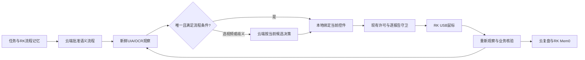

# 云端 Agent 选型与语义流程适配

2026-11-02更新：当前试验入口的Agent已迁到RK Python；上位机只保留云请求传输与Windows观察/校验。本文下方为11月1日上位机实现及选型历史，最新源码、实测和部署见 [RK Agent与联网网关](rk-agent-gateway.md)。没有将Browser-use框架直接移植到板端。

核对日期：2026-11-01，Asia/Shanghai。当前上位机为Electron/TypeScript，云端为已保存的DeepSeek账户，RK保持原生USB输入。这里的首版仍限已经验收的Bilibili鼠标能力。

## 开源项目适配结论

| 项目                                                                                                                                                           | 适合借鉴或接入的位置                                                                              | 本项目的限制与取舍                                                                                                                                                                                                            |
| -------------------------------------------------------------------------------------------------------------------------------------------------------------- | ------------------------------------------------------------------------------------------------- | ----------------------------------------------------------------------------------------------------------------------------------------------------------------------------------------------------------------------------- |
| [Microsoft UFO²](https://github.com/microsoft/UFO/blob/eae3c0a8d168c47cb10df0652e293e092eda1078/ufo/README.md)，MIT                                            | Windows UIA/视觉感知、应用级规划、多动作预测与实时控件校验、经验检索。与已有Windows观察端最接近。 | 原项目有GUI及原生API混合执行器。本项目复用规划/实时绑定思路，实际输入统一交给RK；没有引入其API/软件输入后端。                                                                                                                 |
| [Browser-use](https://github.com/browser-use/browser-use/blob/b49a68e4060acb226da8f784194fef301c53a6d7/browser_use/agent/system_prompts/system_prompt.md)，MIT | 结构化Agent状态、精简上下文、多动作策略、页面变化后重新观察。                                     | 浏览器控制后端与本项目USB约束不同。只参考消息和执行边界，不运行其浏览器执行器，不把跨页面的旧控件ID拼成动作队列。                                                                                                             |
| [LangGraph.js](https://github.com/langchain-ai/langgraphjs/tree/959f041dfb8f6bbafa6af3ebb4bc20484a9290da)，MIT                                                 | TypeScript状态图、检查点、故障恢复，可在后续长任务中编排观察/规划/执行/验证节点。                 | 本次没有安装SDK。若接入，已发送或结果未知的HID节点不得自动重试；恢复先重新观察，检查点不赋予旧许可/坐标执行权。普通长期记忆仍使用RK Mem0。官方[持久化说明](https://docs.langchain.com/oss/javascript/langgraph/persistence)。 |
| [Agent-S](https://github.com/simular-ai/Agent-S/tree/0fff0e634869dab72027435b4586e62300185d41)，Apache-2.0                                                     | 任务经验、层级规划及Agent接口设计。当前仓库已包含S4接口演化实验。                                 | 已有Mem0，无需再并列一套长期记忆。S4的工具接口生成/基准环境不是可直接运行在RK上的执行器；本次不接入自动修改工具或任意代码执行能力。                                                                                           |

本次是**借鉴开源设计后的本地适配实现**，未安装、嵌入或声称完整集成上述框架，也未复制其实现代码。固定调研revision见 `D:/RK/logs/cloud-agent-optimization-20261101-work/research-sources.json`；没有升级现有依赖或锁文件。UFO README中的旧multi_action文档链接本次404，以上行为以固定README及本项目实现/验收为准，不把链接失效的文档当作已经执行的代码。

## 已实现的云端协议

原模式每个按钮都请求云端，重复携带整条流程记忆和页面文字。上轮完整任务有14次云请求、16,278个接口报告输入token。新模式保持云端做决策，把可确定的低层绑定放到上位机：

首版云端返回固定、受限的语义阶段与约束，包含mouseOnly/sameWindow/verifyEach、1枚币、默认收藏夹。主机用Zod严格核对全部阶段、顺序与约束；它不是允许云端编写新工具、运行代码或任意规划的通用接口。下发的初始计划没有未来控件ID或坐标。

`ScopedUIWorkflow`仅对同一目标、同一AbortSignal生效，保存当前窗口身份、阶段进度和已使用的观察ID。每步必须重新观察：唯一控件、正确role、前台、未生效状态、弹窗和投币数量都符合条件时才生成当前click。不同任务信号、观察重用、窗口变化或流程倒退拒绝。歧义、状态不满足条件或选片继续走真实云端，原始执行器仍独立检查输入许可、UIA/命中、1枚币、默认夹与每个非释放报告。

这里批准的是**语义步骤**，不是批量重放旧目标。一次输入许可前的明确拒绝可对新观察重新绑定；可能已发送输入的失败仍停止。运行时回执增加 `decision_source=cloud_plan_local_binding`，逐次云模型决策仍记为cloud_model。`planningCalls`统计规划接口请求次数，不能当作真实云模型请求数；后者以cloud.json为准。本地绑定单独计时为local_binding，没有伪报云调用。

云端目标选择只接收必要字段：观察ID、阶段、窗口、前台、弹窗/数量/登录状态与本次真实候选。移除重复的screen_text、完整记忆正文和sourceEpisode本地路径；保留记忆ID、source=agent/verified=false、能力与约束、少量经验。原始观察仍留在本地并驱动许可，不由压缩结果代替。该投影是上下文优化，未实现通用脱敏/DLP。

## 实测与当前部署

真实新视频BV1XZxe6SEuU完成10次RK USB鼠标动作、20次守卫、点赞/投1枚币/默认夹收藏三态核验。两轮均记忆命中、0次RK模型；对比为：

| 项目                    | 逐按钮模式 | 语义流程模式 |
| ----------------------- | ---------: | -----------: |
| 正式任务总耗时          |   42.912秒 |     32.309秒 |
| 真实云端请求            |         14 |            3 |
| 接口报告输入token       |     16,278 |        2,376 |
| 请求system+user文本字节 |     58,245 |        8,629 |
| 实际鼠标动作/报告守卫   |    10 / 20 |      10 / 20 |

本次耗时减少10.604秒（24.7%），输入token减少85.4%；API报告的prompt_tokens包含其缓存token，不等于本轮全部重新prefill的token或同百分比费用下降。三次真实云请求分别为plan、choose_video、review；其余9个已发送动作由已批准流程结合新观察绑定。一次点赞许可前重新观察只重新做本地绑定，没有增加云请求。正常路径不保证永远三次，目标歧义/异常仍可增加调用。

562项Vitest、19项浏览器Python检查、类型/构建及Ruff/语法通过。最终独立发行物为 `release/cloud-hid-agent-0.13.0-20261101/`，主进程显式启用semantic-plan。真实验证用相同的生产类及相同模式；测试器后加workflowMode记录字段，不影响业务代码。旧stepwise模式保留为对照配置，不自动重放不确定任务。

原始证据：`D:/RK/logs/cloud-agent-optimization-20261101-live-1/` 和 `...-work/`。计时仍为生产手机任务服务提交前→终态，已有Chrome首页、已登录、模型驻留，含4秒开始等待，不含Electron/SSH启动或实体手机网络。正式提交前一次“显示桌面”鼠标准备另记。不同视频、云端响应与输入前重查不同，只有各1个样本，不是单变量A/B或通用SLA；本轮业务成功不代表所有桌面任务已支持。

源码入口：`src/main/services/cloud-ui-agent.ts`、`cloud-hid-relay.ts`、`src/main/index.ts`、`resources/browser-runtime.py`。相关边界验证在 `tests/cloud-ui-agent.test.ts`；部署、独立记忆读回与最终哈希见-work/verification.json。
