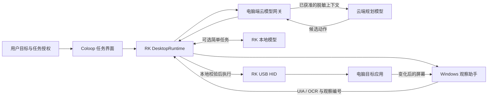

# Coloop 电脑操作 AI 开发方向

日期：2026-10-30。

Coloop 的核心目标调整为：用户提出电脑任务，系统观察屏幕、规划下一步、通过键鼠执行，并根据新的屏幕状态继续或结束。RK 是本地控制与执行端，云端模型提供复杂理解和规划能力。本地模型承担经过验证的简单任务，其他 AI 助手接入作为扩展。

本定位稿之后，M1 已接入开发源码并完成随机数字输入与确认的实机闭环。按用户最新优先级，同页动作一次规划、连续执行、结束后统一观察验证，组内不重复推理或 OCR。实现、构建与验收见 [电脑操作首版](desktop-operation.md)；其余阶段仍按下文逐步推进。

## 手机任务主线（2026-10-31）

用户明确的目标是：在 Coloop 手机 App 给自己的 Violoop 发消息，消息交给 RK 处理，由 RK 决定是否调用云端模型，再通过鼠标与键盘操作电脑完成工作。手机应以任务对话、执行进度、结果和停止入口为核心。Violoop 在本文中沿用用户给出的名称，具体部署方式尚未由这项需求确定。

```text
Coloop 手机 App → Violoop → RK 任务运行时
                               ├─ 本地技能 / 本地模型
                               └─ 按需请求云端模型，返回候选计划
                            → 本地动作校验 → RK USB HID → 电脑应用
                            ← 新观察与结果验证
手机 App ← 任务进度、结果或需要补充的信息
```

此图描述职责顺序，不表示手机已能直连板端。当前手机通信经过已配对电脑的加密网关与公网中继；后续复用现有连接传递任务。中继负责传输，RK 负责处理与路由；现有电脑观察助手和云端出口网关继续提供各自能力。

目标默认由 RK 自动路由：已验证的简单操作在本地完成，复杂或本地能力未覆盖的步骤按任务允许的数据范围请求云端，再由 RK 校验并执行候选动作。路由依据能力记录、当前观察和执行结果建立，不能只采用模型自报信心。用户不必每发一条消息手动选择规划模型；开发源码已增加自动模式与桌面专用路由策略，单窗口自动本地路线已实测，云端桌面路线与广泛能力校准尚待验收。

首个完整业务验收场景为“打开 QQ 邮箱，给指定收件人发送指定主题和正文的邮件”：

1. 手机发送目标，Violoop 返回任务已接收及任务标识，RK 建立任务。缺少收件人、正文等必要信息时，在手机补充。
2. RK 判断处理路线，观察电脑，打开或切换浏览器并进入 QQ 邮箱。需要登录时使用已有私密凭据流程或请求用户接管。
3. 通过键鼠填写收件人、主题和正文，回读核对；执行授权覆盖的发送操作。
4. 核对实际发送结果并回传手机。点击发送后的结果若未知，先核查，避免重复发送；仅点击按钮不能记为完成。
5. 手机停止操作须传到同一 RK 任务，并显示停止确认或未确认状态。

这是开发目标，不是已完成的能力，也不是当前对真实邮箱发送邮件的执行指令。验收使用用户指定的测试账号与收件人。

下一阶段顺序更新为：先接通手机到 RK 桌面任务的提交、任务标识、进度和停止；再补齐跨应用启动/切换、中文和邮件结果验证；随后建立 RK 自动路由的同题验收。沿用已验证的同页动作组。现有 Android 的 OpenCode 会话消息入口不能作为这条链路已完成的依据。

实现进展：Android 0.3.0 与开发源码已接入独立 Violoop 消息、任务账本、进度、补充信息和停止，并增加桌面专用 RK 路由策略。手机界面与加密传输使用模拟执行器验收；真实 RK/HID、新路由质量与 QQ 邮箱场景未据此验收。具体使用范围见 [Violoop 手机任务](violoop-mobile.md)。

后续实机进展：Android → 公网 → RK 自动本地路线 → USB HID → 独立结果与手机回执已经通过单窗口随机数字样例，另验证手机停止解析。该次真实证据见 [RK 联调](violoop-rk-live.md)，不代表云端桌面规划、跨应用或通用任务成功率。

## 现有设备可以继续使用

本机项目记录的设备是 LubanCat-4 V1，16GB 内存、128GB eMMC，使用 RK3588 系列工具链。现阶段优先复用现有设备，不以升级算力或更换主板作为开始条件。

| 能力               | 现有证据                                                    | 下一阶段用途                               |
| ------------------ | ----------------------------------------------------------- | ------------------------------------------ |
| USB 网络与 SSH     | Coloop 已使用固定指纹 SSH 与私有转发                        | 任务控制、观察传输和服务连接               |
| Windows OCR 与 UIA | RK 工程已有截图、文字识别、控件与焦点观察                   | 提供屏幕状态及可操作目标                   |
| RK USB HID         | 独立工程已有复合 USB 网卡、键盘、绝对坐标鼠标及隔离窗口实测 | 由设备实际发送键鼠输入                     |
| 本地 Qwen3.5-4B    | 已部署 RKLLM 服务并完成部分任务验证                         | 离线小任务、可选语义理解；具体任务另行验收 |
| 云端模型网关       | Coloop 已有协议适配和文本隐私协作                           | 新增桌面规划入口，返回候选动作             |
| 记忆与 Agent Hook  | 已有独立实现及相应边界                                      | 作为后续扩展，不作为桌面任务的必经链路     |

原始实测 [summary.json](../../RK/rk-opencode/logs/testbench-20261029-174233-8e95/summary.json) 记录：固定测试窗口任务耗时约 64.92 秒，4 次模型请求共 56.02 秒，3 次 USB 发报告共约 0.53 秒。另一独立 compact 样例约 45.87 秒、3 次模型请求。两种入口的上下文和编排不同，不是严格 A/B，也不是通用成功率。

这些记录支持一个具体判断：该样例的主要耗时在模型处理与生成，优先优化规划调用和观察数据，比先更换键鼠执行硬件更有依据。云端的实际速度、质量与费用需要用同一任务测量，不能预先保证更快。

现有执行链路限定单屏、精确标题的前台窗口、已观察目标与 US 布局 ASCII 输入。测试窗口由测试台打开；跨应用启动、中文输入、图标理解和多屏没有据此完成验收。Coloop 当前还没有连接这条执行链路。

## 设备与模型的分工

建议先做有 Windows 观察助手的协作版本，让用户先得到能够完成任务的产品，再决定是否发展为独立采集硬件。

| 部分              | 负责的工作                                                                 |
| ----------------- | -------------------------------------------------------------------------- |
| Coloop 界面       | 接收目标、选择允许操作的应用、展示执行进度、暂停与接管                     |
| Windows 观察助手  | 截图、UIA/OCR、窗口与显示器标定、动作前的前台和焦点检查                    |
| RK DesktopRuntime | 持有桌面任务状态，调度观察与规划，检查动作范围和观察有效性，串行执行及回读 |
| 云端规划器        | 根据允许发送的屏幕上下文决定候选下一步，处理复杂任务与失败后的重新规划     |
| RK 本地模型       | 承担实测通过的小任务；不要求它为每一次云端动作再做一轮语义审批             |
| RK USB HID 执行器 | 发送键鼠报告、释放按键、报告执行状态，断连或停止后撤销本任务后续动作       |

RK 的职责进一步拆为任务管理、观察管理、本地数据与出口策略、规划调度、动作校验、HID 执行、结果验证和运行保障八部分。具体模块、电脑端配合范围及首版完成标准见 [RK 设备职责](rk-responsibilities.md)。其中多数工作由普通程序完成，本地模型只参与需要语义理解且已验证的环节。

调用云端既与端侧算力有关，也与模型能力、上下文和规划可靠性有关；单纯增加 TOPS 不足以保证桌面任务成功。云端调用的是模型 API，任务循环由 Coloop/RK 自己掌握，不需要用户另开一个 AI 助手接管任务。主流 [Computer use 工具的官方机制](https://platform.claude.com/docs/en/agents-and-tools/tool-use/computer-use-tool) 也由调用方执行模型提出的动作并回传观察。

实现阶段先验证“云端规划 + 本地执行”，另提供明确选择的本地模式；最终手机任务采用上文的 RK 自动路由。当前文本分析模式的默认值保持原样；网络失败时暂停并说明状态，不自动改变数据发送范围。

## 目标闭环



板端运行时是桌面任务状态的唯一权威；Coloop 显示和发送控制指令。初版云端凭据继续留在电脑端加密存储，经现有 SSH 私有通道提供限定的规划调用，避免迁移密钥成为首版前置工作。

每轮先取得新观察，再让模型选择动作。执行器从本地观察中解析目标位置，不直接相信模型猜测的像素坐标。发送输入后重新观察，验证输入值、页面变化或保存结果；“HID 已发送”与“任务已完成”分别记录。对结果未知的输入先重新观察，不盲目重发。

桌面任务采用独立生命周期：观察、规划、待授权、执行、验证，以及暂停、完成、失败、取消。观察失败、模型超时、目标变化、断连、用户接管都要有明确状态，恢复时重新观察；收到旧任务或旧观察的迟到规划结果不能继续执行。停止成功必须包含板端撤销确认；确认前界面显示正在停止，已发送输入仍需核查结果。

## 首版如何调整软件

1. **给 Coloop 增加 DesktopTaskService。** 接收桌面任务、管理界面订阅和停止指令；它与现有文字任务服务并列，不借用 OpenCode 会话控制来表达键鼠操作。
2. **接入现有 PC Companion。** 优先复用 `pc/observer.py`、`pc/observations.py` 和 `desktop_host.py` 的观察、焦点校验与 SSH 通道。Coloop 当前 OCR 坐标属于图片像素，不能直接接到鼠标执行器。
3. **增加独立的板端 DesktopRuntime。** 从现有 `DesktopTools`、HID 和观察校验中提取通用能力。`agent/compact.py` 的 `BenchmarkTask` 写死了 Code → Apply → 关闭的测试阶段，只能借鉴循环结构，不能作为通用任务引擎直接上线。
4. **给本地和云端规划器定义同一动作协议。** 候选动作绑定任务、窗口和最新观察；初始动作集合限制为点击、快捷键、短文本输入、等待和结束。跨窗口及滚动在下一阶段加入。凭据、动作编号和许可由本地服务掌握，模型不能给自己授予权限。
5. **复用确定性校验，补上任务授权。** 本地检查允许应用、目标身份、焦点、观察代次、一次消费和停止状态；模型承担语义规划，不充当最终权限判据。现有冻结文件读取许可不能直接作为 HID 许可使用。
6. **让界面围绕执行过程组织。** 主入口是“让电脑完成任务”，运行时展示当前应用、下一步、执行结果与停止/接管。已有 Agent 协调保留为扩展入口，视觉风格沿用当前设计。

现有 [隐私协作](cloud-cooperation.md) 的云端输出是分析答案，不能把回答文本或现有短 JSON 直接交给执行器。桌面规划需单独校验动作 schema、目标关联和真实动作结果。

首版继续只发送已获准的脱敏文字和必要结构化观察，保留凭据移除、本地实体映射及出口检查。每次实际发送的内容都要经过检查；任务级授权不等于可以发送之后看到的任意新内容。可以在字段和内容范围可核验时研究复用既有检查结果，但不能为了提速直接跳过现有语义检查或把检测失败视为可发送。

遇到纯图标、画布等文字观察不足的场景，首版可请求用户接管。若后续接入需要截图的视觉规划模型，必须先新增明确的图像数据策略及相应授权；当前不因接入云端规划而自动开放截图上传。

## 硬件调整顺序

**第一阶段沿用现有硬件。** 通过 USB OTG 保留网络与键鼠复合设备，电脑端继续提供画面。先检测当前 HID 是否可用；启用配置会短暂重连，复用现有备份、确认和超时回滚机制。重启后的识别与恢复应单独验收，启动后默认不允许发送输入，任务授权后才执行。[Linux HID Gadget 文档](https://docs.kernel.org/usb/gadget_hid.html)说明了此类设备通过 `/dev/hidgX` 发送输入报告的机制。

**后续需要脱离电脑观察助手时，再增加采集。** [野火硬件手册](https://doc.embedfire.com/linux/rk3588/quick_start/zh/latest/quick_start/lubancat/lubancat4.html)列出的板上 HDMI 用于显示输出，不能直接接收电脑画面。可选外接 HDMI 转 USB 采集设备，画面从电脑 HDMI 输出进入采集设备，再接 RK 的 USB Host；RK 的 OTG 口继续向电脑提供 HID。具体采集设备需验证 Linux 驱动、格式、分辨率、延迟与显示器连接方式。

独立采集阶段还需要把 OCR/视觉定位、显示坐标标定、规划网关与授权入口迁到设备或配套控制端。离开 Windows 观察助手后也会失去 UIA 目标和焦点信息，需要重新设计校验；增加采集卡本身不等于实现免助手运行。中文输入在纯 HID 模式下还涉及输入法与键盘布局，不能沿用电脑助手的 Unicode 方案。

如之后需要独立物理确认与急停，再增加独立 HID 控制 MCU 和物理按键，并明确实际切断/放行的路径。同一 RK Linux 上运行的校验服务属于软件控制，不能称为独立硬件隔离。

## 开发顺序与完成标准

| 阶段            | 要交付的能力                                            | 完成标准                                                                                         |
| --------------- | ------------------------------------------------------- | ------------------------------------------------------------------------------------------------ |
| M1 单窗口闭环   | Coloop 内发起任务，经 RK HID 输入、点击并回读；支持停止 | 在隔离窗口读取本次随机文字，正确输入并触发结果；业务内容独立核对，旧观察和停止后的迟到结果被拒绝 |
| M2 真实跨应用   | 允许窗口列表、明确切换窗口、滚动、中文输入与保存        | 从已打开的浏览器测试页获取本次文本，切换已打开的文本编辑器，保存到新的测试文件并核对内容         |
| M3 模型分工优化 | 同一闭环切换云端/本地规划，压缩观察、控制调用次数       | 同题记录最终成功率、总耗时、模型轮次、观察/校验/HID 耗时和云端用量，所有失败保留                 |
| M4 独立硬件     | 外接画面采集、板端感知与独立控制入口                    | 拔掉 Windows 观察助手仍可完成明确范围内的任务，并重新验证目标定位、中文输入和断连停止            |

M1 先接入本地与云端规划接口，不要求先完成纯本地的所有场景。功能稳定后，分别用每类至少 10 次的小批次重复测试建立基线，再决定是否扩大应用范围；这些样本不作为长期成功率或延迟 SLA。

M2 的中文输入可先由已授权电脑助手提供 Unicode 文本通道，再用 HID 快捷键粘贴，并回读核对。若使用剪贴板，应处理原内容和任务期间用户改写的冲突。这仍是电脑助手协作模式，不能宣传为纯 HID 任意 Unicode 输入。

每个阶段同时检查窗口失焦、旧观察、停止、断连与输入结果未知的情况。当前“精确前台窗口”校验不能直接放宽成任意桌面；跨应用切换需要授权的窗口身份、预期目标与切换后重新观察。

当前 **M1 已完成单窗口同页批量执行的首个实机样例**。2026-10-31 后续优先级以上文手机任务主线为准：手机消息接入 RK 桌面任务、跨应用业务闭环、RK 自动路由。新增助手适配、审批题集和长期记忆暂不作为主线投入。

## 本地依据

- [RK 桌面工程说明](../../RK/rk-opencode/README.md)与[验证记录](../../RK/rk-opencode/VALIDATION.md)。
- [原始 OpenCode fast 结果](../../RK/rk-opencode/logs/testbench-20261029-174233-8e95/summary.json)与[输入及源码 manifest](../../RK/rk-opencode/logs/testbench-20261029-174233-8e95/manifest.json)。
- [独立 compact 原始结果](../../RK/rk-opencode/logs/testbench-20261029-163805-4095/summary.json)。
- 观察校验：`D:\RK\rk-opencode\pc\observations.py`；动作与 HID：`D:\RK\rk-opencode\agent\desktop.py`、`agent\hid.py`；固定测试循环：`agent\compact.py`。
- [当前 Coloop 架构](architecture.md)与[云端隐私协作](cloud-cooperation.md)。
