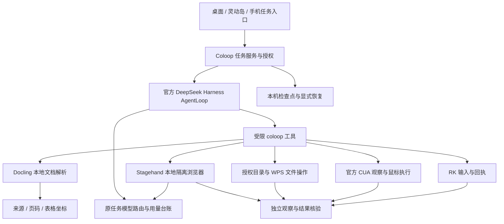

# Coloop 0.14.0 运行架构

2026-11-06 演进交付使用 `release/evolution-0.14.0-20261106-final/win-unpacked`，安装路径仍为 `%LOCALAPPDATA%\Programs\Coloop`。新增缺价拒绝、累计费用上限和服务端持久冷却；最新结果见 [本轮验收](evolution-acceptance-20261106.md)。下文 r13、autoconnect 等包名为历史记录，不是当前启动入口。

2026-11-05：主任务循环默认采用 DeepSeek Harness；文档理解采用 Docling；交互网页默认采用 Stagehand。本次迁移保留 RK 执行器、独立结果核验、模型路由、费用台账和任务目录授权。



## 迁移范围

- 实际原主循环是 AgentTARS。`TarsAgentService` 暂保留类名以兼容既有调用方，生产实例注入官方 Harness runtime。没有将两个推理循环叠加运行。
- OpenCode 的开发会话、hooks 和会话控制兼容入口仍保留。这些是独立功能；RK 的本地 Qwen HTTP 接口不依赖 OpenCode。
- 模型仍使用用户配置的本地 RK 或云端兼容接口。使用 DeepSeek Harness 不会强制切换到 DeepSeek 模型，也不会自动设置新的云端密钥。
- Docling 通过 `read_structured` 读取授权目录中的 PDF/DOCX，提供块分页、页码、表格坐标和源摘要。原有 PDF 渲染读回与交付验证仍独立执行。
- Stagehand 承担自然语言定位、结构化提取及受控浏览器动作。动作绑定最新观察的目标，上传/下载继续使用 Coloop 的文件授权和发布检查。提取结果不能充当任务完成证据。
- Stagehand 的模型请求共享父任务路由、请求上限、费用台账和取消信号；不会另建未计费的 Agent 循环。
- CUA 0.38 提供窗口观察和鼠标 click / double_click / scroll；RK 继续承担键盘、粘贴与其余输入。鼠标执行仍经过窗口、目标、停止和持久回执校验，失败不会自动向另一通道重发。`COLOOP_CUA=off` 可禁用 CUA；`COLOOP_MOUSE_BACKEND=rk` 可仅保留 CUA 观察而使用 RK 鼠标。

## 恢复与停止

检查点保存目标、授权目录、允许外发字段、补充信息、已提交产物摘要和动作回执。电脑操作页提供显式恢复入口。恢复后重新获取页面、观察和文件证据，不复用旧观察编号、问题编号或完成证明。恢复的 PDF 需要重新读取渲染页后才能发布。

Harness 的已派发调用同时有持久化 intent/result 记录。没有确定结果的写入、输入、下载、提交或计划登记会阻止恢复；当前没有自动替用户判定这些副作用。只读操作允许重新请求，旧调用不会被重放。若启动在创建会话前失败，且没有会话或派发证据，可沿原任务编号首次启动。

准备阶段取消会等待检查点写入收束；运行阶段停止会撤销模型/浏览器信号，等待官方 Harness 子进程及宿主工具结束，并验证 RK 的停止回执。不会将关闭 Agent 进程等同于物理输入已停止。

## 构建与启动

固定依赖：Harness SDK/CLI `0.2.1-rc.5`、Stagehand `4.4.0`、Docling `2.147.0`。Harness 仍处于预览阶段，升级应连同恢复、停止、工具边界和包内测试一起验收。

首次准备：

```powershell
npm ci
npm run setup:docling
npm run setup:stagehand
npm run prepare:runtime
npm run package:dir
```

2026-11-06 起，桌面快捷方式和所有 `start*.cmd` 统一指向 `%LOCALAPPDATA%\Programs\Coloop\Coloop.exe`。本轮最终合并目录包为 `release/autoconnect-0.14.0-20261106/win-unpacked`（含灵动岛动效/关闭与自动连接修复）；灵动岛单独冻结包保留在 `release/installed-island-0.14.0-20261106/win-unpacked`；通过包内运行验证后，用 `scripts/install-local.ps1 -PackageDirectory <win-unpacked目录>` 替换安装目录。脚本逐文件校验并保留旧安装备份；不要仅复制 exe，也不要混入旧 `app.asar`。后续修改默认直接部署，详见根目录 `AGENTS.md`。r13、r7 和 r60 为历史回退包。

Docling 使用内置 Python 3.12.10 与离线模型，运行时约 1.86 GB。Harness 使用内置标准 Node 24.14.0；上游原生模块不支持当前 Electron 45.1.0 的 V8，因此没有使用 Electron 内嵌 Node。为让标准 Node 读取官方 CLI、原生依赖和浏览器扩展，目录包采用 `asar:false`。SDK 可执行文件适配涉及精确版本的构造器注入点，详见 [Harness 实现与升级约束](harness-runtime.md)。

本机需安装兼容 Chrome/Edge；WPS、RK 连接与原有 OCR 能力仍沿用现有环境。Docling 可通过 `COLOOP_DOCLING_HOME` 指定另一份完整运行时。恢复旧主循环设置 `COLOOP_AGENT_RUNTIME=tars`，恢复旧网页实现设置 `COLOOP_BROWSER_RUNTIME=playwright`；需要重新启动进程。原 r60 目录包保留。

## 验证边界

当前 r13 全量 Vitest：66 个文件、1195 项通过、1 项可选 Docling 跳过。类型检查、生产构建、安装包 UI 启动与 29,229 个构建/资源文件哈希核对通过。真实 RK 勾选、空白中文输入与同一编辑实现的局部修改均有 completed 记录；构建版本、耗时、历史失败与本地模型边界见 [本地 Agent 验收](local-agent-reliability-20261105.md)。RK/CUA 分层证据详见 [可靠性修复记录](rk-reliability-20261105.md)。

以下为原 r1 迁移基线的历史验收：59 个文件、947 项通过；1 项需要 `COLOOP_DOCLING_REAL=1` 的可选转换测试在常规回归中跳过，已另用真实 portable Python 和离线模型运行通过。恢复列表与离线禁用按钮通过实际 Electron preload/IPC 验证。

清理后的目录包 29,224 项构建/资源文件逐项 SHA-256 核对通过（排除 Python 字节码缓存及空目录标记）。原 r1 的完整性记录已按原字节归档至 `.qa/retired-pre-r8-bundles-20261105/r1-integrity.json`；SDK、CLI 与 Stagehand 包版本一并核验。r1/r5/r6 主 bundle 及 SHA-256 清单也已归档到该目录。两个发布包测试脚本的默认目标已改为 r13，r1/r5/r6 可由用户手动清理；本记录不表示这些目录已删除。

包内运行验证通过：官方 Harness 一次受限工具往返、两次合成模型请求及停止退出；Stagehand 真实提取、中文填写和一次 POST；Docling 中文 DOCX、表格来源摘要与缓存。运行证据分别保存在 `.qa/runtime-package-windows-1793859037384/report.json`、`.cache/docling/portable-validation/workspace-read-structured.json` 和 `.qa/proactive-package-1793859190540/report.json`。

测试覆盖官方 SDK 子进程、完整 RK 工具提示预算、压缩、推理回传、工具边界、显式恢复、停止收束、浏览器实际表单与单次延迟 POST、附件、父任务计费，以及 Docling 真实中文文档和扫描 PDF。

包内 smoke 使用隔离配置、本地测试网页和合成模型回答，不读取个人浏览器会话、不调用付费模型、不发送真实 RK USB 输入。软件集成通过不能替代用户真实业务任务验收。尚未在另一台干净 Windows 验证整个目录包。

实现详情：[Docling](docling-integration.md)、[Stagehand](stagehand-integration.md)、[Harness](harness-runtime.md)。

r7 收尾仅删除未被启动脚本引用、无运行进程的 r2/r3/r4 中间目录包；保留源码、兼容入口、r1/r5/r6/r7、r60 与全部验收记录。范围清单见 `.qa/intermediate-build-cleanup-20261105.json`。

r13 收尾：r8–r12 中间包的逻辑大小共 16,169,918,778 字节，已核对无运行进程或启动引用、归档主 bundle 并逐项核对哈希。删除被自动审批以 `blocked by policy` 拒绝，未提供更具体原因，五个包均保留。随后完成可逆 NTFS 压缩：按 Windows 压缩大小统计，存储量降至 11,065,347,151 字节，减少 5,104,571,627 字节（约 5.10 GB；不是卷可用空间差值）。文件数量、逻辑大小及主 bundle/归档哈希均通过复核，r13 与 r7 未压缩。清单、预检与实际结果见 `.qa/reliability-r13-cleanup-candidates.json`、`.qa/reliability-r13-cleanup-preflight.json`、`.qa/reliability-r13-cleanup-result.json`；压缩及独立复核见 `.qa/retired-build-compression-20261105.json` 和 `.qa/retired-build-compression-verification-20261105.json`。

2026-11-05 清理：删除 138 项无运行/启动引用的旧构建、已确认的测试缓存与有源码对应的 Python 字节码，共约 66.3 GB。保留当前 Harness、r60 回退、Android 包及专项启动器仍引用的版本，历史验收报告、模型、工具链与用户文档均保留。调试 smoke 移至 tests，打包只纳入 Harness 插件并排除 Docling 缓存和探针报告。清理后包启动、离线 Docling 导入和全部启动器目标检查通过；清单见 `.cache/cleanup-20261105.json`。
