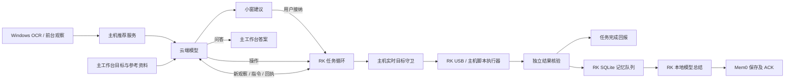
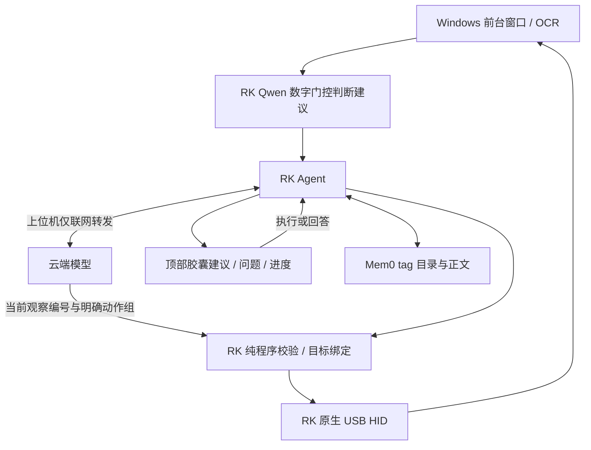

# 云端理解与 RK 执行架构

当前迁移方向已切换为[官方 Agent TARS 主架构](agent-tars-architecture.md)。以下记录保留自研循环阶段的实现和验收历史，不代表 TARS 已通过同样范围的验收。正常应用的主动任务入口已改用 TARS，旧循环仅保留供尚未迁移的独立入口与历史测试参考。

2026-11-04。当前重构覆盖主工作台任务、被动 OCR 推荐和小窗执行入口。DesktopPage、Violoop 等独立旧入口暂保留各自协议。

## 职责与数据流



被动 OCR 由主机直接请求云端，推荐请求拥有独立取消信号，不占用 RK 执行循环。页面变化、凭据保护、暂停和断连使旧建议失效。defer 或请求失败最多触发三次 5/10/20 秒退避重采样，云端 JSON 格式最多纠正一次。普通主工作台任务由云端返回 answer 或 execute；操作目标只派发一次，已派发任务的恢复由 RK 任务循环负责。

RK 负责任务身份、动作校验、执行回执和执行后的记忆整理。SSH 就绪即可进行云端任务，本地模型在后台准备。小窗不可用时立即请求停止所有相关执行器。长操作目标完整保存在任务目录 user-request.txt，由执行器分段读取。

记忆整理使用冻结的已验证任务证据，前台完成状态独立于后台保存状态。SQLite 按 namespace 保存任务和已校验 proposal，跨进程文件锁限制本地模型并发。保存重试沿用同一 key 和 proposal，并要求真实 id ACK。模型只能提供流程内容、标签和摘要，来源与任务身份由程序指定。生产和 QA 使用独立队列，旧版缺少 namespace 的 pending 日志进入 needs_review，供明确审查后处理。

## 审核发现与修复

- 被动云请求原先占用 RK 主循环，已移到主机独立服务。
- 主工作台仍调用本地分类器，现已走统一云端规划入口。
- 连接未 ready、旧连接异步回包、停止后请求和未知输入状态曾存在交叉处理风险，现按来源 pipe、任务身份和取消状态检查。
- 未变页面的 defer/失败曾被去重永久吞掉，现提供有限退避重采样。
- 后台记忆曾逐任务创建线程且丢失重启任务，现由持久队列和单 worker 处理。
- truthy 保存返回曾被误判成功，现校验 ACK，并区分 saved、skipped、retry、failed。
- 小窗失效分支曾漏停 proactive，现已补齐停止处理。

以下为早期实现与验收历史，路径、图和耗时仅适用于对应版本。

# 主动屏幕建议、灵动岛与 RK 执行

2026-11-03，Asia/Shanghai。本轮新增独立主动建议链路，复用已有 OCR、云端网关、板端 Qwen、原生 USB HID 和真实 Mem0。本文区分源码、协议测试、真实模型、真实记忆与完整电脑操作，历史验证见其他专题，不直接计入本轮验收。

**历史 2026-11-03 云端直接动作路线已真实验收通过。** 当时 Qwen保留OCR数字门控；云端根据当前观察返回明确动作组，RK程序校验后直接USB执行，不再调用Qwen转换。固定报告`D:/RK/logs/coloop-proactive-live-direct-20261103-01/result.json`的route为`cloud_actions_rk_usb`：仅1次本地classify（3439ms）、0次translate，两个云端动作组、9次云调用，真实中文追加、tag目录/正文召回及两次剪贴板恢复通过。两任务含复盘记忆分别15.656/22.064秒；范围为真实观察的独立WinForms窗口，不是实际Notepad写入、跨应用或物理手机验收。

**历史live09通过的是旧Qwen动作转换路线。** 其在独立可见WinForms编辑器完成真实被动观察、RapidOCR→Qwen数字门控→云端建议→接纳建议→Qwen动作转换→RK USB中文追加→全文核验/最新观察→Mem0保存；第二任务按tag目录取正文后追加“记忆已调用”。该轮不是合成观察，也不是实际记事本或物理手机验收。旧路线动作转换25–27秒的瓶颈是本次省略转换步骤的依据，不是新路线性能证据。

## 历史启动与交互

本轮独立入口为 `start-proactive.cmd`，现指向 `release/proactive-glass-0.13.0-20261103-r4/win-unpacked/Coloop.exe`，包含后续六类动作适配；两轮真实验收详见[动作任务集](action-taskset.md)。先从托盘退出已有Coloop再启动独立版本，避免单实例逻辑重新显示旧程序。保持模型、云端账户和RK连接配置，不要求重新下载模型。新构建包含当前RK脚本及临时剪贴板资源；旧`proactive-cloud-direct-...`和`proactive-...`目录均保留历史回退，与当前目录不混用。

当前actions包隔离启动smoke为`.qa/proactive-package-1793673381605/report.json`；首次direct包smoke`.qa/proactive-package-1793671451746/report.json`及旧Qwen转换包smoke`.qa/proactive-package-1793645404518/report.json`保留各自历史范围。此类smoke确认胶囊可见且默认不可聚焦，不连接RK/云/USB，不替代真实任务验收。

当前交付清单`release/proactive-actions-0.13.0-20261103/verification.json`：603项Vitest、60项RK Python、类型检查和build通过；包main/RK/clipboard资源一致，最新suite02 Agent与capture摘要匹配。首次direct清单`release/proactive-cloud-direct-0.13.0-20261103/verification.json`的601/58测试和direct源码哈希仍属当时版本；旧目录verification不能替代当前包核对。

屏幕顶部胶囊是独立 Electron 窗口。常驻状态不抢目标应用焦点；胶囊直接显示单行命令输入框，无需先点 New task。Enter或发送箭头提交，中文输入法选词Enter不提交；提交失败保留草稿，Escape返回原窗口。后台状态刷新保留输入焦点，执行中禁用新命令。展开可查看建议或回答问题。输入时才允许焦点切入；提交后恢复此前目标窗口，再由实时观察确认可操作。

- 主动建议先展示，用户点击执行才建立操作任务；忽略不执行。
- 明确下达的任务直接开始，缺信息时在胶囊提问，回答回到同一任务。
- 运行时显示进度与停止；等待源端终态，不能隐藏窗口冒充停止成功。
- 只有标题的文档返回的是拟议大纲，不能声称已存在正文。
- 旧观察的建议会失效；任务接纳、回答、输入及回执均关联任务/观察编号。

本次命令框验证：603项Vitest、12项renderer交互检查、2项真实Windows焦点检查及command包隔离启动通过；源码main与包内hash相同。已切换实际进程到command包。桌面最终截图/草稿回填因Computer Use连续两次 `foreground window did not report a process id` 未完成；旧任务文本保存在 `.qa/island-command-draft-20261103.txt`，未自动重发任务。完整范围见 `release/proactive-command-0.13.0-20261103/verification.json`。

## 实际分工与数据流

| 位置 | 本轮职责 |
| --- | --- |
| Windows / Coloop | 读取前台窗口、裁剪截图、RapidOCR；排除自身窗口与胶囊区域；提供观察、焦点/目标守卫和结果回读；呈现建议、问题、进度；保管云端 Key 并转发 RK 组织的云请求。 |
| RK Agent | 常驻任务循环、观察去重、组织云上下文、接收用户答案；对云端动作做纯程序校验、目标绑定、USB执行和结果核验；维护任务日志、Mem0工具与任务后复盘。 |
| RK Qwen | 仅对OCR用数字0/1/2输出ignore/suggest/defer门控，命中后程序传OCR原文，不让模型改写；不参与任务动作规划或转换。沿用已部署模型，不替换权重或运行库。 |
| 云端模型 | 根据OCR原文生成建议；复杂规划并直接给出明确结构化动作；请求用户补充、按tag检索记忆、对已核验回执复盘。Agent控制层仍在RK。 |
| RK HIDController | 经 `/dev/hidg*` 和 USB 发出真实键盘/鼠标报告；Windows 不用软件键鼠注入代替 USB 输入。 |
| Mem0 | 普通事实/偏好/流程；目录先给 tag、编号和摘要，云端按需请求正文；总结由 RK 以 agent 来源、未核实状态保存。 |



被动观察默认以500ms周期检查，画面稳定约800ms后才 OCR，最短 OCR 间隔1500ms；即使指纹不变也会在约5秒后允许复核OCR，正文hash相同则不重复提交/建议。这些是源码调度默认值，不是端到端响应承诺。执行任务期间暂停后台建议观察，按任务请求采集结果；记忆管理、凭据窗口、其他电脑控制或配置变更期间服从现有互斥。截图采集和 OCR 是不同阶段，不在每个鼠标报告后调用 OCR。

## 执行能力与接口

主通道为 `coloop-proactive-v1`，包含观察、建议接纳/忽略、任务开始/停止、问题回答、阶段/终态和记忆保存回执。host RPC 提供云转发、最新观察、输入校验及临时剪贴板租约。任务输入状态落盘；结果未知时停止，不自动重放。

云端返回 `suggestion`、`ask_user`、`action_plan`、`memory.search`、`memory.get`、`finish` 或 `blocked`。`action_plan`必须直接携带当前`observation_id`、1–8个明确`actions`和短字面量`expected_text`；粘贴时还提供原文`text`。RK不接受只有自然语言instruction的动作计划，也不调用本地模型修补或转换。

程序核对观察编号、已观察目标编号、动作字段及参数、原文引用和执行范围后，支持目标绑定的点击、双击、移动、滚动、快捷键和粘贴。不接受任意桌面坐标、代码或新目标。页面跳转/布局变化后重新观察；云端读取记忆后也必须使用新的当前观察编号。当前任务绑定同一窗口，不宣称任意跨应用；“省掉Qwen转换”不省略目标守卫、USB回执或结果核验。

为避免中文重生成，云端明确正文由RK保管；云端粘贴动作返回`text_ref:"cloud_text"`，程序将它解析成同次动作计划的原文并校验一致性，不接受未知引用或替换正文。执行路径只有云端生成和RK确定性处理，已去掉旧路线十余至二十余秒的本地转换调用；实际总延迟须以新路线端到端结果为准。

键盘不是从零开发：既有 RK 原生 USB 输入能力允许键盘与鼠标，本轮复用。ASCII 快捷键走原生 USB；中文长文本采用临时 Windows 剪贴板租约准备，RK 通过 USB `CTRL+V` 粘贴，最后用 UIA 观察正文变化并恢复剪贴板；这一路线需要允许临时剪贴板，并非“只用鼠标写中文”。原剪贴板不传 RK/云端，用户主动改过剪贴板时不覆盖其新内容。受保护/不支持的焦点或剪贴板格式会阻塞。

## Mem0 tag 目录与部署恢复

`/call` 新增 `catalog(tags?,query?,limit<=5)`、`get_many(ids)`；目录不含正文，仅普通当前记忆。多 tag 为 AND；可结合 CPU 语义检索。每次正文读取核对当前 ID、项目、TTL、删除及同键版本。旧数据保持空 tag/摘要；不能借普通云端工具读取私密引用或凭据正文。

`set` 接受可选 `tags`、`summary`、`source_task_id`，继续真实 Mem0 `infer=False`，不再让 Qwen 对云端总结重复提取。每条正文沿用1000字上限，tag最多八个、每个64字，摘要160字；省略元数据继承同键当前值。云端总结未核实来源不能自升为 verified。后台维护忙或锁超过50ms时目录/正文查询返回 deferred，当前任务可不使用记忆继续。

真实板端服务已公布 `tag_catalog_v1`。部署先确认无其他活动任务或维护，短时停止服务，备份整个 Mem0 存储、配置及旧源码，仅增量更新 `agent/mem0_engine.py`、`agent/memory_service.py` 后重启。未增删生产事实，新增 sidecar 表不重建 Qdrant。固定清单为：

- `D:/RK/rk-opencode/logs/memory-catalog-deploy-20261102-180828-105152/report.json`，含旧/新源码 SHA256、健康能力与板端隔离验收路径。
- 远端备份 `/home/cat/rk-opencode/.runtime/memory-catalog-backup-20261102-180828-105152/`，含完整 `store/`、配置与旧服务源码。
- 本机真实 CPU 验收 `D:/RK/rk-opencode/logs/memory-catalog-20261102-180636-985170/report.json`。

恢复旧源码时确认任务空闲，在板端工程运行 `bash scripts/stop-memory.sh`，从上述备份将两份服务源码复制回 `agent/`，再运行 `bash scripts/start-memory.sh`。旧代码可忽略新增 sidecar 表，无需删表。恢复整个 `store/` 只用于确认的数据损坏恢复，不作为普通代码回退，避免覆盖部署后产生的新记忆。`scripts/deploy-memory-catalog.py` 已记录部署/自动源码恢复流程，`scripts/validate-memory-catalog.py` 使用隔离目录，不操作生产事实。

## 本轮验收状态与限制

| 层级 | 已获得的证据 | 尚不能声称 |
| --- | --- | --- |
| 真实 Qwen | `D:/RK/logs/coloop-proactive-model-20261103-02/result.json`：OCR分类输出正确，7451ms；动作转换输出点击、字符串 `CTRL+END` 和中文粘贴组，18644ms；USB输入数为0。 | 未证明实时/快速。单样本、合成文字/控件元数据，不等于实际屏幕定位和输入成功。 |
| 先前模型尝试 | `...-01/result.json` 保留快捷键输出为数组的原始结果；后续提示要求单个大写字符串，`...-02`为符合接口的输出。 | 不把首轮脚本 `ok` 字段等同于执行器协议兼容。 |
| 数字建议门控 | `D:/RK/logs/coloop-proactive-model-20261103-05-digit/result.json`：真实Qwen数字1输出3457ms；`...-04-raw-classify/result.json`旧JSON门控重测16297ms。 | 样本/提示不同，不能作固定倍数提速或稳定延迟承诺；两次均为0USB模型测试。 |
| text_ref动作转换 | `...-03-ref/result.json`真实转换17438ms，程序正确解析cloud_text；`...-06-frozen-plan/result.json`使用冻结真实观察快照，24864ms，原文绑定正确，USB输入0。 | 仍慢；冻结真实观察不等于实时操作，不能与其他轮次拼接成成功闭环。 |
| 真实Windows前台观察 | `.qa/foreground-native-1793644879838/verification.json`：实际WinForms多行编辑器被UIA暴露为无patterns的Pane，严格原生win32编辑适配确认焦点与控件身份，被动截图/OCR正常触发；validate/guard均allowed。 | 该验证无云/RK/HID，证明观察与目标守卫，不证明模型能完成输入。 |
| 真实记事本兼容 | `.qa/notepad-compat-1793645121223/verification.json`：可见Windows记事本11.2607.14.0空白未保存文档，UIA Document路径确认runtime ID及命中身份，validate/guard均allowed。 | 未插入文字，无OCR/云/HID；不能宣称记事本中文写入已通过。 |
| 临时剪贴板 | `.qa/clipboard-native-1793644066844/verification.json`：3个真实Windows helper场景通过——prepare/guard/finish恢复原内容与格式名、10秒空闲过期恢复并使旧guard失效、dispose恢复活动租约。 | 未据此证明USB粘贴和端到端正文核验成功。 |
| Mem0 | 20项相关 Python 测试、4项上位机记忆管理测试；真实本机及板端 CPU 存储隔离验收通过，覆盖 tag目录、持久ID重开读取、旧版本及删除失效。 | 没有据此证明完整云端任务已正确使用长期记忆。 |
| 记忆界面 | `.qa/memory-catalog-ui/`：1200/760宽合成目录实际渲染及tag/摘要编辑提交通过，截图已查看；设计检测无发现。 | 合成UI验收不计为板端桌面任务成功。 |
| 早期集成失败（历史） | `D:/RK/logs/coloop-proactive-live-20261103-01/`保留实验窗编译失败，`...-02/`保留运行时资源参数失败。`...-03/`、`...-04/`为验收driver未await `clipboard.readText()`，把Promise传入Hash.update；未进入云请求，不能归因为生产capture失败。后续capture全链加await是兼容处理，不构成失败根因证据。 | 早期失败保持原样，后续live09成功不覆盖这些记录。 |
| live05进展与失败 | `D:/RK/logs/coloop-proactive-live-20261103-05/`已实际通过被动观察/OCR、Qwen判断、云端建议生成和建议接纳；4次云调用后终态为failed/JSONDecodeError。Agent回执含两次click的input_sent；独立实验窗text_changed=0、text_length=6，actual-text仍为原标题，未完成中文写入或记忆保存。 | input_sent仅表示报告已发送，不能替代业务成功；无完整闭环。被动观察无建议的中间状态已被后续建议事件更新，不据此归因光标或复核机制。 |
| live08失败（历史） | `D:/RK/logs/coloop-proactive-live-20261103-08/`的真实任务在本地动作校验invalid_action失败，0USB，未通过。 | 保留原失败，不计入后续成功样本。 |
| 旧路线live09真实闭环通过 | `D:/RK/logs/coloop-proactive-live-20261103-09/result.json`为ok；`first-result.json`确认第一任务completed、memorySaved=true，独立正文保留原标题并追加五部分中文提纲；`second-result.json`确认第二任务completed、memorySaved=true，目录查询两次后get_many读取记忆正文，再由USB追加“记忆已调用”。两次任务均恢复原剪贴板，合计10次真实云调用。 | 这是旧Qwen动作转换路线。范围为独立WinForms实验文档、真实屏幕/OCR/原生编辑守卫、真实RK/Qwen/云/USB/Mem0及独立QA记忆namespace；不是合成观察，不扩展为新云端直接动作路线、实际Notepad写入、跨应用或物理手机成功。 |
| 旧路线软件与包 | 上轮601项Vitest、54项RK Python检查通过；`.qa/proactive-package-1793645404518/report.json`隔离配置打包启动smoke通过，胶囊可见且默认不抢焦点。 | 旧测试/包启动不计作本次新路线验收；包启动smoke未连接RK/云/USB。 |
| 新路线：云端直接动作通过 | `D:/RK/logs/coloop-proactive-live-direct-20261103-01/result.json`为ok、route=cloud_actions_rk_usb；真实被动OCR→Qwen门控→云建议接纳→云结构化动作→RK USB中文追加→全文核验→Mem0保存；第二任务tag目录/get_many取正文并追加“记忆已调用”；两个动作组、9次云调用，两次剪贴板恢复。 | 实际独立WinForms窗口、非合成观察；不扩展为Notepad写入、跨应用或物理手机验收。 |
| 新路线软件与包通过 | 601项Vitest、58项RK Python、类型检查与build通过；`.qa/proactive-package-1793671451746/report.json`隔离smoke通过；`release/proactive-cloud-direct-0.13.0-20261103/verification.json`核对main/RK/clipboard以及live源码哈希均一致。 | 包启动smoke未连接RK/云/USB；真实任务成功由direct固定报告另证。 |

### 当前云端直接动作路线性能与范围

direct首次成功单轮包含两个任务，各自开始至完成（含云复盘与Mem0收尾）为15.656秒、22.064秒。全轮本地模型仅一次classify，3439ms、16输出token预算，translate调用为0；两组云端动作、9次真实云调用。独立实验文档先保留原标题并追加五部分中文提纲，再在末尾追加“记忆已调用”，两次剪贴板均恢复。

旧live09的40.380/76.398秒与本轮目标和输出并非严格固定A/B；可以确认去掉了旧路线的本地动作转换调用，但不能以两个单次样本声称稳定倍数提速或SLA。3.439秒只计本地门控，不是屏幕变化到建议显示的端到端延迟。仍限同一观察窗口，记事本仅有零输入兼容验证，物理手机与跨应用未测。

### 旧Qwen转换路线live09性能与范围

第一任务开始至完成约40.380秒，第二任务约76.398秒，均包含复盘及记忆收尾。该轮数字门控3.527秒；三次本地动作转换分别25.290、26.261、26.854秒，是当前主要耗时来源。记忆工具序列为catalog、catalog、get_many。各阶段存在包含关系，不能把NPU、云端及任务总耗时重复相加；门控3.527秒也不是从屏幕变化到建议显示的全程延迟。

上述结果来自单轮两个受限任务，不是稳定SLA。早期3.457秒门控、17.438/24.864秒动作样本与本轮任务输入不同，保留原口径，不能拼成固定提速倍数。任务不保存实验文档文件；实际记事本11.2607.14.0目前仍只有零输入目标兼容验证，物理手机与任意跨应用任务未在本轮验收。

真实模型7451ms和18644ms属于不同调用阶段，不能称作快速，也不能直接相加成为完整任务耗时。后续按各主机单调时钟分别记录 OCR、NPU判断、云端、动作转换、USB、核验及复盘；板端墙钟有偏差，不能用两端文件时间计算延迟。完整 USB 验收成功或失败都应新增具体证据与范围，不覆盖上述失败记录。

建议时效需继续观察：被动光标变化或周期复核可能产生新观察，不能只比较观察对象/编号便把仍适用的结果作废；当前已按实质内容变化及光标扰动处理并在live09成功触发建议，但没有覆盖所有应用和持续编辑场景。该机制风险并非live03/04的driver错误，也未被live05的JSON解析失败证明为根因。


## 顶部常驻与实际切换（2026-11-03）

默认start.cmd及start-proactive.cmd均优先启动proactive-resident独立构建。此前用户实际运行的是旧rk-agent-state，普通start.cmd也未更新，故桌面看不到空闲胶囊；本次已更新默认入口、切换实际运行进程。主窗关闭到托盘后顶部独立窗口仍可见；意外隐藏时每2秒检查恢复，不依赖任务、RK连接或主窗可见。实际Windows观察已确认顶部窗口显示Ready状态。603项Vitest及类型/构建检查通过。

## 玻璃、悬停与拖动

当前胶囊采用半透明液态玻璃视觉（CSS高光、亮边、透明层；非macOS原生Liquid Glass材质）。默认收起，鼠标移入展开，移开350ms后收起；输入焦点或正在填写回答时保持展开，减号可手动收起并保留命令草稿。拖动左侧手柄可移动；同一运行周期内状态更新保留位置，展开围绕拖动后的中心锚点，屏幕变化时限制在可见范围。运行中收起仍显示Stop。

真实Electron悬停尺寸、焦点保持、手动收起、位置保持及运行中Stop检查通过；renderer12项交互和606项Vitest通过。原生焦点回归在本机返回 `Could not restore the target window; select it and retry`，0任务派发，不能据此声称真实任务提交已通过；保留严格目标保护。详情见glass包verification。

最终r2修正：仅左侧手柄采用native拖动区，状态文案保留DOM鼠标事件；修正此前native拖动区吞掉mouseenter。r2真实Windows焦点回归两项通过（`.qa/island-focus-1793692555946/verification.json`），前述失败作为修正前记录保留。

最终交付r4：左侧手柄使用Pointer Capture并将事件坐标传给受限窗口移动IPC，避免native不可聚焦窗口拖动和光标采样延迟问题；坐标有限数值校验并限制在显示器工作区。真实窗口指针拖动、悬停/收起/草稿/位置保持检查通过（`.qa/island-hover-1793692983341/verification.json`）；Windows焦点两项通过（`.qa/island-focus-1793693013242/verification.json`）；606单测及r4隔离包smoke通过。

实机r4验证：Computer Use观察到展开宽576、收起宽336的缩放截图；真实手柄拖动截图原点从(921,12)到(1034,62)，并返回顶部(990,12)。当前RK连接状态为Waiting for RK connection；此轮未提交云端/USB任务。


## 2026-11-03：自主规划预算与无进展检测

板端 `resources/rk-proactive-agent.py` 增加确定性的 DecisionBudget，参考开源 Agent 的有界工具循环与中断思路，不新增框架依赖。

- 每次用户答复后的自主规划最多40轮；连续3轮异常，或首次观察后连续6轮窗口、OCR文字、控件语义状态均无变化时，停止追加规划并进入既有 waiting_user。
- 观察ID及控件ID变化不算进展；控件 name/role/state/value/checked/enabled 的变化可算进展。该启发式可能受动态文字影响，因此仍保留总轮数上限。
- 暂停保留任务、输入回执及核验状态，通过 task.budget 记录原因和计数；收到匹配问题的用户答复后重置预算。未知输入仍走原有人工确认流程，不自动重放。
- 预算约束 run_task 的规划轮次，不是墙钟超时，也不限制 observe 内部重试或单轮供应商格式重试。

CPU验证：test_rk_proactive_agent.py 共49项通过，包含反复目标过期、云端连续失败、观察ID变化、控件状态变化、总轮数限制及用户答复重置。未部署板端、未调用真实云模型、未发送USB输入。

参考：[smolagents 工具循环](https://github.com/huggingface/smolagents/blob/main/src/smolagents/agents.py)、[LangGraph 状态编排](https://github.com/langchain-ai/langgraph)。本次是独立实现预算逻辑，没有移植上述项目源码。


## 2026-11-03：控件状态完成条件

云端 action_plan 可用 expected_state 替代 expected_text：

```json
{"type":"action_plan","observation_id":"当前观察ID","actions":[{"action":"click","target_id":3}],"expected_state":{"target_id":3,"property":"checked","value":true}}
```

property 仅允许 checked / selected，value 必须为布尔值；目标必须来自当前观察且具有 runtime_id 和 center。RK 从观察绑定控件身份和位置，不接受云端自行提供这两项。主机通过只读 UIA TogglePattern / SelectionItemPattern 回读，Indeterminate 或不支持的状态均不视为 false。

执行前必须独立读到可观察且尚未达到目标的状态。完成时要求同一窗口、进程、控件 runtime ID、命中位置及目标状态，另保留实际输入回执要求。目标移动或替换会拒绝核验并要求重规划。本接口不覆盖任意网页业务语义、不支持未绑定身份的纯OCR目标，也不以控件状态替代粘贴文本核验。

验证：76项RK Agent Python检查、28项相关Vitest通过；新测试覆盖状态转换、未知/已满足状态拒绝、身份变化及非法条件。尚未真实设备验收或部署。


## 2026-11-03：新版本重启验收

发行目录 `release/agent-state-check-0.13.0-20261103-r1/win-unpacked`；start.cmd 优先使用此包，start-proactive.cmd 指向同一包。保留此前发行物。

- 打包Agent与维护源码 SHA256相同：eb1b204625678293eca7cbdc395b6a3958ad2a121b886a586d96f92573039b11。
- 隔离配置包smoke通过，证据 `.qa/proactive-package-1793702179360/`。
- 真实生产配置两轮启动（中间正常退出）均自动恢复 RK 连接，qwenReady / modelPrivacyReady 为true，收到外部窗口观察后proactive.connected为true，active为false。证据 `.qa/agent-restart-1793702408202/verification.json`。
- Windows原生只读观察启用后的20项测试通过；不等于真实控件状态切换或USB任务验收。
- 首轮验收误把惰性Agent启动视为开机即连接，后续又遇到测试脚本误选control窗口；失败证据分别保留在 `.qa/agent-restart-1793702267520/` 和 `.qa/agent-restart-1793702351374/`。修正了验收脚本主窗选择及最小化步骤，未降低产品就绪门槛。
- 测试进程退出后另启动正式实例供用户继续使用。此次没有派发业务任务或主动调用USB动作，不声称完成真实业务闭环验收。


## 2026-11-04 云端 OCR 实机验证

固定报告：`D:/RK/logs/coloop-cloud-ocr-20261104-03/result.json`，ok=true。真实 Windows WinForms 独立实验文档、RapidOCR、云端推荐、服务接口接纳、RK USB 中文追加、独立正文读取、第一任务 Mem0 保存、第二任务 catalog/get_many 读取并追加“记忆已调用”通过；两轮剪贴板均恢复。12 次云调用、8 个动作组；本地模型仅两次 memory_review，未调用 OCR 分类或动作转换。

推荐到达 3780ms（从被动观察开始，单样本）；两任务含记忆整理耗时 128250ms、21041ms。本地记忆总结分别 104298ms、12668ms，首次整理明显偏慢，当前仍同步等待后才发 completed。这不是固定提速倍数或完整任务实时性保证。未实测小窗按钮点击；接纳经 ProactiveAgentService.acceptSuggestion。QA host 显式限制模型使用 USB action_plan，不提供生产脚本执行器，不能扩展为脚本工具或任意应用验收。

01 因实验窗未处于前台在云调用前停止；02 旧 QA host 未声明脚本不可用导致重复请求，停止后保留原证据。03 旧 QA completion.verify 未分派 control_state/visible_text 导致两次工具错误，后续模型重新规划完成；随后已将 QA 分派修正为生产行为。报告源码/driver 哈希为运行时快照，不代表修正后的 driver。运行时现已支持 SCRIPT_EXECUTOR_UNAVAILABLE 清除未启动脚本并重新规划，65 项运行时测试及构建通过。


## 2026-11-04 小窗实机与交付包

`D:/RK/logs/coloop-cloud-island-20261104-01/verification.json`：真实 OCR→云端推荐→生产 ControlIndicatorWindow/renderer/preload/IPC 小窗 Execute 点击→RK USB 中文追加→独立正文读取→第一轮 Mem0 保存→第二轮读取并追加“记忆已调用”通过，剪贴板恢复。截图 island-recommendation.png 已检查。推荐 3908ms，两轮首次完成事件分别 21320ms、17770ms；记忆模型分别 168751ms、103737ms。任务完成已与后台整理解耦。原 result.json 第一轮 timings 使用最后一个 completed 状态（包含迟到记忆更新），因此 190178ms 并非前台执行完成时间；以 verification.json 和 states.json 首次 completed 为准。第二轮本地模型返回成功，但验收进程在保存回执前退出，不声称第二轮记忆保存已确认。后续 driver 已修正等待两次 memory.saved 及同名文件串行写入。

66 项 RK 单元测试、635 项 Vitest、类型检查及构建通过。交付包 `release/cloud-ocr-island-0.13.0-20261104-r1/win-unpacked/Coloop.exe`；隔离启动 smoke `.qa/proactive-package-1793755534443` 通过；包目录 verification.json 确认 main、RK Python 及实机源码哈希匹配。start.cmd 与 start-proactive.cmd 优先启动新包。包启动 smoke 无 RK/HID；真实执行由上述独立实机报告证明，不扩展为所有应用或跨应用验收。
