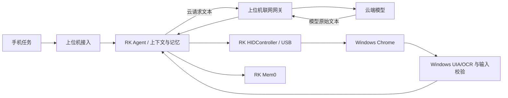

# RK Agent 与上位机联网网关

2026-11-02，Asia/Shanghai。云端 USB 试验的 Agent 已迁到 RK Linux。当前入口 `start-cloud-hid.cmd` 使用独立构建 `release/rk-agent-state-0.13.0-20261102/win-unpacked/Coloop.exe`，已启动并检查RK连接/模型就绪。其他聊天、私密分析、OpenCode 和通用桌面链路保持各自入口。

## 2026-11-02 状态、回执与首页记忆

本次在板端Agent补齐了执行状态，保持云端通过上位机转发、输入通过原生RK USB。以下为本次新能力；下方65.415秒的完整B站三连是初步迁移版本的历史验收，不冒充本版本新测。

- `state.json` version2原子落盘：计划获准、待输入、dispatching、input_sent/unknown、业务核验、复盘保存和记忆写入分别记录。Linux上对文件和目录执行fsync；dispatching必须在第一个HID报告前保存。日志记录是诊断依据，不是自动恢复执行器。相同任务目录拒绝重建，没有从checkpoint自动重放的入口。
- 每次输入必须匹配本任务待执行的观察ID、阶段、目标和决策来源。只在输入前明确未发送时允许新观察/新决策；控制器开始后的异常记为unknown，阻止后续动作与记忆写入。已经发送过的语义阶段也拒绝再次发送；前台恢复保留独立受控动作。
- 云端即使返回合法JSON，也不能点击已激活/未知状态按钮、把Follow冒充Like、确认两枚币或扩大首页任务到三连。复盘须匹配Agent持有的实际回执和窗口/进程/视频身份。业务已核验后，复盘失败不会允许再次操作。
- 首页任务增加独立Mem0键 `procedure:coloop:bilibili-home:mouse-v1`；三连沿用 `procedure:coloop:bilibili-triple:mouse-v1`，不混用。来源、未验证标记、删除/不可用后不复活旧值、完整短摘要规则保留。只有成功核验并完成严格云复盘后才写入。
- 云上下文增加RK运行位置、Windows目标、观察方式、USB动作范围及最近六条真实执行结果；它们是事实上下文，不是新执行授权。复盘去掉重复屏幕文字，完整原始事实仍保存在本地episode。
- 「电脑操作」现在可选择“RK Agent · 云端规划 / USB 鼠标”，再选首页或固定三连任务；目标与核验条件固定，不允许界面扩大能力。上轮computer-use在读取Chrome时因无法确认URL而终止，没有发起业务任务；本次没有通过其他工具绕过该浏览器限制。

验证：574项Vitest、19项原浏览器Python、20项Agent边界与5项Agent/runtime联合检查通过；这25项也在真实RK Python3.10 CPU通过（模拟云/记忆/HID，和实机分开）。严格覆盖输入未确认、部分输入、拒绝重放、伪造回执、磁盘错误、租约释放、首页/三连记忆隔离和复盘失败后的业务状态。

实机验收使用独立WinForms实验窗：**真实RK＋云端API＋Mem0＋原生USB**，观察中的两个浏览器语义阶段明确为合成投影，指向同一受控实验按钮，不代表访问真实B站。2次USB点击、4次报告守卫、2次云调用、0次Agent NPU调用，窗口独立记录点击数2。最终协议start→终态 **11.368秒**；前一成功样本14.724秒，云上下文也有改动，不是提速A/B。这个计时不含实验窗准备、computer-use前台切换、产品4秒提示、手机或Electron/SSH启动，不能与65.415秒完整B站任务直接比较。

当前测试记忆ID `ed474334-2aa2-4e0f-8edd-5a125300c4a2`；通过仅测试适配器把固定首页键映射到独立 `test:coloop:rk-agent-state:<run-id>`，普通事实和生产流程键未被实验覆盖。独立板端进程get及新Agent召回读回同一ID，保留source=agent/verified=0，云总结明确写“合成测试”。前台缺失时的两次拒绝均为0输入/0云请求；编译失败也单列保留，没有重放不确定输入。

验收后，两个成功样本的QA键均使用原有TTL机制过期，独立get确认不可再召回，审计证据保留；没有调用会影响同项目待提取队列的delete。测试适配器后续写入默认60秒TTL，这项仅测试脚本变更在真实Mem0另做过期检查，没有追加USB。生产首页键仍为空，原三连记录ID9601105f-1b73-4494-843a-0af360adfaf1保持不变。过期是召回控制，不是物理清除历史。

证据目录 `D:/RK/logs/rk-agent-state-20261102-100331/`：live-5为最终版本，live-4为前一成功样本，live-1～3为失败；原始输入、manifest、所有云请求/响应、两端耗时、实验窗事件、板端源码/state/episode和独立记忆读回均留档。启动入口、包内资源摘要和就绪检查见该目录汇总。本次未新测完整B站首页/三连或物理手机链路，也没有把Agent改成常驻服务或引入任意桌面工具。

显式复现实机实验（默认测试套件不会触发USB）：

```powershell
# 从 D:/Coloop 执行；RK_BOARD_PASSWORD只在当前进程环境设置。
$env:COLOOP_AGENT_STATE_OUTPUT = 'D:/RK/logs/rk-agent-state-新的独立目录'
$env:COLOOP_LAB_WAIT_FOR_FOREGROUND = '1'
node tests/rk-agent-state-live.mjs --hid-lab
```

`lab-ready.json`出现后把该独立实验窗置于前台，再写本轮目录的`lab-armed.json`为`{"ready":true}`；这只是准备就绪信号，不取代实时前台/命中/逐报告守卫。生产路径不加载QA观察或键映射适配器。

## 实际分工

| 位置 | 实际职责 |
| --- | --- |
| RK / Python 3.10 CPU | 接收受限任务、核对能力范围，召回 Mem0，组装云端上下文和提示，解析及严格校验模型 JSON，跟踪窗口/阶段/观察，绑定当前控件，记录流程及云复盘、写 Mem0，通过原生 HIDController 发送 USB 鼠标报告。 |
| Windows / Coloop | 手机通道和任务生命周期，保存加密云 Key，转发 RK 生成的 system/content 到所配置云接口并原样返回模型文本；提供只读 UIA/OCR、目标许可、逐报告守卫及业务状态回读。 |
| 云端模型 | 批准受限语义步骤，选择当前主页视频或处理歧义，完成后的事实复盘。 |



Agent 通过现有固定指纹 USB SSH 通道请求上位机联网，不需要 RK 直接访问公网，也不把云 API Key 复制给 RK。板端 Mem0 请求只访问 `127.0.0.1:8092`。本次没有修改系统路由、防火墙或全局代理；这表示应用不依赖 RK 公网连接，不表示验证了操作系统级断网隔离。

上位机仍保留任务接入白名单与 Windows 目标校验，因为观察与真实 Windows 窗口关联。联网网关只检查传输大小、所配置 HTTPS、供应商响应封装及正常结束状态，返回原始模型文本；语义 JSON 解析、流程和动作判断由 RK 完成。普通 UIA/OCR 内容在本试验允许上云，未新增通用脱敏能力。

## 实现入口与运行方式

- `resources/rk-cloud-agent.py`：维护的 RK Agent 源码，不导入 Electron 或浏览器框架。
- `resources/browser-runtime.py`：在板端创建 Agent；`relay_plan/act/review` 成为进程内调用，只有 `cloud_transport` 发往上位机；实际 USB 输入后仍重新观察。
- `src/main/services/desktop-tasks.ts`：把打包的 Agent 源码通过现有 SSH 引导到 RK，核对 ready 消息中的源码 SHA256；只提供云请求转发和观察服务。
- `src/main/infrastructure/cloud.ts` 的 `relayText`：保留云 Key 和联网，返回未解析的模型文本。
- `src/main/index.ts`：本试验默认 `agentLocation='rk'`；`browser-task.ts` 仅是接入能力白名单。旧 TypeScript Agent 保留用于历史对照，当前入口不调用它或上位机流程记忆对象。

目前是**每任务一个 RK Python 进程**，Agent 与 HID 运行在同一个进程，并非新增常驻 systemd 服务。每任务源码、原始云请求/响应、事件、episode 保存在 RK 的 `logs/cloud-hid-agent/<task-id>/`。任务结束释放自己的记忆前台租约和 HID 锁。模型服务仍沿用现有就绪门槛；本轮 Agent 不调用 NPU，但没有测试关闭整个模型服务后的产品可用性。

固定能力仍限 Bilibili 首页，以及“主页任选一个普通视频，点赞、投一枚币、默认夹收藏”。已有登录和同一 Chrome 中可见的 Bilibili 首页标签是前提。每步使用新观察；目标ID是当前观察内从0开始的编号，0有效，不能跨观察重放。输入仍只走 RK 原生 USB，保留窗口身份、前台、逐报告守卫及结果未知停止规则。

## 初步迁移的历史实测

生产手机任务服务提交同一条三连任务，实际新视频 `BV1VJxs6oE7x`：10次USB鼠标点击、20次守卫，同一 Chrome HWND199496/PID17772，点赞/投币/收藏三态 true。3次真实云请求、0次RK模型推理、0次上位机流程记忆调用。板端 Agent 和 HID ready 均为 hostname=lubancat、PID18805；从独立 SSH 会话取回的源码摘要与该次 manifest 匹配。

提交前至终态使用同一个 PC 单调时钟，**65.415秒**；业务核验60.604秒，后续复盘、记忆及收尾4.811秒。此前上位机 Agent 单次样本32.309秒，因此本轮不能声称迁移提速。PC侧观察/许可/守卫/回读合计49.177秒，3次云请求合计7.328秒，PC准备0.399秒，其余8.511秒包含4秒开始提示及输入、通信、等待和收尾。上述四组为PC外层时间口径；不要再把嵌套 RK RPC、USB或守卫计时加上。观察类正常成功样本46个合计49.131秒，两次页面尚未就绪的失败观察合计45.633ms单列。10次点击后的固定等待仍为100ms，总实测1.002秒，另有两次500ms页面就绪等待；这些重查没有重发已发送的点击。

首轮失败单独保存在 `D:/RK/logs/rk-agent-migration-20261102-live-1/`：云动作提示未含供应商 JSON 模式要求的字样，2次打开/回首页输入后拒绝，未进入账号互动。失败12.111秒不纳入成功样本。第二轮成功在 `...-live-2/`，每步开始、结束、耗时、结果和主机在 `all-step-timings.json`，正常样本统计在 `desktop/<task-id>/normal-timings.json`。

首次成功任务的云复盘误读目标0及记忆 verified 标记，原结果保留。随后补充编号/来源语义，复盘不再携带旧经验以免循环放大误述；对冻结的成功回执单独重新复盘，没有追加USB。最终复盘要求摘要≤160字、至多两条经验且每条≤60字，超限拒绝，不截断条件后写记忆。当前 Mem0 记录ID `9601105f-1b73-4494-843a-0af360adfaf1`，固定键 `procedure:coloop:bilibili-triple:mouse-v1`，来源指向板端复盘 episode，其 `review-origin.json` 可追溯原业务回执。独立 get 与语义 search 均读回；source=agent、verified=0、cloudSummaryVerified=false 保持不变，业务核验与云复盘可信度分别记录。

574项Vitest、19项原浏览器Python检查、12项新Agent Python检查通过；12项新检查也在真实RK Python3.10 CPU上通过，使用模拟云/记忆，不冒充硬件验收。另有上述真实云/USB/记忆业务验收，以及最新提示/完整记忆文本的真实云复盘验收。最终提示修正后没有再执行一次完整三连。类型、构建、Ruff/语法、包内主程序和三份资源摘要及启动就绪检查通过。完整证据、修复前版本及限制见 `D:/RK/logs/rk-agent-migration-20261102-work/`。

两端墙钟存在偏差，仅用于记录事件；耗时没有跨端相减。正式任务包含4秒开始提示，不含准备Chrome、Electron/SSH启动、物理手机或公网手机传输。只有一个成功连续样本，当前不是通用桌面 Agent 或延迟SLA。未替换模型/运行库，原worker2207保留，验收后HID锁空闲。
