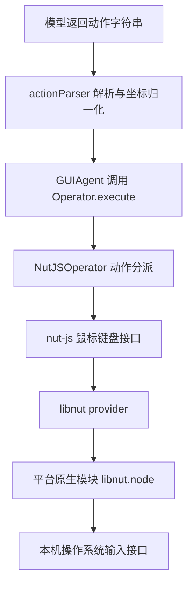

# UI-TARS 鼠标键盘实现与 RK 迁移分析

日期：2026-10-30。

建议借鉴 UI-TARS 的动作协议、坐标转换和复合动作编排，在 RK 上继续使用现有 USB HID 执行器。你的 LubanCat-4 / RK3588 运行 Linux，通过 USB 操作 Windows；UI-TARS 的 nut-js 则在被操作电脑上调用本机输入库。两者可以共享动作语义，最终发送输入的方式需要分开实现。

本次完成源码下载和静态调用链分析。没有安装运行上游依赖、调用模型、连接开发板、发送真实键鼠输入或修改现有执行服务。下文扩展项属于迁移设计。

## 源码位置和固定版本

完整 UI-TARS 源码快照在 [UI-TARS-desktop-main](../.cache/research/UI-TARS-desktop-main/README.md)，来自 GitHub 官方 ZIP，未包含 Git 历史：

- 仓库：[bytedance/UI-TARS-desktop](https://github.com/bytedance/UI-TARS-desktop)。
- ZIP 内记录的提交：`3ac2cb8d946d78d5ff92ad17b318eaafa18c178c`。
- 压缩包：[UI-TARS-desktop-main.zip](../.cache/research/UI-TARS-desktop-main.zip)。
- SHA256：`56b6013d290f93fc476d535b3c56ca7bccf927e572aca379d00e494e0f6de433`。
- 下载与依赖校验清单：[source-manifest.json](../.cache/research/source-manifest.json)。源码缓存位于现有忽略目录，不会自动纳入项目提交。

沿上游 `pnpm-lock.yaml` 另外下载并解包了 `@computer-use/nut-js@4.2.0`、`@computer-use/libnut@4.2.0`、`@computer-use/libnut-win32@2.7.1` 和 `@computer-use/libnut-linux@2.7.1`。四个 npm 包均按 lockfile 中的 SHA512 integrity 校验；没有运行安装脚本或加载原生模块。

另有 [libnut-core C/C++ 参考源码](../.cache/research/libnut-core-develop/src/win32/mouse.c)，提交为 `6bbe5825f1123bcd740117ca932c8b1c6cffb48c`。它用于解释操作系统输入机制，**不能当作上述 npm 二进制的精确构建源码**：npm 元数据的 `gitHead` 是另一提交 `095e09d504a892bb33518f266770b591b6bdada4`。

## 推荐阅读顺序

以下行号对应本次固定快照。

| 顺序 | 源码 | 重点 |
| --- | --- | --- |
| 1 | [packages/ui-tars/operators/nut-js/src/index.ts](../.cache/research/UI-TARS-desktop-main/packages/ui-tars/operators/nut-js/src/index.ts) | 第 94 行开始，`execute()` 如何把动作分派为点击、拖拽、输入、组合键与滚动 |
| 2 | [packages/ui-tars/sdk/src/utils.ts](../.cache/research/UI-TARS-desktop-main/packages/ui-tars/sdk/src/utils.ts) | 第 29 行，`parseBoxToScreenCoords()` 取框中心并映射到屏幕尺寸 |
| 3 | [packages/ui-tars/action-parser/src/actionParser.ts](../.cache/research/UI-TARS-desktop-main/packages/ui-tars/action-parser/src/actionParser.ts) | 原始动作字符串解析；模型坐标先按模型版本、缩放尺寸归一化 |
| 4 | [apps/ui-tars/src/main/agent/operator.ts](../.cache/research/UI-TARS-desktop-main/apps/ui-tars/src/main/agent/operator.ts) | 第 20 行起的 Electron 子类；截图与 Windows 剪贴板输入覆盖了部分通用行为 |
| 5 | [packages/ui-tars/sdk/src/types.ts](../.cache/research/UI-TARS-desktop-main/packages/ui-tars/sdk/src/types.ts) | 第 66 行，Operator 抽象：`screenshot()` 和 `execute()` |
| 6 | [packages/ui-tars/sdk/src/GUIAgent.ts](../.cache/research/UI-TARS-desktop-main/packages/ui-tars/sdk/src/GUIAgent.ts) | 第 385 行，Agent 调用 Operator；输入执行的默认重试次数是 0 |

仓库还包含 [multimodal/gui-agent/operator-nutjs/src/NutJSOperator.ts](../.cache/research/UI-TARS-desktop-main/multimodal/gui-agent/operator-nutjs/src/NutJSOperator.ts)，采用统一的 `BaseAction`、`point/start/end` 与归一化坐标。可以参考它的结构，但当前 UI-TARS 桌面应用的 `runAgent.ts` 导入的是前述 `@ui-tars/operator-nut-js` 路径，两套实现不能混为同一调用链。

## 输入如何真正发出



下载的确切 npm 发布包中，可以继续读：

- [nut-js mouse.class.js](../.cache/research/input-deps/nut-js-4.2.0/package/dist/lib/mouse.class.js)：`move()` 沿路径逐点移动；`drag()` 按下左键、移动、释放。
- [libnut-mouse.class.js](../.cache/research/input-deps/libnut-4.2.0/package/dist/lib/libnut-mouse.class.js)：映射到 `moveMouse`、`mouseClick`、`mouseToggle`、`scrollMouse`。
- [libnut-keyboard.class.js](../.cache/research/input-deps/libnut-4.2.0/package/dist/lib/libnut-keyboard.class.js)：组合键映射后进入 `keyToggle`，文字进入 `typeString`。
- [import_libnut.js](../.cache/research/input-deps/libnut-4.2.0/package/dist/import_libnut.js)：按 `process.platform` 选择 Windows、Linux 或 macOS 包。

原生发布包只带接口和编译模块，没有对应的完整 C/C++ 实现。单独下载的参考源码展示：Windows 的 [mouse.c](../.cache/research/libnut-core-develop/src/win32/mouse.c) 和 [keypress.c](../.cache/research/libnut-core-develop/src/win32/keypress.c) 调用 `SendInput()`；Linux 的 [mouse.c](../.cache/research/libnut-core-develop/src/linux/mouse.c) 使用 `XWarpPointer()`、`XTestFakeButtonEvent()`，键盘使用 XTest。

把 Linux nut-js 后端移植到 RK，操作的是 RK 自己的 X11 桌面。你的目标是操作 USB 另一端的 Windows，因此应在 Operator 层换成 USB HID 后端。板端现有 Server 系统也无需为了这个输入链路安装 X11 或 Electron。

## 各动作的实现和 RK 对应方式

| 动作 | UI-TARS 与 nut-js 做法 | RK 对应做法与现状 |
| --- | --- | --- |
| 移动、悬停 | `straightTo(Point)` 产生路径，`mouse.move()` 逐点移动 | 发送当前位置绝对坐标、按钮位为 0 的报告；现有编码函数可复用，执行入口待加 |
| 左键单击 | 移到目标，等待 100 ms，`mouse.click(LEFT)` | 当前已有：移动报告 → 左键按下 → 释放 |
| 右键、双击 | 切换按钮，或两次点击并控制间隔 | 报告支持右键；当前动作分派尚未开放。双击需配置间隔并对照主机阈值实测 |
| 拖拽 | 移到起点 → 左键按下 → 沿路径移动 → 释放 | 整条路径保持按钮位 1，结束或取消时释放。必须作为完整动作持锁执行 |
| 垂直滚动 | 先移到滚动区域，再 `scrollUp/Down(500)` | 当前描述符有 wheel 字段，编码函数允许 -8 到 8；动作入口尚未接入。步数需按主机滚动效果标定 |
| 水平滚动 | 这条桌面 Operator 实际只处理 up/down | 当前鼠标描述符没有水平滚轮字段；首版不宣称支持 |
| 组合键 | 字符串映射为 nut-js Key，先 press，再 release | 当前已有 CTRL/SHIFT/ALT 加一个普通键；需独立映射为 HID usage，不能复用 nut-js 枚举数字 |
| 持续按住与释放 | `press`、`release` 可分次调用 | 当前 `send()` 每次结束都释放；跨调用保持状态需另设计，建议先只实现完整组合键和完整拖拽 |
| 英文和数字 | Windows 通常走剪贴板；其他分支 `keyboard.type()` | 现有 `text_reports()` 提供 US 布局 ASCII，每次 1 到 64 字符；受主机布局与输入法状态影响 |
| 中文与任意 Unicode | Windows 写入剪贴板，发送 Ctrl+V，再恢复原文本 | RK 不能靠 HID 报告直接写 Windows 剪贴板；需已有电脑助手协作或单独验证输入法方案 |

`scrollUp(500)` 不是可以直接复制的 HID wheel 数值。原生平台对滚动量的解释也不同。迁移接口宜定义清楚的步数和方向，限制每轮幅度，执行后观察实际变化。

## 你已经具备的 RK 底层

对应现有源码：

- [D:/RK/rk-opencode/agent/hid.py](../../RK/rk-opencode/agent/hid.py)：`keyboard_report()` 第 47 行、`text_reports()` 第 62 行、`mouse_report()` 第 83 行、`HIDController.send()` 第 112 行。
- [D:/RK/rk-opencode/scripts/usb-hid.py](../../RK/rk-opencode/scripts/usb-hid.py)：第 25 行，键盘 8 字节、绝对坐标鼠标 6 字节描述符。
- [D:/RK/rk-opencode/pc/observations.py](../../RK/rk-opencode/pc/observations.py)：第 49 行，现有观察编号、窗口、焦点和目标校验。

现有键盘报告格式：

```text
[修饰键位图, 保留字节, usage1, usage2, usage3, usage4, usage5, usage6]
```

CTRL、SHIFT、ALT 的位分别为 1、2、4。现有映射未开放 GUI/Win 键。`Ctrl+C` 在当前描述符下可编码为 `01 00 06 00 00 00 00 00`，随后发送八个零释放；这是报告解释示例，本次没有发送它。

现有鼠标报告是 `struct.pack('<BHHb', buttons, x, y, wheel)`，对应 1 字节按钮、两个 16 位小端绝对坐标和 1 字节有符号滚轮。坐标范围由本项目描述符定义为 0 到 32767，并非所有 HID 鼠标都相同：

```text
hid_x = round((desktop_x - screen_left) * 32767 / (screen_width - 1))
hid_y = round((desktop_y - screen_top)  * 32767 / (screen_height - 1))
```

当前描述符声明三个按钮，但 Python 校验只允许按钮值 0、1、2。中键位 4 或组合按钮需要同时扩展编码校验和上层能力声明。垂直滚轮在描述符中是有符号相对量，上层目前进一步限制为 -8 到 8。

`send()` 通过 `os.write()` 向对应 `/dev/hidgX` 写报告，最后尝试释放所有按键和按钮。设备节点按 configfs 的 major/minor 查找，不固定假设 `hidg0` 必然是键盘。这符合 [Linux HID Gadget 文档](https://docs.kernel.org/usb/gadget_hid.html) 的字符设备读写机制。

## 建议的迁移结构

```text
模型或人工动作
    → 动作解析与统一命名
    → 观察关联、坐标转换、目标与焦点校验
    → RK 动作编排器
    → 现有 HID 报告编码与发送
    → Windows 目标应用
    → 现有电脑观察助手回读
```

动作层无需绑定模型：先让人工构造的动作走相同链路，验证点击、拖拽与输入，再接规划器。模型可以继续运行在电脑、云端或 RK；研究鼠标键盘不要求同时移植模型和 Electron 客户端。

建议新增独立适配器而不改变旧 HID 工具的默认行为：动作解析器将 UI-TARS 的别名转换为统一的 `move/click/double_click/drag/scroll/hotkey/type`，编排器调用现有 `hid.py`。保留现有观察与目标验证；视觉坐标动作属于后续独立模式，不能把模型坐标绕过当前 `target_id` 校验直接发送。

坐标链路需要显式区分三种空间：模型输出坐标、截图像素、Windows 桌面物理像素。UI-TARS 不同模型版本可能使用 1000 网格或缩放图像像素，不能统一假设“除以 1000”。若截图只截了窗口，还需加窗口/裁剪区域原点；DPI、分辨率或窗口变化后重新观察。最终再转换成上述 HID 坐标。首版继续沿用单屏限制。

建议按这个顺序扩展：

1. 先覆盖移动、左右键点击、双击、已有组合键和 ASCII。复用现有窗口校验及真实效果回读。
2. 增加完整拖拽和垂直滚动，逐段检查停止状态，异常路径释放按钮；拖拽过程独占输入锁。
3. 增加 GUI/Win、PageUp/PageDown、Delete 等明确的 HID usage 映射；未知键整体拒绝。
4. 需要中文时接入电脑助手文本通道。HID 负责粘贴快捷键，助手处理 Windows 剪贴板；与纯 HID 模式分别标明。
5. 再讨论跨应用、多屏和视觉定位，分别扩展观察与坐标约束。

现有发送循环每个报告固定等待 25 ms。不要把 nut-js 的逐像素路径、3600 pixels/s 或忙等待循环直接复制到 RK：1000 个报告仅固定等待就约 25 秒。拖拽宜按总时长与报告频率插值，以少量绝对坐标报告覆盖路径，并对实际应用效果标定。

## 不应照搬的细节

- `index.ts` 第 224 行通过 `if (startX && startY && endX && endY)` 检查拖拽坐标，会拒绝坐标为 0 的合法边缘。迁移时检查有限数值和边界。
- 输入路径多次使用 `.trim()`，会改变前后空格及真实换行。迁移协议应精确保留文本，把“输入”和“按 Enter”分成两个明确动作。
- Windows Electron 子类覆盖 `type`，直接粘贴后返回，没有执行父类后续的 Enter 分支。不能仅按通用 Operator 推断桌面客户端的提交行为。
- 快捷键映射用 `.filter(Boolean)` 忽略未知键；硬件执行器应拒绝整个未知组合，避免部分键被误执行。
- `press/release` 的跨调用保持状态、拖拽中途异常与取消，需要完整的释放路径；现有 RK `finally` 释放应保留。发送后的结果未知不能盲目自动重放。
- 截图仍需来自被操作的 Windows。RK 本机截图无法替代电脑画面；未来独立采集是另一项工作。

## 验证范围

本次验证源码 ZIP 完整性及解包内容、固定提交、关键源码路径，以及四个 npm 包的 SHA512。既有 RK 源码只读。未编译上游客户端，也未做本次板端或桌面输入验收。

真正接线后，应先用隔离测试窗口验收：屏幕边缘坐标、DPI 缩放、右键、双击、拖拽、滚动幅度、带空格文本、组合键，以及停止后的按键释放。发送报告成功与应用结果正确分别记录。
