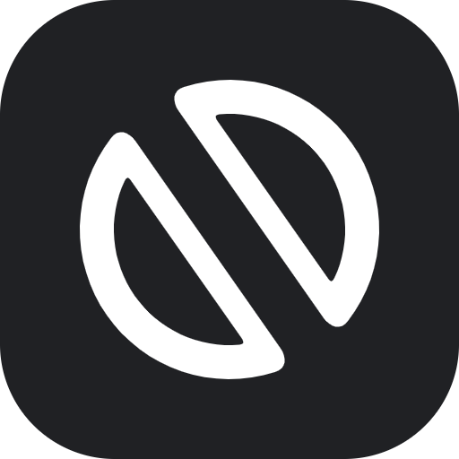
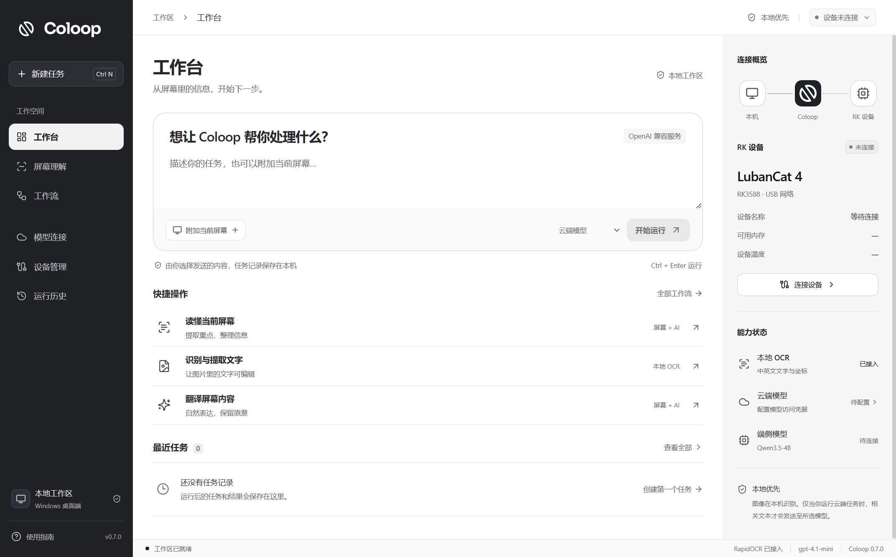
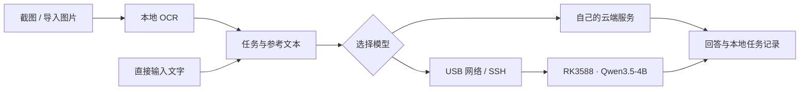

<div align="center">



# Coloop

**从屏幕里的信息，开始下一步。**

连接 Windows 桌面、离线 OCR 与 RK3588 端侧模型的智能设备工作台。

[](https://github.com/Coolenz/Coloop/actions/workflows/ci.yml)

[快速开始](#快速开始) · [设备配置](docs/GETTING-STARTED.md) · [模型下载](docs/MODELS.md) · [开发文档](#文档导航)

</div>



<p align="center"><sub>历史 v0.7.0 界面 · 截图来自隔离测试环境，设备未连接。</sub></p>

## 当前实现

2026-11-04。`main` 同时保存当前 Coloop 上位机与 RK 配套源码。上位机为 0.13.0，电脑操作使用固定的官方 `@agent-tars/core@0.3.1` 运行循环。Windows 提供 OCR/UIA 观察与结果回读，RK 适配器执行 USB HID，独立记忆工作进程使用本地模型整理已验证任务。

工作台与「电脑操作」支持任务进度、下一步建议、补充回答、停止确认及异步记忆状态。Coloop 728 项 TypeScript 测试与构建通过，RK 桥接侧 178 项测试通过，其中 10 项跳过。硬件、模型与界面验收范围见 [TARS 架构和验收记录](Coloop/docs/agent-tars-architecture.md)。

更新前的完整远端实现在 `codex/history-pre-tars-20261104` 分支中保留。上位机各阶段的本地提交历史并入当前 `main`，导出来源与脱敏记录见 [源码快照](docs/source-snapshot.json)。

Coloop 将截图、文字识别、模型分析与设备状态放在同一个工作区。你可以导入图片、提取中英文文字，再交给自己配置的云端模型或通过 USB 连接的 RK 开发板进行总结、翻译和信息整理。

仓库同时提供桌面应用和配套的端侧开发工具：既可以从应用开始使用，也可以继续研究 Qwen 部署、RKLLM 服务、OpenCode 集成与评测复现。

## 能做什么

| 能力       | 当前实现                                                                           |
| ---------- | ---------------------------------------------------------------------------------- |
| 屏幕理解   | 多显示器截图、图片导入、中英文 OCR；查看文字框、置信度与坐标，复制识别结果         |
| 任务工作台 | 输入任务，附加屏幕或 OCR 文本，选择云端或 RK 模型，查看回答                        |
| 云端连接   | 支持 OpenAI 兼容、Anthropic、Gemini 协议；自定义地址与模型，测试连接，流式显示回答 |
| 端侧推理   | 连接已部署的 Qwen3.5-4B / RKLLM 服务，通过 RK3588 NPU 处理文本任务                 |
| 设备管理   | USB 网络连接、SSH 指纹校验；查看温度、内存、运行时长和模型就绪状态，启动已有服务   |
| 任务记录   | 保存最近 200 条任务，支持搜索、状态筛选和 JSON 导出                                |

**按需配置：**文字云端任务需要自己的模型服务；本地 OCR 需要 Python 环境和 OCR 模型；端侧推理还需要已部署的 RK 开发板。

## 工作方式



OCR 在本机运行。选择云端任务时，任务及附加的识别文本会发送到所选模型服务；选择 RK 时，文本经 SSH 私有通道交给板端服务。**Coloop 当前使用 OCR 文本分析屏幕内容，未将截图直接交给端侧视觉模型。**

云端 API Key 使用 Windows DPAPI 加密保存；SSH 密码和板端服务 Key 仅保留在进程内存。任务历史保存在本机，历史正文未加密。详细说明见 [应用架构](Coloop/docs/architecture.md)。

## 快速开始

### 1. 启动桌面应用

准备 **Windows 10/11 x64**、**Node.js 24** 和 Git：

```powershell
git clone https://github.com/Coolenz/Coloop.git
cd Coloop/Coloop
npm ci
npm run dev
```

进入「模型连接」配置云端服务，在「设备管理」连接 RK 后提交任务。默认电脑操作使用 OpenAI 兼容协议，本地模型负责后台记忆整理。「其他操作模式」提供已有的端侧规划等入口。

### 2. 启用本地 OCR

安装 **Python 3.12**。在本次克隆的**仓库根目录**执行，根目录应同时包含 `Coloop/` 和 `RK/`：

```powershell
py -3.12 -m venv RK/deployment/screen-ocr/.venv
& ./RK/deployment/screen-ocr/.venv/Scripts/python.exe -m pip install -r RK/requirements-screen-ocr.lock.txt
& ./RK/deployment/screen-ocr/.venv/Scripts/python.exe RK/tools/prepare_screen_ocr.py
& ./RK/deployment/screen-ocr/.venv/Scripts/python.exe RK/tools/smoke_screen_ocr.py
```

在 Coloop「模型连接」底部，将 **RK 项目路径**设为当前克隆的 `RK` 文件夹的绝对路径。随后可在「屏幕理解」导入图片或截屏，识别后点击「用于任务」。

首次准备模型需要联网，之后 OCR 可离线运行。应用默认的 `D:/RK` 是原开发机路径，换电脑后需要更新。

### 3. 连接 RK 开发板

已验证的硬件环境为 **LubanCat-4 / RK3588、16 GB 内存、Ubuntu 22.04**，通过 USB OTG 提供的网络连接 Windows。

1. 按 [首次配置](docs/GETTING-STARTED.md) 创建自己的 `RK/config/board.json`，填写真实地址、用户和已核对的 SSH 指纹。
2. 在「设备管理」导入配置，输入自己的 SSH 密码并连接。
3. 查看「端侧能力」；已有兼容服务时可启动并等待就绪，再到工作台选择 RK。

默认板端服务目录为 `~/rk-opencode`、端口为 `8088`。**界面的启动按钮只启动已部署的服务，不安装依赖、运行库或权重。**首次部署请阅读 [Qwen3.5-4B 部署](RK/docs/11-qwen35-4b.md) 和 [板端模型服务](RK/rk-opencode/README.md)。

## 模型与运行环境

| 组件         | 当前使用                                              | 下载与复现                                                                                                                                                                                                        |
| ------------ | ----------------------------------------------------- | ----------------------------------------------------------------------------------------------------------------------------------------------------------------------------------------------------------------- |
| 本地 OCR     | RapidOCR 3.10.0 + PP-OCRv5 mobile，ONNX Runtime CPU   | [准备工具](RK/tools/prepare_screen_ocr.py) · [模型清单](docs/model-manifests/ocr.json)                                                                                                                            |
| 默认端侧模型 | 社区转换 Qwen3.5-4B W8A8，RK3588 NPU                  | [固定版本来源](https://huggingface.co/Qengineering/Qwen3.5-4B-rk3588/tree/ee09c44b420e031dbe96fcb489ef30c5f3e0d1a5) · [下载工具](RK/tools/prepare_qwen35_4b.py) · [校验清单](docs/model-manifests/qwen35-4b.json) |
| 端侧推理服务 | 应用私有 RKLLM Runtime/Header 1.3.0，默认 16K 上下文  | [上下文说明](RK/docs/16-qwen35-context.md) · [服务源码](RK/rk-opencode/)                                                                                                                                          |
| 可选研究组件 | Qwen9B、电脑 BF16 基线、Mem0 中文嵌入、RKNN/RKLLM SDK | [完整模型与 SDK 索引](docs/MODELS.md)                                                                                                                                                                             |

仓库保存源码、依赖锁文件、配置模板和小型固定题集。**模型权重、SDK 二进制、虚拟环境、安装程序和运行日志另行准备**；模型清单记录固定 revision、字节数和 SHA256。

## 仓库结构

```text
Coloop/
  src/                 Electron 主进程、preload、React 界面
  resources/           OCR 适配器、品牌资源与字体许可
  tests/               单元测试与 Electron 端到端测试
RK/
  tools/               OCR、模型准备/部署、转换、评测与 C++ 模板
  scripts/             Windows、WSL 和板端操作脚本
  config/              设备配置模板
  rk-opencode/         RKLLM HTTP 桥接、OpenCode、Mem0 与桌面实验
  docs/                硬件、部署、评测报告与学习资料
docs/                  跨组件配置、模型清单与发布记录
```

## 开发与验证

在 `Coloop/` 目录运行：

```powershell
npm run typecheck       # TypeScript 类型检查
npm test                # 应用单元测试
npm run format:check    # 格式检查
npm run build           # 生产构建
npm run package:win     # 生成 Windows portable 程序
```

`npm run test:e2e` 使用真实 Electron、本机 OCR 和本地 HTTP 测试服务，需要先配置 OCR 环境。板端测试通过专门环境变量启用，详见 [应用验收说明](Coloop/docs/verification.md)。

RK 桥接层的 Python 单元测试，从仓库根目录运行：

```powershell
python -m unittest discover -s RK/rk-opencode/tests -v
```

[Windows CI](https://github.com/Coolenz/Coloop/actions/workflows/ci.yml) 自动执行安装、应用测试、格式检查、构建和打包。首次发布已通过；本机发布验证包含 **39 项应用测试、51 项 Python 测试、3 项插件测试，以及 10 项 Electron 端到端检查**。具体环境与限制见 [发布检查记录](docs/PUBLICATION.md)。

## 当前范围

- **桌面应用：**已接入 OCR 和模型文本分析。HID、记忆召回、跨应用自动操作、语音与离开模式尚未接入 Coloop 界面。
- **RK 实验：**仓库保留 OpenCode、Mem0、USB HID 与隔离窗口闭环实验。这些能力分别验收，不能据此推断 Coloop 已具备通用桌面自动操作能力。
- **模型输出：**默认 16K 是配置与模型转换上限，不代表已完成满 16K 质量验证。端侧回答一次性返回；「停止等待」不强制中断板端共享推理。
- **实验报告：**`RK/docs/` 中的记录对应各自日期、题集与环境。原始日志未上传；历史验证不代表克隆后的环境已验证，固定抽样成绩也不是完整官方榜单分数。

## 文档导航

| 我想……                         | 阅读入口                                                                                                                          |
| ------------------------------ | --------------------------------------------------------------------------------------------------------------------------------- |
| 从零配置应用、OCR 与设备       | [首次配置](docs/GETTING-STARTED.md)                                                                                               |
| 下载模型、查版本和 SHA256      | [模型与 SDK 索引](docs/MODELS.md)                                                                                                 |
| 了解应用设置、数据流与安全边界 | [应用说明](Coloop/README.md) · [架构](Coloop/docs/architecture.md)                                                                |
| 部署 Qwen4B 和板端服务         | [4B 部署](RK/docs/11-qwen35-4b.md) · [RK OpenCode](RK/rk-opencode/README.md)                                                      |
| 查看实测与已知问题             | [应用验收](Coloop/docs/verification.md) · [端侧验收](RK/rk-opencode/VALIDATION.md) · [C-Eval 对照](RK/docs/15-qwen35-ceval260.md) |
| 学习 RK 端侧开发               | [RK 文档目录](RK/docs/README.md) · [学习路线](RK/docs/学习路线.md)                                                                |
| 参与开发或检查发布来源         | [贡献约定](CONTRIBUTING.md) · [源码快照](docs/source-snapshot.json)                                                               |

## 许可

Coloop 应用使用 [MIT License](Coloop/LICENSE)。RK 原创文件尚未另行声明开源许可；模型、SDK、字体与评测题集保留各自的许可和使用条件，详见 [第三方来源与许可](docs/THIRD-PARTY.md)。
