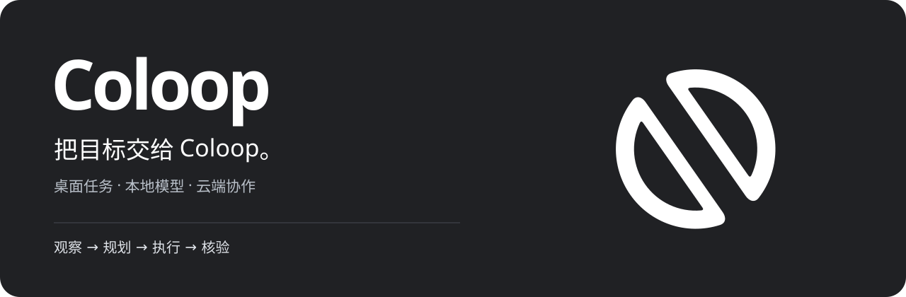
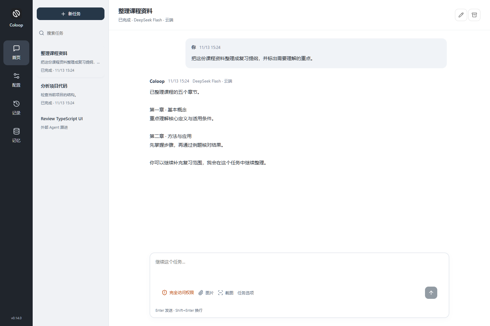
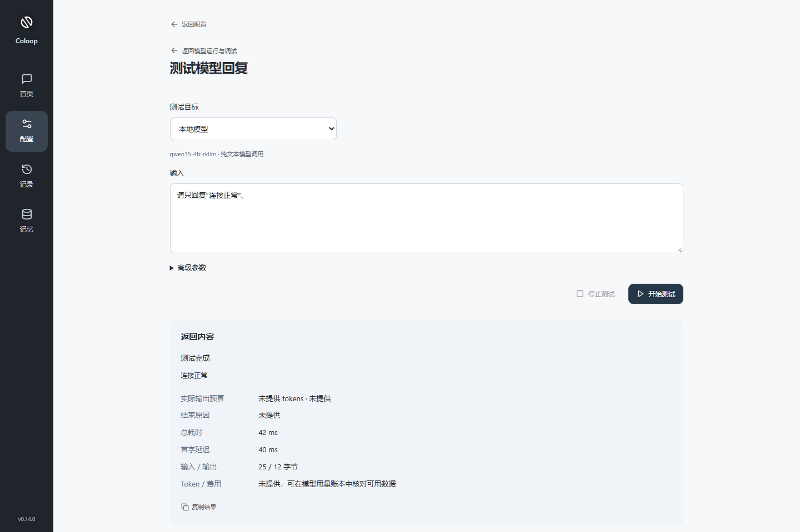
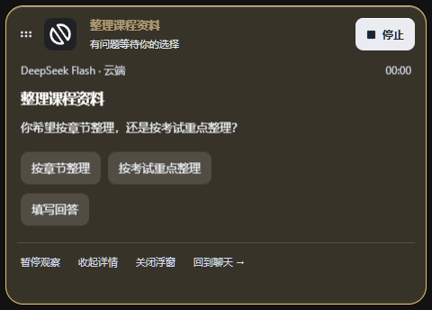
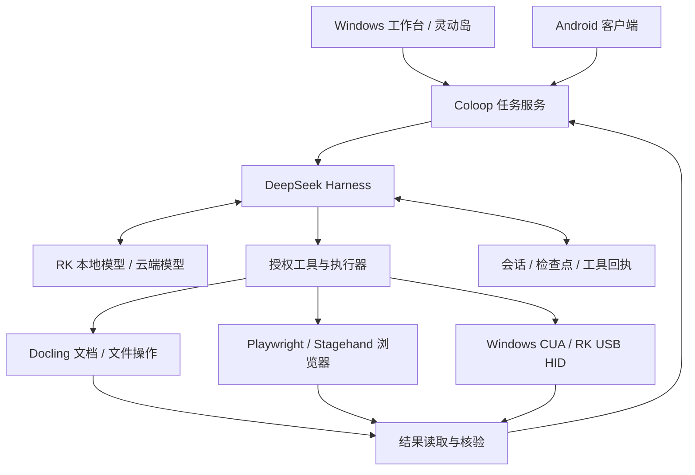

<div align="center">



# Coloop

**连接 Windows 桌面、浏览器与 RK 本地智能的 AI 工作台。**

用自然语言发起任务，让 Coloop 读取资料、操作电脑、核对结果，再从桌面或手机继续跟进。

[](#快速开始) [](#执行架构) [](#模型与硬件) [](Coloop/LICENSE)

[能力概览](#能力概览) · [开发进展](#开发进展) · [快速开始](#快速开始) · [文档导航](#文档导航)

</div>

## 能力概览

<table>
<tr>
<td width="50%" valign="top">

### 让电脑执行任务

从屏幕观察到动作规划，接入 Windows CUA 与 RK USB HID，执行后读取实际结果。任务过程包含进度、提问、停止和执行回执。

</td>
<td width="50%" valign="top">

### 读懂文件与网页

通过 Docling 读取 PDF、DOCX 的结构、页码与表格，通过官方 Playwright 扩展连接现有 Edge 会话，并提供 Stagehand 网页定位、信息提取和受控操作。

</td>
</tr>
<tr>
<td valign="top">

### 按需使用本地与云端模型

连接 RK3588 上的 Qwen 服务或自己的云端模型。模型路由、工具授权和用量记录由同一任务服务管理。

</td>
<td valign="top">

### 从手机继续跟进

Android 原生客户端支持配对、发起任务、查看进度、补充要求与停止。手机通过加密通道连接电脑端任务服务。

</td>
</tr>
<tr>
<td valign="top">

### 把记忆留给下一次任务

统一管理普通记忆与私密凭据引用，按需召回相关内容。凭据通过专用服务保存和填写，普通记忆支持搜索与编辑。

</td>
<td valign="top">

### 保存过程，接续任务

DeepSeek Harness 保存会话与检查点，Coloop 记录工具意图、回执和产物。显式恢复时重新确认当前环境，再接续任务。

</td>
</tr>
</table>

以上能力已接入 GitHub 主分支的 **0.14.0 DSH 架构**。电脑操作的效果取决于应用、设备与任务环境，具体测试范围记录在各专题文档中。[架构与接入说明](Coloop/docs/harness-migration.md)

## 开发进展

**近期开发围绕一个持续工作的任务空间展开。** 聊天、工具执行、模型调试与外部 Agent 跟进汇集到同一工作区。



<p align="center"><sub>开发版测试界面 · 隔离测试环境中的示例任务与合成回复 · 2026 年 11 月</sub></p>

| 最近进展             | 已同步的源码能力                                                             |
| -------------------- | ---------------------------------------------------------------------------- |
| **连续的任务聊天**   | 持久化聊天、草稿与任务队列，追加要求、历史检索和中断后恢复                   |
| **随手可用的灵动岛** | 顶部及左右贴边、拖动定位、任务标题同步、问题回答与停止                       |
| **三端操作审批**     | 按聊天选择权限策略，在桌面、灵动岛和已配对 Android 客户端处理同一请求        |
| **可调试的模型路由** | 云端、本地与自动分配，模型回复测试、容量配置与运行诊断                       |
| **外部 Agent 跟进**  | 接入 Codex / OpenCode 会话事件，跟进状态、发送补充指令并记录回执             |
| **命令行操作**       | 可发现的命令目录与 JSON Schema，任务发起、等待、历史读取及配置管理           |
| **偏好与恢复可靠性** | 身份范围内的偏好保存和读回核验，部分更新、延期回执及已识别执行异常的接续处理 |

开发进度核对至 **2026-11-14**。任务聊天、CLI、三端审批与模型调试等源码已同步到 GitHub `main`。截图来自隔离 UI 测试，各功能的操作入口与参数见 [CLI 操作手册](Coloop/docs/cli.md)。

<details>
<summary><strong>查看模型调试与灵动岛</strong></summary>

### 模型调试

在工作区测试模型回复和任务分配，查看运行状态及诊断信息。



### 灵动岛

在桌面边缘查看当前任务，需要补充信息时直接回答。

<p align="center">

</p>

上述界面均来自隔离 UI 测试，内容为示例数据。

</details>

## 执行架构



DSH 提供 Agent 执行循环和会话生命周期，Coloop 连接现有业务服务、工具授权、模型路由与结果核验。云端任务使用用户配置的模型服务，RK 任务通过本地设备连接访问端侧模型。[运行层设计](Coloop/docs/harness-runtime.md)

## 快速开始

### 启动桌面开发环境

准备 **Windows 10/11 x64、Node.js 24 和 Git**，然后运行以下命令。首次安装 Electron 和 npm 依赖需要联网。

```powershell
git clone https://github.com/Coolenz/Coloop.git
cd Coloop/Coloop
. ./scripts/workspace-cache.ps1
npm ci
npm run setup:node
npm run dev
```

在应用中配置自己的模型地址、模型 ID 与 API Key，测试连接后发起任务。开发缓存和临时文件由 `workspace-cache.ps1` 放在应用目录的 `.cache` 中。

### 命令行调用

应用启动后，可在另一个终端发现命令并读取参数 Schema。

```powershell
npm run --silent cli -- status
npm run --silent cli -- commands
npm run --silent cli -- help conversation send
```

安装版提供根目录 `coloop.cmd`。任务发起、等待、恢复与配置的完整用法见 [CLI 操作手册](Coloop/docs/cli.md)。

### 按任务准备能力

| 想使用的能力           | 需要准备                                                                                    |
| ---------------------- | ------------------------------------------------------------------------------------------- |
| 云端任务               | 可访问的模型服务、模型 ID 与相应凭据                                                        |
| 本地屏幕 OCR           | Python 3.12、OCR 环境与模型，并配置 RK 项目路径                                             |
| RK 本地推理与 USB 操作 | 已部署兼容模型服务及 HID 环境的 RK 设备、USB OTG 连接与已核对的 SSH 指纹                    |
| PDF / DOCX 结构化读取  | 准备 Python 3.12，并确保 `python` 指向该版本，再运行 `npm run setup:docling` 安装环境与模型 |
| 受控网页操作           | Windows 安装 Microsoft Edge，运行 `npm run setup:stagehand` 校验环境                        |
| Windows CUA            | 运行 `npm run setup:cua` 准备电脑观察与操作驱动                                             |
| Android 远程任务       | 构建手机客户端并与电脑端配对，配置对应连接服务                                              |

设备与 OCR 的首次配置、模型下载入口以及 Android 使用说明见对应文档。[首次配置](docs/GETTING-STARTED.md) · [模型清单](docs/MODELS.md) · [Android 客户端](Coloop/docs/android.md)

<details>
<summary><strong>本地 OCR 安装命令</strong></summary>

在克隆的仓库根目录执行，目录中应同时包含 `Coloop/` 和 `RK/`。

```powershell
. ./Coloop/scripts/workspace-cache.ps1
py -3.12 -m venv RK/deployment/screen-ocr/.venv
& ./RK/deployment/screen-ocr/.venv/Scripts/python.exe -m pip install -r RK/requirements-screen-ocr.lock.txt
& ./RK/deployment/screen-ocr/.venv/Scripts/python.exe RK/tools/prepare_screen_ocr.py
& ./RK/deployment/screen-ocr/.venv/Scripts/python.exe RK/tools/smoke_screen_ocr.py
```

在应用中将 RK 项目路径设为本次克隆的 `RK` 文件夹绝对路径。首次下载完成后，OCR 可以离线运行。

</details>

## 模型与硬件

| 层级         | 当前技术                                         |
| ------------ | ------------------------------------------------ |
| 桌面应用     | Electron、React、TypeScript                      |
| Agent 运行时 | DeepSeek Harness，通过原生工具与生命周期扩展接入 |
| 文档与网页   | Docling、Stagehand                               |
| 屏幕与输入   | 本地 OCR、Windows CUA、RK USB HID                |
| 端侧参考环境 | LubanCat-4 / RK3588、16 GB 内存、Ubuntu 22.04    |
| 端侧参考模型 | Qwen3.5-4B W8A8、RKLLM 服务                      |
| 手机客户端   | Kotlin、Jetpack Compose                          |

仓库提供源码、锁文件、配置模板与模型校验清单。模型权重、SDK、运行环境和安装包按对应说明准备，版本与 SHA256 可在模型索引中查询。[模型与 SDK 索引](docs/MODELS.md)

## 参与开发

仓库将桌面应用与 RK 配套代码放在一起，便于从界面、执行器到端侧服务进行联调。

```text
Coloop/
  src/                 Electron、React 与业务服务
  resources/           Harness 插件、设备适配与品牌资源
  android/             Android 原生客户端
  scripts/             环境准备、打包与本机安装
  tests/               单元测试、集成测试与专项验收
RK/
  rk-opencode/         端侧模型服务、记忆与 HID
  tools/               OCR、模型部署与评测工具
  docs/                硬件部署与研究记录
docs/                  跨组件配置、模型索引与许可
```

在 `Coloop/` 应用目录运行检查。完整目录包还需要先准备离线运行资源。

```powershell
. ./scripts/workspace-cache.ps1
npm run typecheck
npm test
npm run build
```

```powershell
npm run setup:docling
npm run setup:remote
npm run prepare:runtime
npm run package:dir
```

贡献方式、测试环境和打包要求见项目文档。[贡献约定](CONTRIBUTING.md) · [应用验收](Coloop/docs/verification.md) · [打包与运行时](Coloop/docs/harness-migration.md)

## 文档导航

| 主题             | 入口                                                                                                                                      |
| ---------------- | ----------------------------------------------------------------------------------------------------------------------------------------- |
| 开始使用         | [设备与 OCR 配置](docs/GETTING-STARTED.md) · [模型下载与校验](docs/MODELS.md)                                                             |
| 理解执行链路     | [DSH 架构](Coloop/docs/harness-migration.md) · [会话与恢复](Coloop/docs/harness-runtime.md)                                               |
| 扩展工具能力     | [Docling](Coloop/docs/docling-integration.md) · [Stagehand](Coloop/docs/stagehand-integration.md) · [CUA](Coloop/docs/cua-integration.md) |
| 连接手机与 Agent | [Android](Coloop/docs/android.md) · [会话控制](Coloop/docs/session-control.md) · [原生 Hook](Coloop/docs/native-agent-hooks.md)           |
| 了解记忆与凭据   | [私密凭据](Coloop/docs/private-credentials.md) · [RK 服务](RK/rk-opencode/README.md)                                                      |
| 部署与研究 RK    | [Qwen 4B 部署](RK/docs/11-qwen35-4b.md) · [RK 文档目录](RK/docs/README.md)                                                                |

## 许可

Coloop 应用采用 MIT License。RK 原创文件的许可状态、第三方模型、SDK、字体与数据集的使用条件分别见对应说明。[应用许可](Coloop/LICENSE) · [第三方来源与许可](docs/THIRD-PARTY.md)

<div align="center">

**Coloop**

[查看源码](https://github.com/Coolenz/Coloop) · [反馈问题](https://github.com/Coolenz/Coloop/issues)

</div>
