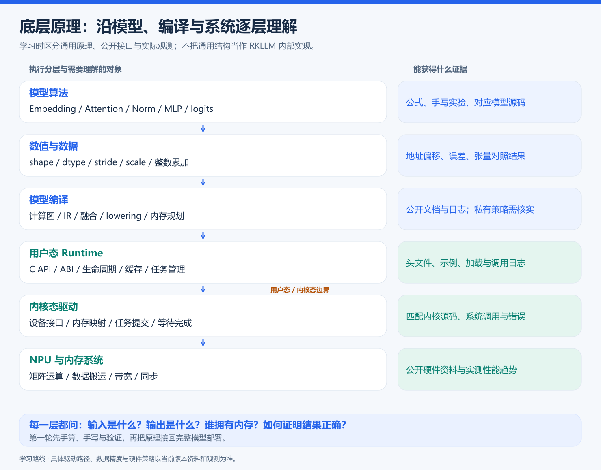
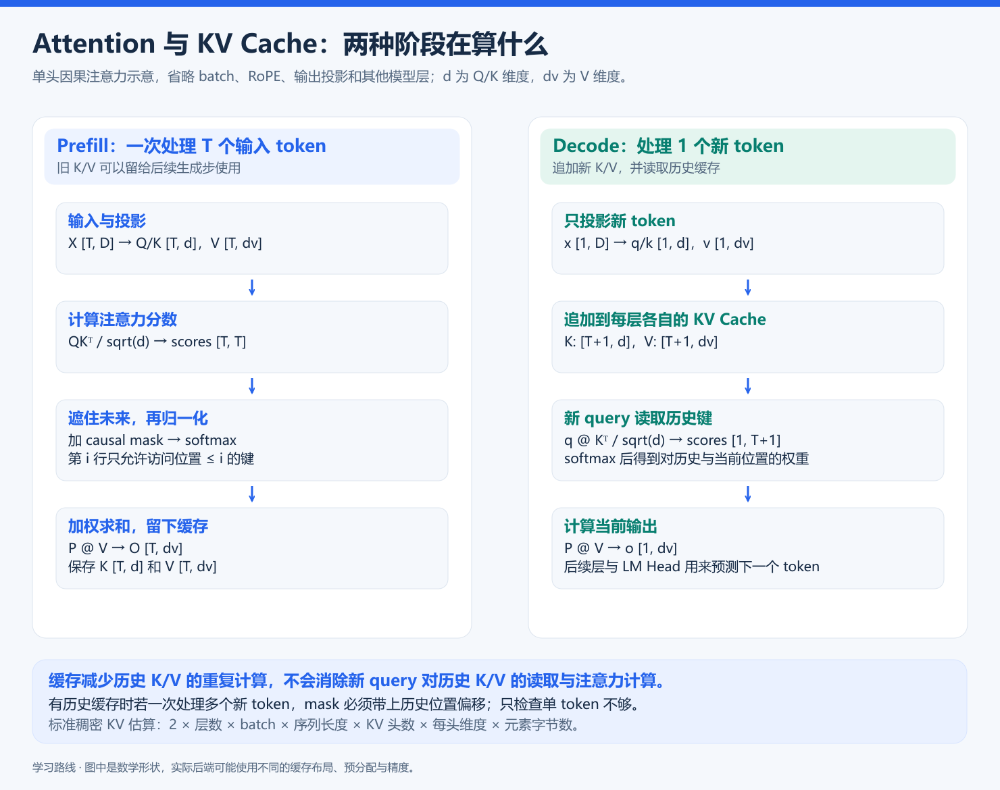
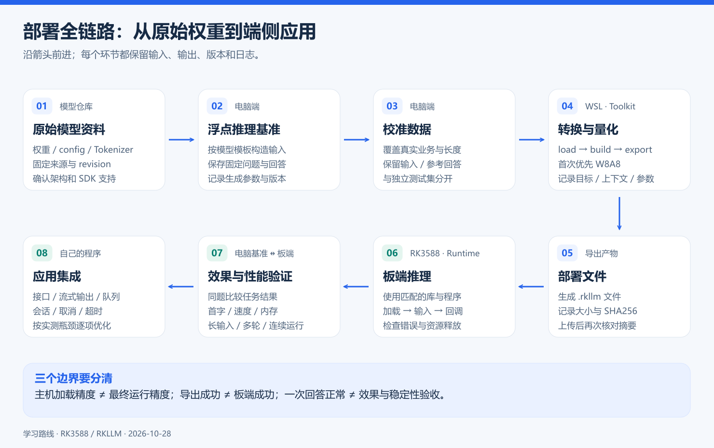
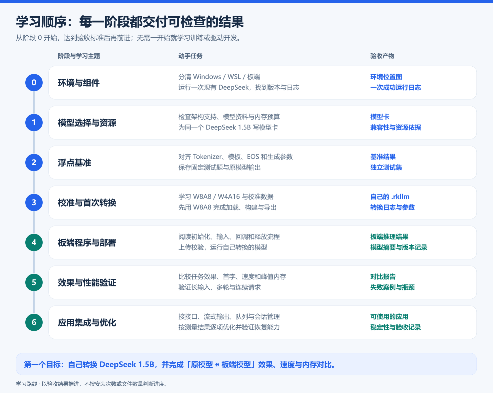
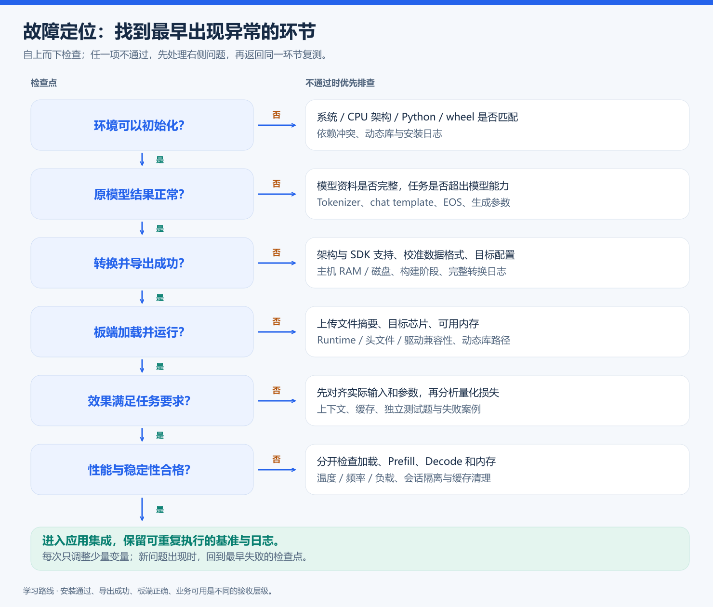

# 学习路线：从张量、推理原理到 RK3588 端侧部署

整理日期：2026-10-28。适用设备：鲁班猫 4 / RK3588，16GB 内存；开发环境：Windows + WSL Ubuntu + 板端 Linux。

这份路线以语言模型和 RKLLM 为主，把“理解计算和系统原理”放在“调用工具完成部署”之前。目标是让你既能独立部署，也能说明模型算了什么、数据怎样存储、量化误差从哪里来、Runtime 与驱动怎样协作，以及为什么模型会慢或出错。

建议先按第 0 节补基础，用小实验验证理解，再进入完整模型部署。最终完成：**自行把 DeepSeek-R1-Distill-Qwen-1.5B 原始权重转换为 `.rkllm`，在板子上运行，并用原理与数据解释效果、速度和内存差异。**

## 阅读导航

- [0. 从底层开始的学习主线](#0-从底层开始的学习主线)
- [1. 明确目标与当前起点](#1-明确目标与当前起点)
- [2. 看懂部署全链路](#2-看懂部署全链路)
- [3. 按阶段学习与实践](#3-按阶段学习与实践)
- [4. RKLLM 重点知识清单](#4-rkllm-重点知识清单)
- [5. 怎么定位全链路问题](#5-怎么定位全链路问题)
- [6. 第一个完整实验](#6-第一个完整实验)
- [7. 实验记录模板](#7-实验记录模板)
- [8. 官方资料与项目入口](#8-官方资料与项目入口)

## 0. 从底层开始的学习主线

### 0.1 “理解底层”具体要做到什么

学习时用四个动作检查自己：**先预测、再手写、做对照、解释差异。** 例如，先预测转置后张量的 stride，再运行代码；先手写量化公式，再比较浮点和整数矩阵乘。只有解释得出结果，才算掌握这一层。



[查看可缩放 SVG 原图](assets/learning-roadmap/04-fundamentals-stack.svg)

按下面的 A～H 学习，每层都对应一个可观察、可计算或可实现的对象。

| 顺序 | 要理解的对象 | 先掌握的内容 | 和部署的关系 |
|---|---|---|---|
| A | 程序与内存 | 指针、数组、对象生命周期、结构体、动态链接 | 看懂 Runtime 的 C API，不误用缓冲区 |
| B | 张量与算子 | shape、dtype、stride、布局、矩阵乘、数值误差 | 判断输入是否正确、是否发生复制、算子在算什么 |
| C | Transformer 推理 | Attention、RoPE、RMSNorm、MLP、KV Cache | 理解一条输入如何变成下一个 token |
| D | 量化数学 | scale、zero point、舍入、截断、整数累加 | 判断变小的模型为什么可能退化 |
| E | 模型编译 | 计算图、IR、融合、lowering、内存规划 | 理解转换为何需要架构和硬件支持 |
| F | Runtime 与驱动 | ABI、用户态/内核态、任务提交、DMA、同步 | 区分库、驱动、硬件和应用的问题 |
| G | 性能模型 | 计算量、访存量、带宽、算术强度 | 用数据解释 Prefill/Decode 的瓶颈 |
| H | 完整部署 | 原模型基准、转换、板端、对比实验 | 把前面各层接起来，形成复现报告 |

### 0.2 A：先能读懂 C API 背后的内存

**学什么：** C/C++ 的指针和引用、数组与连续存储、栈和堆、`sizeof`、结构体对齐、函数指针、所有权和生命周期；Linux 的进程、文件描述符、共享库与 ABI（应用二进制接口）。

例如，`float *data` 只给出地址，不自带 shape、长度和所有权信息。接收方还必须知道有多少个元素、元素类型、谁负责释放、什么时候失效。`sizeof(data)` 得到的是指针大小，不是缓冲区长度。

**动手：** 阅读本地 `deployment/deepseek/include/rkllm.h`，为 `RKLLMInput`、`RKLLMResult` 和回调参数画出“谁创建、谁使用、何时失效”的表。再读 `llm_demo.cpp`：为什么回调里的结果需要及时读取？异步调用时，局部变量可能产生什么生命周期问题？实际失效时机须按当前版本接口约定核对。

可在板端或匹配架构的 Linux 环境，用 `file`、`readelf -h`、`readelf -d`、`nm -D` 检查库的架构、依赖和导出符号。这些工具能帮助你理解“找不到库”和“缺少符号”，不能展示库内部完整算法。

**验收：** 能解释为什么更换头文件后不一定能直接使用旧 `.so`；能区分空指针、越界、悬空指针和模型数值错误。

### 0.3 B：把张量看成数据与寻址规则

张量不只是“多维数组的数值”。它还包括 shape、dtype、存储位置和 stride（各维移动一步对应的存储偏移）。例如 C 连续布局的 `float32[2, 3]`，每行 3 个元素，字节 stride 通常是 `(12, 4)`。

```text
元素地址 = 起始地址 + Σ(该维下标 × 该维的字节 stride)

X: [M, K]，W: [K, N]
Y = XW: [M, N]
Y[i,j] = Σ_k X[i,k] × W[k,j]
```

转置可以只改变 shape/stride，不立即复制数值；需要连续布局的下游算子可能要求再复制。NumPy 的 stride 单位是字节，PyTorch 的 `tensor.stride()` 单位是元素，比较时要换算。[PyTorch 张量视图说明](https://docs.pytorch.org/docs/stable/tensor_view.html)

**先自己做：** 创建 `2×3` 张量，预测转置和切片后的 shape、stride、是否共享内存，再打印验证。用三层循环手写一次矩阵乘，与 `@` 对照；知道 PyTorch `Linear` 的权重常用 `[out_features, in_features]`，表达式是 `X @ W.T + b`。

**数值基础：** FP16 和 BF16 都占 16 位，但指数与尾数分配不同；溢出范围和有效精度也不同。浮点加法不满足严格的结合律，换计算顺序可能带来误差。记录最大绝对误差、RMSE；接近零时，单纯的相对误差可能失真。

**验收：** 能手算张量元素偏移和矩阵乘输出形状；能解释“形状一样但含义不同”和“转置后可能出现额外复制”。

### 0.4 C：自己算一遍 Transformer 的前向过程

先理解标准的因果 decoder，再对照具体 Qwen2 架构。下面是简化的 pre-norm 数据流；真实模型还需核对偏置、位置编码、权重共享等配置。

```text
token IDs → Embedding → hidden states
  → RMSNorm → Q/K/V 投影 → RoPE → 因果 Attention → 输出投影 → 残差相加
  → RMSNorm → 门控 MLP → 残差相加
  → 重复各层 → 最终 Norm → LM Head → logits → 选下一个 token
```



[查看可缩放 SVG 原图](assets/learning-roadmap/05-attention-cache.svg)

先把单头 Attention 的形状推出来，再扩展到多头：

```text
Q: [Tq, d]，K: [Tk, d]，V: [Tk, dv]
scores = QKᵀ / sqrt(d)             → [Tq, Tk]
P = softmax(scores + causal_mask) → [Tq, Tk]
O = PV                            → [Tq, dv]
```

mask 对允许的位置加 0，对不允许的位置加负无穷；softmax 为避免溢出，通常先减去该行最大值。单头矩阵公式理解后，再加入 batch 和 head 维。标准多头 Q 常写成 `[B, Hq, T, d]`，GQA 模型的 K/V 使用更少的 `Hkv`，与 Q 的多个头共享。

还需要理解三个部件：

- **RMSNorm：** `x / sqrt(mean(x²) + eps) * weight`，关注归一化的维度；它不做减均值。
- **RoPE：** 按位置对 Q/K 向量的成对分量作旋转。缓存中的 K 必须与实际位置对应；不能随意重用错误位置或其他会话的缓存。
- **门控 MLP：** 典型形式为 `(SiLU(XW_gate) ⊙ XW_up)W_down`，其中 `⊙` 是逐元素乘。它同样包含大量矩阵乘，不应只盯 Attention。

**Prefill 与 Decode：** Prefill 处理一段输入并得到各层 K/V；之后每个生成步主要处理新 token，并读取历史 K/V。KV Cache 避免重新计算历史 K/V，但新 query 对历史键值的注意力仍要计算，长上下文仍有成本。[Hugging Face 缓存原理](https://huggingface.co/docs/transformers/main/cache_explanation)

缓存的教学估算（标准全注意力、稠密 K/V、无量化元数据）：

```text
KV 字节数 ≈ 2 × L × B × T × Hkv × d × 每个缓存元素字节数
             ↑ K 与 V
```

以官方 DeepSeek 1.5B 配置为例，`L=28`、`hidden_size=1536`、`Hq=12`、`Hkv=2`，所以 `d=128`。假设 `B=1`、`T=2048`、K/V 每元素 2 字节，理论 K/V 为 `58,720,256` 字节，即约 **56 MiB**。若错把 `Hq=12` 代入，就会多估 6 倍。该值不代表 RKLLM 实际分配量，后端可能另有布局、对齐、预分配与缓存精度。[原始模型配置](https://huggingface.co/deepseek-ai/DeepSeek-R1-Distill-Qwen-1.5B/blob/main/config.json)

**动手：** 手写一个很小的因果 Attention，分别用完整序列和分段 KV Cache 计算，比较输出。还要把“有历史缓存、一次输入多个新 token”的情况纳入对比，检查 mask 的位置偏移。最后去读与你安装版本对应的 Qwen2 `forward`，找出上面每个部件。

**验收：** 能画出每一步的 shape；能解释为什么旧 K/V 可缓存、为什么不能随意跨会话共享，以及为什么 BF16 原始模型不意味着 KV Cache 必然采用同一精度。

### 0.5 D：从公式理解量化

先学习仿射量化，再去理解某个 SDK 的具体算法。常见的概念表达式为：

```text
q = clip(round(x / s) + z, qmin, qmax)
x_hat = s × (q - z)
```

`s` 是 scale，`z` 是 zero point；舍入造成离散误差，`clip` 造成截断误差。对称量化常令 `z=0`。教学实验采用 `[-127,127]` 的有符号 8 位对称范围，并不代表所有后端都用相同范围。[ONNX QuantizeLinear 定义](https://onnx.ai/onnx/operators/onnx__QuantizeLinear.html)

把模型变成整数后，矩阵乘的概念是：

```text
Y_hat[i,j] ≈ sx × sw × Σ_k (qx[i,k] - zx)(qw[k,j] - zw)
```

上式假定各张量共用一个 scale；逐通道、逐组时要沿对应维度应用各自的 scale。小实验用更宽的整数累加，再反量化；真实内核的存储、累加与重新量化精度要查后端，不能由模型名称推断。

**需要回答的问题：**

- 一个离群的大值为什么可能让大量小值都舍入成 0？
- 校准范围太大时，量化步长怎样变化？范围太小时，哪些值会被截断？
- per-tensor、per-channel、group-wise 分别让哪些数据共用 scale？
- group 更小，为什么可能改善误差，却增加元数据和计算/访存成本？
- W4A16 表示权重与激活的表示位宽，为何不能据此保证整个内核都是 4 位算术？

**动手：** 手写量化与反量化，对比有/无离群值的误差；再写一次 INT8 输入、较宽整数累加的矩阵乘，和浮点参考比较。观察量化权重误差与最终层输出误差并不是同一个量。

**验收：** 能手算几个样本的 `q` 和 `x_hat`；能区分舍入、截断、累加溢出和模板错误，不把所有效果变化都归因于量化。

### 0.6 E：理解“转换”为什么更像编译

通用模型编译器可能包含：读取模型语义 → 构建计算图/IR → 形状与类型分析 → 常量折叠/融合 → 量化与布局变换 → 面向硬件的算子实现和切分 → 内存规划 → 生成部署产物。顺序和细节因后端而异，**这不是对 RKLLM 内部流水线的逐步确认**。

IR 是中间表示，lowering 是把高层操作改写为更接近目标后端的操作。比如把高层线性层展开成矩阵乘与偏置，再选择硬件支持的实现。`.rkllm` 的具体内容应按公开文档理解，不应把通用编译器结构当作它的私有文件格式说明。[ONNX 图概念](https://onnx.ai/onnx/intro/concepts.html)、[MLIR 教学编译器](https://mlir.llvm.org/docs/Tutorials/Toy/)

**动手：** 对一个很小的 `Y = XW + b`，画出图，标出常量与运行输入、各边的 shape/dtype、各张量何时不再使用。再比较“矩阵乘结果先写回内存，再单独加偏置”和“融合输出阶段加偏置”的中间存储需求。浮点运算顺序改变后，还要比较数值误差。

对照 `tools/convert_llm.py`：它只调用了 SDK 的公开入口，不能从这几行 Python 中读出量化内核和完整编译实现。遇到不支持的模型，先区分前端未识别架构、算子语义不支持、shape/布局约束、资源超限，而不是直接改模型名字。

**验收：** 能解释“框架能跑”为什么不等于“NPU 能编译”；能说清楚融合、内存复用和算子支持的实际意义。

### 0.7 F：沿 Runtime → 驱动 → NPU 追踪一次请求

通用的工作分层是：应用在用户态调用 Runtime；Runtime 管理模型与运行状态，并通过操作系统提供的接口与设备驱动协作；驱动管理设备资源与任务执行。具体系统可能用设备文件、`ioctl`、映射内存和等待机制；要以当前内核源码和实际观测确认调用路径。[RKLLM 官方分层说明](https://github.com/airockchip/rknn-llm/tree/release-v1.1.4)、[Linux ioctl](https://man7.org/linux/man-pages/man2/ioctl.2.html)

**内存再深入一层：** CPU 虚拟地址、物理地址和设备 DMA 地址不是同一个概念。IOMMU 可为设备建立地址映射；CPU 与设备共享数据时还要考虑同步和缓存一致性。共享 DDR 并不自动意味着没有数据复制或不需要同步。[Linux DMA 指南](https://docs.kernel.org/core-api/dma-api-howto.html)

**动手：** 在单独的小实验程序中观察动态库和进程映射；有相应权限与工具时，沿当前板端内核的 RKNPU 驱动源码找设备注册、提交、等待完成、中断/超时和内存管理路径。先理解流程，不修改驱动或寄存器。`strace` 能看到系统调用边界，不能直接读出 NPU 内部算子执行。

**公开边界：** 本工程可直接阅读头文件、示例与转换包装脚本；可根据匹配的公开内核源码阅读驱动。已获得的 Toolkit 包和 `.so` 不等于内部算法源码。NPU 指令布局、精确切分策略、量化内核等，只有官方披露或实验直接支持的部分才能作确定判断。

**验收：** 能画出用户态/内核态边界，解释为什么 NPU 仍需要 CPU 参与，以及为什么 Runtime 报错与内核驱动报错应分开定位。

### 0.8 G：用计算量和访存量解释性能

对 `X[M,K] @ W[K,N]`，按一次乘加记作两次操作，计算量约为 `2MKN`。算术强度是“运算次数 / 实际搬运字节数”。一个粗略的下界模型是：

```text
计算时间下界 ≈ 运算次数 / 可达到的算力
访存时间下界 ≈ 实际搬运字节数 / 可达到的带宽
总耗时 ≥ max(计算时间下界, 访存时间下界)
```

这只是帮助提出假设的模型，未包含所有调度、同步、数据转换与系统开销。峰值 TOPS 还依赖数据精度与统计口径，不能直接换算成 token/s。

在较小 batch 的标准 decoder 中，Prefill 的大矩阵乘通常更容易复用权重；Decode 每步少量 token 时，权重搬运和长上下文缓存读取可能占更大比重。是否受带宽限制应靠测量验证，也不能认为所有层都具有相同瓶颈。参考 [Roofline 原始论文](https://www2.eecs.berkeley.edu/Pubs/TechRpts/2008/EECS-2008-134.pdf)。

**动手：** 为一个线性层手算运算量和最少的输入/输出/权重字节数；改变输入行数，观察数据复用机会。板端固定其他条件，分别改变输入长度、生成长度和上下文长度，分开记录 Prefill 与 Decode；用数字解释趋势。

**验收：** 能解释模型小了为什么不一定更快、多核为什么不一定线性加速，以及为什么“CPU 没跑满”不能证明系统没有瓶颈。

### 0.9 H：把原理接回部署

完成 A～G 后，再按第 1～8 节做完整部署。每个工程操作都补一句原理解释：

| 操作 | 应该能解释的问题 |
|---|---|
| 确认模型支持 | 架构中的操作与后端能力是否匹配？ |
| 对齐模板和 Tokenizer | 实际送入模型的 token 序列是否相同？ |
| 设置量化和校准数据 | 哪些数值共用范围，误差在哪里产生？ |
| 设置上下文 | 缓存规模、位置编码和运行约束怎样变化？ |
| 加载 Runtime | ABI、架构、资源和驱动是否匹配？ |
| 调整性能 | 是计算、访存、同步，还是应用处理拖慢？ |

第一轮的完成标准是：**自己实现过简化计算、验证过数值对照、解释过资源与性能，再独立完成部署。**

### 0.10 三个可运行的原理小实验

参考代码：[fundamentals_lab.py](examples/fundamentals_lab.py)。只依赖 NumPy，在现有 Windows Python 环境可运行，不加载大模型，也不访问板子。

```powershell
cd D:\RK
.\.venv\Scripts\python.exe docs/examples/fundamentals_lab.py layout
.\.venv\Scripts\python.exe docs/examples/fundamentals_lab.py quant
.\.venv\Scripts\python.exe docs/examples/fundamentals_lab.py attention
```

| 实验 | 观察什么 | 跑完之后自己改什么 |
|---|---|---|
| `layout` | 转置/切片的 stride、共享内存、连续复制、手写矩阵乘 | 改张量大小和切片步长，先预测再运行 |
| `quant` | 离群值、校准范围、舍入/截断、INT8 矩阵乘与误差 | 改校准范围和离群值幅度，分别看主体与整体误差 |
| `attention` | 因果 mask、完整序列与分块 KV Cache 的数值对照 | 改分块大小，画出历史偏移后的 mask |

这些是教学参考实现，不复刻 RKLLM 内核。Attention 实验仅覆盖单头因果注意力，不含完整 Transformer、RoPE、GQA 或语言能力。先尝试独立写出核心几行，再对照参考代码；脚本显示成功不是学习验收，能解释中间结果才是。

### 0.11 推荐阅读方式

按实验中的疑问选择资料，先读相关章节，不必一次通读全部文档。框架源码和 API 示例应切换到实际安装版本。

| 内容 | 原始资料 | 阅读目标 |
|---|---|---|
| 张量视图和复制 | [PyTorch Tensor Views](https://docs.pytorch.org/docs/stable/tensor_view.html) | 理解 shape/stride 与复制行为 |
| Attention 定义 | [Attention Is All You Need](https://arxiv.org/abs/1706.03762) | 对照矩阵乘、mask、多头形状 |
| Qwen2 架构 | [Qwen2 模型实现](https://github.com/huggingface/transformers/blob/v4.45.0/src/transformers/models/qwen2/modeling_qwen2.py) | 在对应版本找到 Norm、RoPE、MLP、缓存与前向流程 |
| KV Cache | [Hugging Face 缓存解释](https://huggingface.co/docs/transformers/main/cache_explanation) | 对照自己的分块 Attention 实验 |
| 量化定义 | [ONNX QuantizeLinear](https://onnx.ai/onnx/operators/onnx__QuantizeLinear.html) | 对照 scale、zero point、范围与舍入 |
| 图和编译 | [ONNX Concepts](https://onnx.ai/onnx/intro/concepts.html)、[MLIR Toy](https://mlir.llvm.org/docs/Tutorials/Toy/) | 理解 IR 和 lowering 的用途，不要求第一轮写完整编译器 |
| 设备内存 | [Linux DMA API](https://docs.kernel.org/core-api/dma-api-howto.html) | 分清 CPU 地址与设备地址、同步职责 |
| 性能上界 | [Roofline](https://www2.eecs.berkeley.edu/Pubs/TechRpts/2008/EECS-2008-134.pdf) | 学会按计算与访存提出、验证瓶颈假设 |

## 1. 明确目标与当前起点

### 1.1 “模型没有量化过”有两种目标

| 目标 | 对应工作 |
|---|---|
| 输入是 FP16/BF16 等原始权重，允许自己量化后部署 | 建立原模型基准，准备校准数据，通过 RKLLM 转换量化，再部署验证；这是本文的主要路线 |
| 部署后也要求保留浮点精度 | 先查选定 SDK 对具体芯片、模型和浮点运行方式的支持，再验证内存、速度与数值误差；不能直接套用 W8A8 教程 |

`load_huggingface(..., dtype="float16")` 表示主机加载模型时采用的精度，**不等于最终 NPU 的运行精度**。同样，不能把 RKNN 的某个参数行为直接当作 RKLLM 的保证。如果要求最终不量化，应以对应 RKLLM 版本手册和实际导出、运行结果为准。

把量化模型重新保存成 FP16，也不能恢复量化时已经丢失的信息。准备原始模型时，应核对模型仓库和配置，确认拿到的是所需的原始权重。

### 1.2 你已经完成了什么

以下是工程资料中已经记录的结果，详细信息见 [DeepSeek 部署记录](07-deepseek.md) 和 [开始使用](START-HERE.md)。

| 环节 | 已有基础 | 后续学习重点 |
|---|---|---|
| 板端系统 | 鲁班猫 4，Ubuntu，SSH 连接和 NPU 推理已验证 | 识别驱动、运行库与应用各自负责什么 |
| 视觉模型 | RKNN 环境及 ResNet18 推理已跑通 | 作为另一条部署路线的参考 |
| 语言模型 | 社区转换的 DeepSeek 1.5B W8A8 已通过板端短问答 | 自己从原始权重生成部署文件 |
| RKLLM 运行 | 已有 1.1.4 运行库、头文件和 C++ 示例 | 阅读示例，理解输入、回调与资源释放 |
| 电脑端转换 | 工作区可找到独立转换环境与转换脚本 | 区分“脚本已准备”“环境已验证”“完整模型已转换” |

**不要把现成模型成功回答一次，视为自己的转换流程已经完成。** 也不要把一个随机初始化的小模型转换成功，视为完整 DeepSeek 的效果、内存和板端运行已经验证。

独立环境的配置和使用方法见 [RKLLM 转换环境](08-rkllm-toolkit.md)。安装与转换是否通过，以实际日志为准。若存在，可查看 `logs/rkllm-toolkit-status.json`；其中的小模型测试和完整模型测试应分别判断。

## 2. 看懂部署全链路



[查看可缩放 SVG 原图](assets/learning-roadmap/01-deployment-chain.svg)

### 2.1 三个运行位置

| 位置 | 主要工作 | 需要注意 |
|---|---|---|
| Windows：`D:\RK` | 阅读资料、写代码、管理实验、通过 SSH 上传与控制板子 | Windows Python 不能直接使用 Linux 的 wheel |
| 电脑 WSL：`/mnt/d/RK` | 原模型参考推理、校准数据准备、RKLLM 转换 | 通常使用 Linux x86_64 工具包；先核对选定版本要求 |
| 板端：`/home/cat/rk-edge-ai` | 使用 aarch64 运行库加载模型、NPU 推理、性能验证 | 板端运行库与电脑端转换工具是不同组件 |

电脑虚拟环境不能直接复制到板子上使用。CPU、GPU、NPU 是不同的执行设备；电脑转换时选 `device="cpu"`，并不表示生成的模型在板上也只能使用 CPU。

### 2.2 两套工具链

```text
普通视觉模型的常见路线：
PyTorch 等训练模型 → ONNX → RKNN-Toolkit2 → .rknn
                                      ↓
                       板端 Lite2 / RKNN Runtime → 结果后处理

语言模型的本文路线：
Hugging Face 权重 + 配置 + Tokenizer → RKLLM-Toolkit → .rkllm
                                                    ↓
                          板端 RKLLM Runtime + 对话输入 → 文本生成
```

RKLLM 官方示例可直接加载 Hugging Face 格式，通常不用先自行导出 ONNX。RKNN 与 RKLLM 的模型格式、接口和版本号分别管理，不要求两套 SDK 具有相同版本号。

### 2.3 贯穿全程的原则

1. 每一段都保留固定输入和对应结果，出问题时才能找到最早异常的位置。
2. 先验证原模型能力与正确性，再评估部署和量化带来的变化。
3. 一次实验优先只改一个变量，例如量化类型或上下文长度。
4. 记录模型 revision、SDK 版本、转换参数和文件 SHA256，保证可以复现。
5. 测量当前问题后再优化；成功导出文件只是中间结果。

## 3. 按阶段学习与实践



[查看可缩放 SVG 原图](assets/learning-roadmap/02-learning-stages.svg)

下图是工程实践顺序；底层知识的学习顺序以第 0 节 A～H 为主。每阶段都要能解释对应原理，再以验收结果推进，不必强行按天数完成。遇到问题时，回到该阶段的输入、输出和日志。

### 阶段 0：分清环境与组件

**学习内容：** Linux 基础、SSH/SCP、虚拟环境、x86_64 与 aarch64、动态库、运行库与内核驱动的区别。

**实践任务：** 用现有入口运行一次 DeepSeek，找到加载的模型路径、运行库版本和日志；能说明 Windows、WSL、板端分别做什么。

**验收：** 可以自己启动和退出问答，找到错误日志，并说清楚 Toolkit、Runtime、RKNPU 驱动各自的位置和用途。

### 阶段 1：选择一个能部署的模型

检查以下条件：

- 选定 SDK 是否支持该模型的实际架构和具体变体，而不只是同名模型家族。
- 模型目录是否包含完整权重、配置、Tokenizer、特殊 token 和对话模板。
- 参数量、上下文长度和运行精度是否符合板端资源。
- 原始模型是否能完成目标任务，模型许可是否符合使用方式。

权重大小可以先粗略估算：

```text
权重大小 ≈ 参数量 × 每个参数占用的字节数
实际运行内存 ≈ 权重 + KV Cache + 临时工作区 + 运行库与系统占用
```

| 参数量 | FP16 权重理论大小 | 8 位权重理论大小 | 4 位权重理论大小 |
|---|---:|---:|---:|
| 1.5B | 约 3GB | 约 1.5GB | 约 0.75GB |
| 7B | 约 14GB | 约 7GB | 约 3.5GB |

上表采用十进制 GB，只计算权重数据。实际文件还包括量化参数、元数据和其他内容，实际内存更大。不同架构的 KV Cache 大小也不同；不要根据“16GB 内存”直接判断某个模型必然能运行。

**实践任务：** 为 DeepSeek 1.5B 原始模型写一张模型卡，记录来源、revision、架构、dtype、Tokenizer 和预期上下文。

**验收：** 能解释为什么选它，并找到所用 RKLLM 版本支持它的依据。

### 阶段 2：建立电脑端浮点基准

**学习内容：** Transformers 的基本加载与生成、Tokenizer、chat template、EOS、采样参数；不要求先掌握训练。

**实践任务：** 在资源允许的电脑环境中运行原模型，准备一套固定测试题，保存实际输入、输出、生成参数和模型版本。若电脑资源不足，可在另一台资源足够的机器建立基准，并记录环境。

建议第一轮先用 30～50 道题做工程验证，覆盖中文问答、信息抽取、JSON 输出、短输入和较长输入。这不是全面能力评测；后续按真实业务扩充。

特别注意：

- 先把消息按模型要求的模板转成实际 prompt，再进行推理。
- 对比时尽量使用确定性生成，并记录框架与 SDK 能控制的参数。
- 不同精度和后端下，生成文本不一定逐字相同；要用任务指标判断是否可接受。
- 不要让模板重复添加特殊 token，也不要把“角色标签错误”误判为量化问题。

**验收：** 同一组输入可以重复执行，原模型对目标任务的能力和失败案例都有记录。

### 阶段 3：准备校准数据，完成首次转换

**学习内容：** 训练、微调、校准的区别；PTQ（训练后量化）、W8A8、W4A16、分组量化和量化误差。

校准通常不需要重新训练整个模型。它帮助量化算法根据代表性输入估计数据特征；不同算法所需数据和步骤不同。官方 DeepSeek 示例提供使用浮点模型回答生成校准数据的流程。

**实践任务：** 固定一套兼容 SDK，先使用 W8A8 转换。掌握三个核心调用：

```python
# 这是流程示意；具体参数以所用版本手册和项目脚本为准。
llm.load_huggingface(...)  # 加载模型
llm.build(...)             # 目标平台构建与量化
llm.export_rkllm(...)      # 导出部署文件
```

校准数据需覆盖实际业务语言、输入长度和任务类型，并按模型模板构造。下面仅说明项目脚本要求的 JSON 数据结构，不代表任意模型的完整 prompt 模板：

```json
[
  {
    "input": "按所选模型对话模板编码的用户问题与助手前缀",
    "target": "浮点原模型生成的参考回答"
  }
]
```

校准集和测试集分开保存。不要用相同样本同时校准和证明效果，也不要把少量格式示例当成充分的校准集。

转换前检查主机可用 RAM、磁盘和所需设备。转换峰值内存可能显著高于模型权重大小，不能用板端内存占用反推主机需求。若转换失败，保留失败阶段和完整日志。

**验收：** 自己的原始模型成功导出非空 `.rkllm`，同时保存转换参数、SDK 版本、校准集版本和 SHA256。

### 阶段 4：理解板端程序并部署自己的模型

**学习内容：** 最小 C/C++ 程序、头文件和动态库、交叉编译或板端编译、同步调用、回调、UTF-8、错误码。

阅读本工程 `deployment/deepseek/llm_demo.cpp`，沿以下顺序理解：

```text
默认参数 → 设置模型与生成参数 → rkllm_init
    → 准备输入 → rkllm_run → 回调输出文本
    → 判断结束或错误 → rkllm_destroy
```

部署时，检查 `.rkllm` 的目标平台和配套 Runtime；头文件也要对应使用的运行库。不同版本的结构体与接口可能变化，不能只替换 `.so` 就默认兼容。

**实践任务：** 把自己生成的模型放到独立实验目录，校验上传前后 SHA256，使用匹配的程序加载。现有 DeepSeek 启动脚本使用固定模型路径，测试新模型时需要显式配置自己的入口。

**验收：** 自己转换的模型在板端完成固定输入推理，中文输出正常，推理报错能识别，正常退出能释放资源。

### 阶段 5：验证效果、性能与稳定性

**学习内容：** TTFT（首个 token 的等待时间）、Prefill、Decode、峰值内存、上下文、温度与降频。

- **Prefill：** 处理输入 token，形成后续生成所需的状态。
- **Decode：** 基于已有上下文，逐个生成新 token。
- **KV Cache：** 缓存注意力计算使用的键和值，减少重复计算；其占用受架构、序列长度和缓存精度等影响。

**实践任务：** 对原模型和板端模型使用同一套独立测试题，记录下面的指标：

| 维度 | 记录内容 | 避免的误判 |
|---|---|---|
| 效果 | 任务通过率、JSON 有效率、典型失败案例 | 回答流畅不等于任务正确 |
| 启动 | 初始化耗时、模型加载耗时 | 不与模型常驻时的响应时间混算 |
| 延迟 | 从提交输入到第一个输出 token 的时间及计时边界 | 不只看生成速度 |
| 吞吐 | 输入/输出 token 数、Prefill 与 Decode 耗时 | token 不等同于汉字；不同统计口径不能直接比较 |
| 内存 | 加载、短输入和长输入期间的峰值 | 文件大小不等于运行内存 |
| 稳定性 | 多轮对话、连续请求、取消、错误恢复 | 一次成功不足以证明长期稳定 |
| 环境 | 温度、频率策略、散热状态、其他负载 | 不同运行条件会改变性能 |

先比较 W8A8，再在所选 SDK 和模型支持时尝试 W4A16。逐项比较精度、速度与占用，不能预设 4 位一定更快。日志可使用 `RKLLM_LOG_LEVEL=1`；具体统计和监测方式见对应版本官方说明。

上下文上限、输入长度和生成长度要分别记录，确认符合所选 SDK 的约束。不要只提高运行参数而忽略模型构建时的配置。

**验收：** 可以用数据说明模型是否满足自己的任务要求，以及主要瓶颈在哪里。

### 阶段 6：接入应用，按证据优化

**学习内容：** HTTP 接口、流式输出、请求队列、会话隔离、取消与超时、日志和服务恢复。

**实践任务：** 在已经验证的命令行推理之上增加应用接口，明确模型是否常驻、请求是否排队、每个会话如何管理缓存。并发能力以所选 Runtime 的接口和实测为准。

先根据指标定位瓶颈，再选择缩短 prompt、调整上下文、减少生成长度、缓存复用、改量化方式或更换模型。需要优化应用处理时，再考虑 CPU 线程和数据传输等因素。

**验收：** 应用能够持续处理目标请求，异常可恢复，效果与性能达到预先定义的标准。

## 4. RKLLM 重点知识清单

| 优先级 | 要学什么 | 学到什么程度 |
|---|---|---|
| 必学 | 模型目录与 Tokenizer | 能区分权重、配置、词表、模板和特殊 token |
| 必学 | Transformer 推理基础 | 理解 token、上下文、注意力、KV Cache、Prefill、Decode |
| 必学 | SDK 分层与版本 | 说明 Toolkit、Runtime、头文件、驱动如何配合，找到兼容要求 |
| 必学 | 转换 API | 看懂加载、构建、导出的参数与返回值 |
| 必学 | 量化与校准 | 理解 W8A8/W4A16、代表性数据、量化误差、独立评测 |
| 必学 | C/C++ 最小推理 | 看懂初始化、输入、回调、结束状态、取消和释放 |
| 必学 | Linux 与日志 | 会连接板子、查看资源与错误、识别动态库问题 |
| 进阶 | 性能分析 | 分开测量加载、首字、Prefill、Decode、内存与温度 |
| 进阶 | Prompt Cache、LoRA 等功能 | 按具体版本文档了解支持范围，设计独立实验验证 |
| 后续 | 服务并发、多模态、自定义架构 | 在单模型链路可靠后继续扩展 |

第一轮要理解张量、Attention、量化、编译和系统分层，并通过第 0 节的小实验验证。随后掌握原模型推理、转换、输入对齐和排错；完整训练框架、CUDA 内核与驱动修改可按后续目标继续深入。

项目当前的转换脚本使用 CPU、W8A8、`normal` 算法、`rk3588` 目标和三个 NPU 核。它是明确范围的起点，不是通用的全功能转换器，也没有提供 W4A16 或浮点部署开关。后续实验应按对应 SDK 能力扩展，并为每种配置保存独立结果。

## 5. 怎么定位全链路问题



[查看可缩放 SVG 原图](assets/learning-roadmap/03-debugging-path.svg)

| 现象 | 先看哪里 | 保留什么证据 |
|---|---|---|
| 依赖安装失败或导入失败 | 操作系统/架构、Python 版本、wheel 标签、依赖冲突 | 安装日志、环境版本清单 |
| 模型无法加载 | 目录完整性、权重分片、架构与配置支持、主机资源 | 模型 revision、报错和资源数据 |
| 原模型就无法完成任务 | 模型能力、任务设计、chat template、生成参数 | 浮点基准输入与输出 |
| 构建或量化失败 | 出错阶段、校准格式、目标平台、SDK 支持和峰值内存 | 完整转换日志和参数 |
| 板端初始化失败 | 文件完整性、目标平台、配套 Runtime/驱动、动态库、可用内存 | 模型摘要、版本日志、退出码 |
| 输出角色标签、乱码、过早结束 | UTF-8、Tokenizer、模板、特殊 token、EOS、长度限制 | 实际 prompt 和原始输出 |
| 浮点正确，部署后明显退化 | 先核对输入与参数，再分析量化；有对应工具时使用模拟/精度分析 | 同题结果、量化配置和失败样本 |
| 短输入正常，长输入失败 | 上下文配置、缓存、输入与生成预算、内存 | token 数、资源曲线、错误日志 |
| 回答正常但响应慢 | 加载与常驻方式、Prefill/Decode、温度、频率、系统负载 | 有计时边界的性能记录 |
| 多轮后串话或效果异常 | 会话历史构造、缓存复用与清理、上下文截断策略 | 连续请求顺序与会话日志 |

使用同一输入逐段缩小范围。生成文本不同不一定是错误；若接口支持，比较实际 token、概率或中间结果有助于进一步定位，但第一轮可以先用任务结果和失败案例分析。

## 6. 第一个完整实验

### 6.1 实验边界

- 模型：DeepSeek-R1-Distill-Qwen-1.5B 的原始 Hugging Face 权重。
- 设备：当前鲁班猫 4 / RK3588。
- 首个部署目标：W8A8，采用与项目运行环境兼容的 RKLLM 版本。
- 第一轮优先固定版本与模型，再逐项扩展量化和上下文实验。
- 完成标准：自己生成的模型可以运行，且有独立的效果与性能记录。

### 6.2 工程内已有入口

下列命令在相应位置运行。它们是学习入口；安装或完整转换耗时取决于网络、主机资源与模型大小。

在 Windows 项目 PowerShell 打开独立转换终端：

```powershell
cd D:\RK
powershell -ExecutionPolicy Bypass -File scripts/open-rkllm.ps1
```

若终端提示环境不存在，在 **WSL 项目目录**执行安装脚本，再重新打开终端：

```bash
cd /mnt/d/RK
bash scripts/setup-rkllm.sh
```

环境准备好后，在 **已激活 RKLLM 环境的 WSL 终端**中检查：

```bash
python tools/check_rkllm.py
```

可选的小模型转换自检：

```bash
python tools/check_rkllm.py --conversion
```

这会构造随机初始化的微型 Qwen2，仅检查加载、W8A8 构建与导出。**它不能回答有意义的问题，也不验证板端推理。**

准备好原始模型目录和真实校准数据后，使用以下命令形式转换。这里的目录和数据需要你先准备，命令不会自动下载原始模型或生成校准集：

```bash
python tools/convert_llm.py \
  --model models/hf/DeepSeek-R1-Distill-Qwen-1.5B \
  --dataset data/llm-calibration.json \
  --output models/deepseek-self-w8a8-rk3588.rkllm
```

`convert_llm.py` 会拒绝覆盖已有输出。保存完整转换日志，并核对所用 SDK 对构建参数的默认值；需要改变上下文等配置时，应显式配置并记录。

上传和运行新模型时，使用独立的实验目录与匹配版本程序。现有 `tools/deploy_deepseek.py` 和 `scripts/deepseek.ps1` 服务于已准备好的社区模型，不应直接当成任意新模型的通用部署入口。

### 6.3 交付清单

- [ ] 模型来源、revision、配置、Tokenizer 和原始精度已记录。
- [ ] 电脑端浮点推理成功，并保存固定测试题的基准结果。
- [ ] 校准集与独立测试集已分别准备。
- [ ] 使用自己的校准集生成 `.rkllm`，保存转换日志和参数。
- [ ] 上传前后模型 SHA256 一致。
- [ ] 自己生成的模型在板端完成推理，错误与退出行为可识别。
- [ ] 同一测试集的原模型与板端结果已比较。
- [ ] 已记录首字延迟、生成速度、峰值内存、温度及测量条件。
- [ ] 至少做过多轮和连续请求测试，保留异常及处理方式。
- [ ] 根据用途写出本次实验的通过/不通过结论和下一项改进。

### 6.4 建议保存方式

```text
models/                         原始模型和生成的模型文件
data/                           校准集、独立测试集
logs/<实验编号>/                转换日志、板端日志、结果和资源记录
docs/experiments/<实验编号>.md  可阅读的实验报告与复现步骤
```

以上为建议目录，按需创建。项目当前忽略大型模型、`data/` 和 `logs/` 等内容；它们留在本机不等于已纳入 Git。将来源、摘要、参数、结果概要和复现方法写进实验报告，需要保留的数据另行备份。

## 7. 实验记录模板

复制下面的模板，为每次有意义的配置变化建立独立记录。

```markdown
# 实验：自行转换 DeepSeek 1.5B

- 日期与实验编号：
- 目标任务与验收标准：
- 原始模型仓库 / revision / dtype：
- Tokenizer / chat template 来源：
- 主机系统 / Python / PyTorch / RAM / 转换设备：
- Toolkit / Runtime / 头文件版本或提交：
- 板型 / 内存 / 系统 / RKNPU 驱动：
- 校准集来源 / 版本 / 样本数 / 长度分布：
- 独立测试集版本与评分方法：
- 转换命令与全部关键参数（量化、算法、目标、上下文等）：
- 导出模型路径 / 字节数 / SHA256：
- 上传后 SHA256：
- 板端命令 / 实际输入模板 / 生成与采样参数：
- 首字延迟及计时边界：
- Prefill / Decode 耗时、token 数及统计口径：
- 峰值内存及测量方式 / 温度 / 频率与散热条件：
- 原模型测试结果 / 板端测试结果：
- 多轮与连续请求结果：
- 典型失败案例 / 错误日志位置：
- 结论与下一步：
```

## 8. 官方资料与项目入口

先阅读与项目固定版本对应的手册、头文件和示例。在线仓库的 `main` 会更新，其中参数和功能不一定适用于 1.1.4。

| 资料 | 用途 |
|---|---|
| [RKLLM 官方仓库](https://github.com/airockchip/rknn-llm) | 软件栈、支持平台、模型列表、性能测试入口 |
| [RKLLM 1.1.4 固定版本](https://github.com/airockchip/rknn-llm/tree/release-v1.1.4) | 对照本项目已部署的旧版本学习 |
| [官方文档目录](https://github.com/airockchip/rknn-llm/tree/main/doc) | 按所选版本查阅 SDK 手册、接口与兼容要求 |
| [官方 API 示例](https://github.com/airockchip/rknn-llm/tree/main/examples/rkllm_api_demo) | 了解当前示例中的校准、转换、编译和板端运行流程 |
| [官方转换脚本](https://github.com/airockchip/rknn-llm/blob/main/examples/rkllm_api_demo/export/export_rkllm.py) | 研究加载、量化、上下文和目标平台等参数 |
| [官方变更记录](https://github.com/airockchip/rknn-llm/blob/main/CHANGELOG.md) | 判断功能在哪个版本加入，评估升级需求 |
| [DeepSeek 原始模型](https://huggingface.co/deepseek-ai/DeepSeek-R1-Distill-Qwen-1.5B) | 原始权重、配置和模型说明 |
| [野火 DeepSeek 教程](https://doc.embedfire.com/linux/rk356x/Ai/zh/latest/lubancat_ai/example/deepseek.html) | 参考鲁班猫的转换和部署流程，注意教程使用的版本 |
| [项目资料索引](README.md) | 查找本地其他教程 |
| [现成 DeepSeek 的部署记录](07-deepseek.md) | 当前运行入口、模型来源、版本与实测结果 |
| [项目 RKLLM 转换环境](08-rkllm-toolkit.md) | 固定版本、独立环境、转换自检与资源说明 |
| [普通视觉模型的开发路线](04-ai-workflow.md) | 与 RKNN 流程对照阅读 |

第一轮完成后，再依次扩展到量化方式对比、长上下文、业务微调模型和应用服务。每次扩展都沿用同一套“基准 → 转换 → 板端 → 对比 → 记录”的方法。
